# Calcolo delle plusvalenze e opzioni

- [Introduzione e normativa di riferimento](#introduzione-e-normativa-di-riferimento)
- [Definizione di plusvalenza](#definizione-di-plusvalenza)
- [Casi fiscalmente rilevanti](#casi-fiscalmente-rilevanti)
- [Valore degli scambi](#valore-degli-scambi)
- [Metodo di valutazione: LIFO](#metodo-di-valutazione-lifo)
- [Esempi di calcolo con metodo LIFO](#esempi-di-calcolo-con-metodo-lifo)
- [Plusvalenze globali o per gruppo wallet](#plusvalenze-globali-o-per-gruppo-wallet)
- [Derivati: come vengono calcolati](#derivati)
- [Situazione ante Legge di bilancio 2023](#situazione-ante-legge-di-bilancio-2023)
- [Funzione "RT & Analisi P&L"](#funzione-rt--analisi-pl)
- [Note importanti](#note-importanti)
- [Bibliografia](#bibliografia)

## Introduzione e normativa di riferimento {#introduzione-e-normativa-di-riferimento}

Il calcolo delle plusvalenze derivanti da operazioni su criptovalute in Italia è regolato
principalmente dal **Testo Unico delle Imposte sui Redditi (TUIR)**, in particolare dagli articoli 67 e
68, che trattano i redditi diversi.

Le plusvalenze generate dalla compravendita di cripto-attività sono soggette a tassazione, ma fino al
2022 venivano equiparate a valute estere (per approfondimenti si rimanda alla
[circolare 30/E dell'Agenzia delle Entrate](https://www.agenziaentrate.gov.it/portale/documents/20143/5589638/Circolare+criptoattivita+del+27+ottobre+2023.pdf)
del 27/10/2023).

Con l'entrata in vigore della
[Legge di Bilancio 2023](https://www.gazzettaufficiale.it/atto/serie_generale/caricaDettaglioAtto/originario?atto.dataPubblicazioneGazzetta=2022-12-29&atto.codiceRedazionale=22G00211&elenco30giorni=false)
(commi dal 126 al 146) è stato introdotto un quadro normativo più chiaro, che tra le altre cose include:

- la definizione di **cripto-attività**, ovvero "rappresentazione digitale di valore o di diritti che
  possono essere trasferiti e memorizzati elettronicamente, utilizzando la tecnologia di registro
  distribuito o una tecnologia analoga";
- la definizione di cosa concorre alla realizzazione delle plusvalenze, ovvero i proventi realizzati
  mediante **rimborso**, **cessione a titolo oneroso**, **permuta** o **detenzione**;
- la **non rilevanza fiscale** degli scambi tra cripto-attività aventi eguali caratteristiche e funzioni;
- una **soglia di esenzione annuale** per le plusvalenze inferiori a 2.000 €.

Successivamente, con la
[Legge di Bilancio 2025](https://www.normattiva.it/atto/caricaDettaglioAtto?atto.dataPubblicazioneGazzetta=2024-12-31&atto.codiceRedazionale=24G00229&atto.articolo.numero=0&atto.articolo.sottoArticolo=1&atto.articolo.sottoArticolo1=0&qId=8adc1507-825e-48dc-8e45-bf015a494974)
(commi dal 23 al 29), la soglia dei 2.000 € è stata abolita a partire dall'anno fiscale **2025**.

## Definizione di plusvalenza {#definizione-di-plusvalenza}

La plusvalenza è la differenza positiva tra:

- il prezzo di vendita delle cripto-attività;
- il prezzo di acquisto, ovvero il valore di carico.

Se la differenza è negativa si parla di **minusvalenza**.

> **NB** — nel programma le minusvalenze si trovano molto spesso sotto la voce *Plusvalenze*, ma con
> importo negativo.

Formula generale:

**Plusvalenza = prezzo di vendita − prezzo di acquisto**

## Casi fiscalmente rilevanti {#casi-fiscalmente-rilevanti}

Facendo riferimento alla normativa, sono considerate fiscalmente rilevanti le operazioni che comportano:

### Conversione di cripto-attività in valuta fiat {#conversione-di-cripto-attività-in-valuta-fiat}

Cessione a titolo oneroso: è sempre rilevante.

### Scambio tra cripto-attività aventi diverse caratteristiche e funzioni (permuta) {#scambio-tra-cripto-attività-aventi-diverse-caratteristiche-e-funzioni-permuta}

Come si evince dalla circolare 30/E dell'Agenzia delle Entrate, per ora gli scambi rilevanti sono quelli
tra queste tre categorie disomogenee: **E-Money Token**, **NFT** e **criptovalute "generiche"**.

Sono quindi **fiscalmente rilevanti**:

- E-Money ↔ NFT
- E-Money ↔ crypto "generiche"
- NFT ↔ crypto "generiche"

**Non** sono invece rilevanti gli scambi tra cripto-attività dello stesso tipo:

- NFT ↔ NFT
- E-Money ↔ E-Money
- crypto "generiche" ↔ crypto "generiche"

Il problema sta nella definizione di E-Money Token. Nella circolare 30/E l'Agenzia delle Entrate fa
riferimento al MiCA e divide le stablecoin in due categorie, **E-Money Token (EMT)** e
**Asset-Referenced Token (ART)**, dove:

- per **e-money token** si intende un tipo di cripto-attività che mira a mantenere un valore stabile
  facendo riferimento al valore di una valuta ufficiale;
- per **asset-referenced token** si intende un tipo di cripto-attività che non è un token di moneta
  elettronica e che mira a mantenere un valore stabile facendo riferimento a un altro valore o diritto,
  o a una combinazione dei due, comprese una o più valute ufficiali.

Leggendo la definizione pare che le stablecoin legate a moneta fiat siano classificabili come EMT, ma è
anche vero che per essere EMT secondo la normativa MiCA una cripto-attività deve rispettare determinati
requisiti e ottenere apposite licenze (anche per essere ART autorizzate a operare in UE servono
determinati requisiti). A questo punto ci sono due scuole di pensiero.

**Solo le stablecoin MiCA compliant sono EMT a tutti gli effetti** (ad esempio USDC a partire dal
1° luglio 2024). Opinioni a favore:
[CryptoBooks](https://cryptobooks.tax/it/blog/pagare-meno-tasse-crypto-2024),
[Koinly](https://koinly.io/guides/guida-fiscale-italia/),
[Blockpit.io](https://www.blockpit.io/tax-guides/guida-fiscale-sulle-criptovalute-italia).

**Quasi tutte le stablecoin legate a moneta fiat sono da considerarsi EMT**, con alcune eccezioni.
Opinioni a favore:
[Studio Tibaldo](https://www.studiotibaldo.com/stable-coin-tassazione/),
[FAQ Cripto Attività FinanzaOnline](https://forum.finanzaonline.com/threads/faq-tassazione-cripto-attivita.2058741/),
[Studio Teruzzi](https://www.studioteruzzi.it/cripto-quando-si-tassa-la-plusvalenza-nel-quadro-rt/),
[Agendadigitale.eu](https://www.agendadigitale.eu/mercati-digitali/criptovalute-nella-dichiarazione-dei-redditi-2024-linee-guida-per-non-sbagliare/),
[The Crypto Gateway](https://thecryptogateway.it/tasse-su-criptovalute-2023/),
[Filippo Angeloni](https://youtu.be/pDRzvLjlgB0?si=MR5GU2aWmftNWXUK).

Proprio per questo il programma lascia scegliere all'utente **cosa** considerare EMT e **da quando**. Le
impostazioni si trovano in **Opzioni – E-Money Token**.

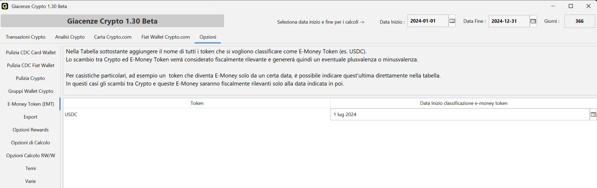

Sopra, un esempio di configurazione in cui si ritiene che solo USDC, e solo a partire dalla data in cui
ha acquisito la licenza (1° luglio 2024), sia da considerarsi EMT.

> **NB** — di default la tabella è **vuota**: va quindi compilata autonomamente.

### Acquisto di beni o servizi utilizzando cripto-attività {#acquisto-di-beni-o-servizi-utilizzando-cripto-attività}

Cessione a titolo oneroso.

> **NB** — il programma considera le commissioni applicate dagli exchange o in DeFi alla stregua
> dell'acquisto di un servizio: ne viene quindi calcolata la plusvalenza.

### Rimborso {#rimborso}

Nel contesto delle cripto-attività il termine "rimborso" si riferisce alla situazione in cui il titolare
riceve un pagamento o una restituzione di valore a fronte della cessazione o liquidazione di quella
specifica attività. Può avvenire, ad esempio:

- **stablecoin o token con valore garantito**: alcune cripto-attività garantite da riserve (USDC, USDT)
  possono prevedere la restituzione del token in cambio della somma equivalente nella valuta sottostante;
- **liquidazione di un fondo o progetto**: i partecipanti possono ricevere un rimborso proporzionale del
  valore residuo delle attività.

I **prestiti** (borrowing) sono gestiti dal programma tramite le apposite voci di classificazione dei
depositi e dei prelievi — ricezione dei fondi, messa a collaterale, sblocco del collaterale e
liquidazione forzata: vedi
[Classificazione dei movimenti](classificazioni-movimenti.html). I derivati e i futures seguono altre
regole e sono gestiti solo in parte: vedi [Derivati: come vengono calcolati](#derivati).

### Proventi da detenzione {#proventi-da-detenzione}

I guadagni derivanti da strumenti come **staking**, **earn**, interessi su prestiti di criptovalute e
altre forme di reddito passivo sono considerati fiscalmente rilevanti: il provento è tassato come reddito
diverso al momento della percezione. Alcune precisazioni:

- gli **airdrop**, a differenza di staking ed earn, non sempre sono classificabili come proventi da
  detenzione: molto spesso vengono erogati a fronte di azioni effettuate e non per il semplice fatto di
  detenere determinati asset;
- il **cashback** si può vedere in più modi:
  - **è** un provento da detenzione, in quanto spesso richiede il blocco di fondi per poterne usufruire;
  - **non è** un provento da detenzione, perché non è il mero possesso di un asset a determinare la
    ricompensa, che scaturisce invece dall'acquisto di un bene o servizio. In questo secondo caso ci sono
    due ulteriori possibilità: vedere il cashback come una sorta di sconto, e quindi caricare il provento
    con costo di carico pari al prezzo di mercato, oppure caricarlo a costo zero. L'ipotesi dello sconto
    era stata prospettata dall'Agenzia delle Entrate nell'
    [interpello 338/2021](https://www.agenziaentrate.gov.it/portale/documents/20143/0/Risposta_338_12.05.2021.pdf/37afcc06-0ed0-9e4d-f05d-6be6f2df8adc),
    che però riguardava il cashback in euro: non è detto si possa applicare anche alle cripto-attività.

Viste le molteplici possibilità, in **Opzioni – Opzioni Rewards** è possibile indicare cosa considerare
o meno provento da detenzione in base alle proprie valutazioni.

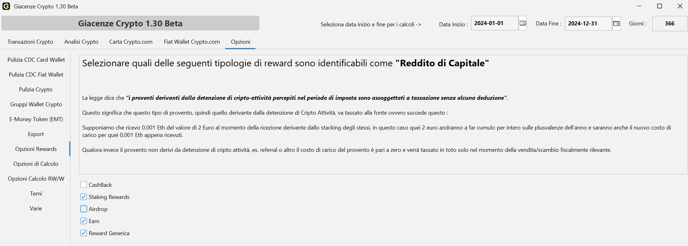

Nella tabella qui sopra, ad esempio, si è scelto che airdrop e cashback non sono da considerarsi proventi
da detenzione e verranno quindi caricati a costo di carico zero.

> **NB** — per il cashback non è attualmente prevista l'opzione di caricarlo a prezzo di mercato senza
> che questo produca plusvalenza.

## Valore degli scambi {#valore-degli-scambi}

Ogni scambio ha un valore in euro, che diventa il corrispettivo della cripto-attività ceduta e il costo
di carico di quella ricevuta. Quando lo scambio muove due monete, il programma deve scegliere quale delle
due ne determina il valore.

**Con una valuta legale da una parte** (acquisto o vendita) il valore è l'importo in valuta: l'importo
in euro così com'è, quello in dollari convertito al cambio della Banca d'Italia.

**Fra due cripto-attività** si usa il valore della cripto-attività **ricevuta**, rilevato al momento in
cui lo scambio si conclude. È l'indicazione della circolare 30/E dell'Agenzia delle Entrate: «si assume
come valore normale della cripto-attività ricevuta quella rilevabile sul sito attraverso il quale è
avvenuto lo scambio alla data in cui lo stesso è concluso». Negli scambi differiti (la moneta esce oggi
e quella acquistata arriva giorni o mesi dopo) è quindi il valore della moneta ricevuta alla data in cui
arriva.

Due eccezioni:

- se la cripto-attività ricevuta non ha un prezzo, si usa quella ceduta.
- se il prezzo della cripto-attività ricevuta non è **preciso**, cioè non è rilevato entro 5 minuti dal
  momento dello scambio, mentre quello della cripto-attività ceduta lo è, si usa quella ceduta. Capita
  soprattutto in DeFi, dove un token poco scambiato ha spesso solo un prezzo per ora: usarlo darebbe
  molti valori sbagliati. Un prezzo inserito a mano, o riportato dal file dell'exchange, conta sempre
  come preciso. Prima di considerare impreciso un prezzo, il programma cerca comunque se esiste un prezzo
  al minuto per quella moneta.
- se il prezzo scelto viene da **CoinMarketCap** e il valore che ne risulta si discosta di oltre il 10% da
  quello dell'altra moneta dello scambio, si usa l'altra moneta (il confronto si fa solo se il prezzo
  dell'altra moneta non viene anch'esso da CoinMarketCap). CoinMarketCap cerca le monete
  per simbolo e a volte restituisce il prezzo di un token diverso con lo stesso nome.

> **NB** — la regola vale per i movimenti importati o riprezzati dalla versione 1.0.65 in avanti. I
> movimenti già presenti mantengono il valore calcolato in precedenza, che sceglieva la moneta con il
> prezzo ritenuto più affidabile (valuta, stablecoin, cripto-attività ad alta capitalizzazione). Chi vuole
> applicare la regola anche a quelli può rigenerarne i prezzi.

## Metodo di valutazione: LIFO {#metodo-di-valutazione-lifo}

Il metodo **LIFO (Last In, First Out)** è utilizzato per determinare il prezzo di acquisto delle
criptovalute vendute: si considera venduta per prima l'ultima unità di criptovaluta acquistata.

## Esempi di calcolo con metodo LIFO {#esempi-di-calcolo-con-metodo-lifo}

Gli esempi che seguono sono in ordine di complessità e cercano di coprire un po' tutte le casistiche.

### Esempio 1 – Compravendita BTC {#esempio-1--compravendita-btc}

1. Acquisto di 1 BTC a **20.000 €** il 1° gennaio.
2. Acquisto di 1 BTC a **25.000 €** il 1° marzo.
3. Vendita di 1 BTC a **30.000 €** il 1° maggio.

Al punto **3** si considera venduto il BTC acquistato il 1° marzo a 25.000 €:

*Plusvalenza = 30.000 € − 25.000 € = **5.000 €***

### Esempio 2 – Compravendita BTC con frazioni di vendita {#esempio-2--compravendita-btc-con-frazioni-di-vendita}

1. Acquisto di 1 BTC a **20.000 €** il 1° gennaio.
2. Acquisto di 1 BTC a **40.000 €** il 1° marzo.
3. Vendita di 1,5 BTC a **60.000 €** il 1° maggio.

Al punto **3** il costo di carico di 1,5 BTC è dato dal costo di 1 BTC del 1° marzo più quello di 0,5 BTC
del 1° gennaio: 40.000 € + 10.000 € = 50.000 €.

*Plusvalenza = 60.000 € − 50.000 € = **10.000 €***

### Esempio 3 – Scambio tra cripto omogenee e successiva vendita {#esempio-3--scambio-tra-cripto-omogenee-e-successiva-vendita}

1. Acquisto di 1 BTC a **20.000 €** il 1° gennaio.
2. Vendita di 1 BTC **per 10 ETH** il 1° marzo.
3. Vendita di 1 ETH a **3.000 €** il 1° maggio.

Al punto **2** termina la detenzione di 1 BTC con costo di carico 20.000 € e inizia quella di 10 ETH, che
si portano dietro lo stesso costo di carico: il costo unitario per ETH è quindi 2.000 €.

Al punto **3**: *Plusvalenza = 3.000 € − 2.000 € = **1.000 €***

### Esempio 4 – Successivi scambi e vendite di cripto omogenee {#esempio-4--successivi-scambi-e-vendite-di-cripto-omogenee}

1. Acquisto di 1 BTC a **20.000 €** il 1° gennaio.
2. Acquisto di 1 BTC a **30.000 €** il 1° marzo.
3. Vendita di 2 BTC **per 10 ETH** il 1° aprile.
4. Acquisto di 1 ETH per **3.000 €** il 1° maggio.
5. Vendita di 2 ETH a **9.000 €** il 1° giugno.

Al punto **3** il costo di carico dei 10 ETH è 30.000 € + 20.000 € = 50.000 €, quindi 5.000 € per ETH.

Al punto **5** il costo di carico dei 2 ETH venduti è 3.000 € (ETH del 1° maggio) + 5.000 € (uno degli
ETH del 1° aprile) = 8.000 €.

*Plusvalenza = 9.000 € − 8.000 € = **1.000 €***

> **NB** — non tutti i software si comportano allo stesso modo in questo caso particolare. La maggioranza,
> **Giacenze Crypto** compreso, applica il sistema appena descritto; altri potrebbero invece caricare al
> punto 3 cinque ETH a 6.000 € (30.000/5) e altri cinque a 4.000 € (20.000/5), ottenendo — a seconda
> dell'ordine nello stack — una plusvalenza di 0 € oppure di 2.000 €.

### Esempio 5 – Compravendita NFT {#esempio-5--compravendita-nft}

1. Acquisto di 1 BTC a **20.000 €** il 1° gennaio.
2. Acquisto di 1 BTC a **30.000 €** il 1° marzo.
3. Vendita di 0,5 BTC **per 1 NFT** il 1° aprile, al controvalore di **20.000 €**.
4. Vendita di quell'NFT a **18.000 €** il 1° giugno.

Al punto **3** si calcola una prima plusvalenza per i 0,5 BTC ceduti (scambio tra cripto-attività con
diverse caratteristiche e funzioni): 20.000 € − 15.000 € = **5.000 €**. Il valore della transazione
diventa inoltre il costo di carico dell'NFT, ovvero 20.000 €.

Al punto **4**: 18.000 € − 20.000 € = **−2.000 €**.

La plusvalenza totale di fine anno è quindi **3.000 €**.

### Esempio 6 – Proventi da staking {#esempio-6--proventi-da-staking}

1. Acquisto di 10 ETH a **30.000 €** il 1° gennaio.
2. Ricezione di 0,1 ETH come provento da staking, con prezzo pari a **300 €**, il 1° marzo.
3. Vendita di 0,1 ETH a **200 €** il 1° giugno.

Al punto **2** si calcola una plusvalenza immediata di **300 €** (provento da detenzione); quei 300 €
diventano il nuovo costo di carico dei 0,1 ETH ricevuti.

Al punto **3**: 200 € − 300 € = **−100 €**.

La plusvalenza totale di fine anno è quindi **200 €**.

## Plusvalenze per aliquota: 26% e 33% {#plusvalenze-per-aliquota}

Fino al 31/12/2025 l'imposta sostitutiva sulle plusvalenze da cripto-attività è al **26%**. Dal **1° gennaio 2026** l'aliquota
ordinaria è del **33%** (Legge di bilancio 2025, art. 1 comma 24). Resta al **26%** il reddito che deriva da operazioni di
detenzione, cessione o impiego di **token di moneta elettronica denominati in euro** (Legge di bilancio 2026, art. 1 comma 28).

Il programma divide le plusvalenze mostrate nella tabella dei movimenti in tre gruppi, che nel dialogo si raccolgono in due aliquote:

| Gruppo | Aliquota |
|---|---|
| Movimenti fino al 31/12/2025 | 26% |
| Dal 01/01/2026, plusvalenza che nasce da un token di moneta elettronica in euro | 26% |
| Dal 01/01/2026, tutte le altre | 33% |

Per aprire il dettaglio si **clicca il riquadro della plusvalenza** nella scheda *Transazioni Crypto* ("Plusvalenze della
tabella"). Il dialogo riguarda le righe mostrate in quel momento, quindi segue il periodo e tutti i filtri scelti, anche il campo di ricerca e i
filtri di colonna, e in testa dice quali sono. Anche i tre riquadri della tabella seguono le stesse righe. In alto una tabella con una
riga per aliquota (26% e 33%, senza divisione per anno) e il totale mostra il numero di movimenti, la somma delle **vendite**, la somma dei **costi di
carico**, la **plusvalenza** e l'**imposta**. Vendite e costi si contano come nei riquadri della tabella e il totale coincide con loro.
Scegliendo una riga, la tabella sotto elenca i **movimenti che hanno determinato quel calcolo**, con la data al secondo, le monete, le quantità,
il corrispettivo, il costo di carico, la plusvalenza e il gruppo (le righe al 26% comprendono sia il periodo fino al 2025 sia i token in euro).
In fondo si elencano i token di moneta elettronica che hanno prodotto plusvalenza dal 2026, divisi fra quelli in euro (26%) e quelli che non lo sono (33%).

L'imposta è un'**indicazione**: è la plusvalenza di ogni aliquota per l'aliquota stessa, con tutti gli anni insieme, e vale zero dove la somma
è negativa. Non tiene conto di compensazioni fra le due aliquote o con minusvalenze di altri anni, né delle regole del quadro RT dei singoli
anni, per esempio la soglia dei 51.645,69 euro per gli anni fino al 2022.

**Come il programma attribuisce un movimento.** La plusvalenza di un movimento nasce da una gamba: quella **uscita** se c'è e non è
FIAT (una cessione, anche in permuta), altrimenti quella **entrata** (un provento, per esempio una reward). Il movimento va al 26% se
quella gamba è un token di moneta elettronica in euro, altrimenti al 33%. Quindi:

- la cessione di EURC contro BTC e la reward in EURC sono al 26%
- la vendita di BTC contro EURC è al 33%, perché il reddito nasce dal BTC
- la reward in USDC è al 33%, perché USDC è un token di moneta elettronica ma non è in euro

La norma non dice nulla sugli scambi: questa è una lettura del programma, e conviene tenerne conto quando si usano questi totali.

**La neutralità fra euro e token in euro.** La legge dice che la «mera conversione» fra euro e token di moneta elettronica in euro, e il
rimborso in euro del relativo valore nominale, non sono realizzo. Il programma legge questa frase come **parità di valore**: un token in
euro vale un euro anche se il suo prezzo di mercato si scosta, quindi lo scostamento dall'ancoraggio non produce da solo plusvalenza né
minusvalenza. Non la legge come un'esenzione dal realizzo: se il token porta con sé un costo di carico diverso da un euro, per esempio
perché è arrivato da uno scambio che non ha realizzato nulla o da una reward, la differenza fra quel costo e il valore nominale resta
plusvalenza o minusvalenza e il motore la calcola quando il token esce, anche contro euro. Quella plusvalenza nasce da un token in euro e
il dialogo la mette al 26%. Anche questa è una lettura: la norma non dice come si tratta il costo di carico e, al momento della
stesura, non risulta una risposta ufficiale dell'Agenzia delle entrate che la confermi o la smentisca.

**Quando un token conta come "in euro".** Servono due cose insieme. Il token deve essere un *E-Money Token* nelle opzioni
(**Opzioni – E-Money Token**) alla data del movimento, e deve essere dichiarato denominato in euro nell'elenco dei token di moneta
elettronica che il programma aggiorna da solo. Il nome del token non basta: un token con "EUR" nel simbolo ma fuori dall'elenco conta
come una cripto-attività qualsiasi. La legge chiede anche che le riserve siano interamente in euro presso soggetti autorizzati
nell'Unione europea. Per i token con licenza MiCA il requisito è quasi sempre soddisfatto, ma l'elenco dice solo che il token è
ancorato all'euro.

Le plusvalenze di cui si parla sono quelle del calcolo generale: il dialogo non tiene conto di compensazioni fra minusvalenze e
plusvalenze né di altri elementi della dichiarazione.

## Plusvalenze globali o per gruppo wallet {#plusvalenze-globali-o-per-gruppo-wallet}

### Calcoli globali {#calcoli-globali}

Generalmente la plusvalenza viene calcolata considerando tutti i wallet come un'unica entità. Ad esempio:

- 01/01 compro 1 BTC sul **wallet 1** per 10.000 €;
- 01/02 compro 1 BTC sul **wallet 2** per 20.000 €;
- 01/03 vendo 1 BTC sul **wallet 1** per 30.000 €.

Il LIFO si applica come se tutto fosse avvenuto sullo stesso wallet: la plusvalenza è quindi di 10.000 €.

### Calcoli per gruppo wallet {#calcoli-per-gruppo-wallet}

Il programma prevede anche la possibilità di applicare il LIFO **per gruppo di wallet**. Servono due
operazioni.

Abilitare in **Opzioni – Opzioni di calcolo** la relativa spunta:

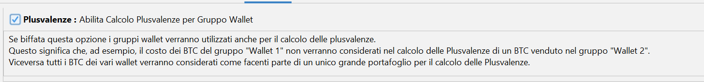

In **Opzioni – Gruppi Wallet Crypto** spostare i vari wallet nel gruppo desiderato:

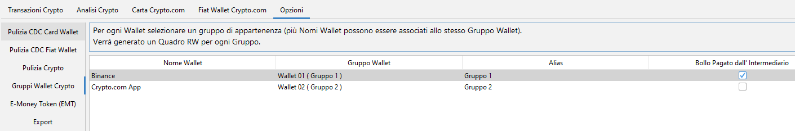

Supponendo di mettere Binance nel **Gruppo 1** e Crypto.com nel **Gruppo 2**, l'esempio precedente
diventa:

- 01/01 compro 1 BTC su Binance (**Gruppo 1**) per 10.000 €;
- 01/02 compro 1 BTC su Crypto.com (**Gruppo 2**) per 20.000 €;
- 01/03 vendo 1 BTC su Binance (**Gruppo 1**) per 30.000 €.

In questo caso la plusvalenza calcolata è di 20.000 € (30.000 € − 10.000 €), perché i wallet appartenenti
al Gruppo 1 possono vendere solo cripto appartenute allo stesso gruppo.

### Trasferimenti tra wallet di proprietà {#trasferimenti-tra-wallet-di-proprietà}

**Con calcolo globale** i trasferimenti tra wallet di proprietà non vengono presi in considerazione: sono
completamente trasparenti.

**Con calcolo per gruppo wallet** il costo di carico della moneta uscita dal wallet di origine viene
trasferito su quello di destinazione (un po' come succede con gli scambi non rilevanti). Esempio:

- 01/01 compro 1 BTC sul **Gruppo 2** per 10.000 €;
- 01/02 compro 1 BTC sul **Gruppo 1** per 20.000 €;
- 01/03 sposto 1 BTC dal **Gruppo 2** al **Gruppo 1**;
- 01/04 vendo 1 BTC sul **Gruppo 1** per 30.000 €.

Il 01/03 viene caricato 1 BTC sul Gruppo 1 con costo di carico pari all'acquisto del 01/01, ovvero
10.000 €: la posizione viene chiusa sul Gruppo 2 e aperta sul Gruppo 1, esattamente come avviene per gli
scambi non rilevanti. Il 01/04 si realizza quindi una plusvalenza di **20.000 €**.

## Derivati: come vengono calcolati {#derivati}

> **Funzione in bozza.** La gestione dei derivati è ancora in versione di prova e può cambiare con le prossime
> versioni, anche nei valori calcolati.

I redditi da contratti derivati (perpetui, futures), anche quando il sottostante è una cripto-attività, sono
redditi diversi di natura finanziaria (art. 67, comma 1, lettera c-quater, del TUIR, circolare 30/E del
27/10/2023, paragrafo 2.3.2) e non si compensano con le plusvalenze da cripto-attività.

Il programma li gestisce **solo in parte**. Profitti, perdite, funding, commissioni e bonus dei derivati appena
importati nascono già **classificati come derivati** (accredito o addebito da derivati), quelli già in archivio
si classificano con la voce *Classifica come derivato* del menu dei movimenti. Se un movimento importato ha la data
in un anno con una dichiarazione definitiva archiviata resta da classificare, per non cambiare i valori di
quell'anno, e alla fine dell'importazione il programma chiede se classificarlo comunque. Il risultato dei derivati va nella
colonna *Risultato derivati* della tabella dei movimenti, separato dalle plusvalenze delle cripto-attività, e
compare nel **quadro T/RT** (vedi [Derivati nei quadri T e RT](#derivati-quadri)), non nel quadro W/RW. Per i perpetui e i futures di OKX e di Bybit (conto Derivati e
Unified Trading Account) il reddito è il differenziale calcolato in LIFO sulla chiusura di ogni posizione, nelle
posizioni in cui i prezzi di esecuzione ricostruiscono il profitto che l'exchange dichiara. Altrimenti, per esempio
con prezzi in un'unità diversa o con una chiusura di una posizione aperta prima del primo file, resta il profitto
dell'exchange. Per Bybit serve reimportare i file: i token dei contratti si aggiungono ai movimenti già importati.

Un derivato regolato in euro o in un'altra valuta FIAT (il profitto o la perdita accreditati o addebitati direttamente in
valuta) si classifica allo stesso modo: il suo risultato è il valore in euro del movimento e va nella colonna *Risultato
derivati* e nel quadro T/RT, senza nessun effetto sulle cripto-attività. Per una valuta diversa dall'euro il valore è quello
del giorno del movimento, e un eventuale guadagno sul cambio dopo l'accredito non fa parte dei derivati.

**Il funding** pagato o incassato su una posizione aperta conta nell'anno in cui è pagato o incassato, anche se la
posizione si chiude in un anno successivo: passa davvero da un trader all'altro e non torna indietro, a differenza del
margine e del risultato non ancora realizzato. È una scelta del programma, perché nessuna fonte ufficiale parla del funding,
ed è dichiarata nelle note del quadro T/RT.

**Vedere tutto il giro.** La voce *Mostra il giro del movimento* del menu dei movimenti (sottomenu *Analizza*) elenca i
movimenti legati a quello scelto, ciascuno con una riga che dice cos'è. Per una posizione su derivati sono tutti i movimenti
dall'apertura alla chiusura: token del contratto, margine parcheggiato e restituito, profitti, perdite, commissioni, funding,
conguagli e rientri del margine. Per gli altri movimenti sono quelli della stessa operazione e quelli collegati da una
classificazione (trasferimenti, scambi differiti, commissioni collegate). È solo consultazione: dal menu delle righe non si
modifica nulla. Le posizioni ancora aperte a una data si vedono con il pulsante *Contratti aperti* della scheda
[Giacenze a data](giacenze-a-data.html#contratti-aperti).

**Le opzioni (call e put) non sono ancora gestite**, da nessun exchange: saranno integrate in una versione futura.
Le righe delle opzioni scaricate dalle API di OKX entrano marcate come derivati, ma nessuna è stata verificata su dati
reali, la scadenza e l'esercizio non diventano movimenti e il premio non segue un calcolo per contratto. Il risultato
delle opzioni che compare nel programma può quindi essere incompleto o sbagliato.

Ogni movimento classificato come derivato ha un **doppio effetto**:

1. **lato derivati**: il provento o l'onere vale la quantità di moneta accreditata o addebitata al suo **valore
   in euro nel momento** del movimento. Il costo di carico non entra in questo calcolo.
2. **lato cripto**: la moneta accreditata entra nel LIFO al valore del momento, quindi senza plusvalenza. La moneta
   addebitata esce come una **cessione**, con plusvalenza o minusvalenza cripto pari al valore del momento meno il
   suo costo di carico LIFO.

Il margine resta una cripto-attività: è denaro dell'utente vincolato a garanzia della posizione. Una perdita si
paga con il margine, e alla chiusura ne torna solo la parte non consumata.

### Esempio 7 – Perdita pagata con il proprio margine {#esempio-7--perdita-margine}

1. Acquisto di **100 USDC** a **0,95 €** l'uno, per **95,00 €**.
2. Apertura di una posizione con i 100 USDC come margine.
3. Chiusura in perdita di **50 USDC**, quando 1 USDC vale **0,90 €**. Tornano 50 USDC.

Al punto **3**:

- onere dei derivati: 50 × 0,90 € = **−45,00 €**
- cessione cripto dei 50 USDC usati per pagare la perdita: valore 50 × 0,90 € = 45,00 €, costo di carico
  50 × 0,95 € = 47,50 €, minusvalenza cripto 45,00 € − 47,50 € = **−2,50 €**

Le due voci insieme danno −47,50 €, cioè quanto erano costati i 50 USDC persi. I 50 USDC che tornano non
sono ceduti: restano nel LIFO con il loro costo di carico, 50 × 0,95 € = 47,50 €.

Con una stablecoin il lato cripto è quasi sempre piccolo: è la sola variazione del cambio dollaro/euro fra
l'acquisto e la perdita. Il grosso è l'onere dei derivati.

### Esempio 8 – Perdita pagata con un bonus dell'exchange {#esempio-8--perdita-bonus}

Stessi prezzi dell'esempio 7, ma i 100 USDC di margine sono un **bonus** accreditato dall'exchange, che lo
usa per pagare perdite, commissioni e funding prima dei fondi dell'utente. Il programma tratta il bonus come un
provento quando arriva e il suo recupero da parte dell'exchange come un onere.

1. Accredito di un bonus di **100 USDC**, quando 1 USDC vale **0,95 €**.
2. Apertura di una posizione con il bonus come margine.
3. Chiusura in perdita di **50 USDC**, pagata dal bonus, quando 1 USDC vale **0,90 €**.
4. L'exchange riprende i **50 USDC** di bonus rimasti, quando 1 USDC vale ancora **0,90 €**.

Al punto **1**: provento dei derivati 100 × 0,95 € = **+95,00 €**. I 100 USDC entrano nel LIFO al valore del
momento, con costo di carico 95,00 €, senza plusvalenza cripto.

Al punto **3**: onere dei derivati 50 × 0,90 € = **−45,00 €**. Cessione cripto: valore 45,00 €, costo di
carico 50 × 0,95 € = 47,50 €, minusvalenza cripto **−2,50 €**.

Al punto **4**: onere dei derivati 50 × 0,90 € = **−45,00 €**. Cessione cripto: valore 45,00 €, costo di
carico 47,50 €, minusvalenza cripto **−2,50 €**.

| Movimento | Derivati | Cripto-attività |
|---|---|---|
| 1. Accredito del bonus | +95,00 € | 0,00 € |
| 3. Perdita pagata dal bonus | −45,00 € | −2,50 € |
| 4. Recupero del bonus rimasto | −45,00 € | −2,50 € |
| **Totale** | **+5,00 €** | **−5,00 €** |

Insieme le due colonne danno **0,00 €**: l'utente non aveva niente e non ha niente. Il +5,00 € e il −5,00 €
nascono solo dal cambio del dollaro fra l'accredito (0,95 €) e le uscite (0,90 €). Con il prezzo fermo a
0,95 € sarebbe tutto a zero: derivati +95,00 € − 47,50 € − 47,50 € = 0, cripto 0.

Le due colonne stanno in categorie di reddito diverse, quindi nel calcolo non si compensano fra loro.

Se la perdita consuma tutto il bonus non c'è recupero. Al punto **3** la perdita è di 100 USDC: onere dei
derivati 100 × 0,90 € = −90,00 €, cessione cripto con valore 90,00 € e costo di carico 95,00 €, minusvalenza
cripto −5,00 €. I totali sono gli stessi: derivati +95,00 € − 90,00 € = +5,00 €, cripto −5,00 €.

Fra la chiusura e il recupero i 50 USDC di bonus restano nel LIFO e nelle giacenze, anche se non sono
prelevabili.

### Il conto derivati {#conto-derivati}

Il programma tratta il conto derivati come **parte del derivato**, e non c'è un'opzione per cambiare. Un'altra lettura
considera il margine con cui si apre una posizione una **cripto-attività**, denaro dell'utente vincolato a garanzia
(circolare 165/E sui margini), con il passaggio al conto derivati senza effetti fiscali: il programma la sa calcolare ma
per ora non la offre, perché dà un quadro W/RW più difficile da sostenere. Il conto derivati conta come parte del derivato
così:

- il passaggio di cripto-attività dal conto spot al conto derivati è una **cessione** al valore del momento, con
  la sua plusvalenza o minusvalenza cripto,
- dentro il conto le cripto-attività hanno un costo proprio, quello del momento in cui sono entrate,
- il rientro nel conto spot dà un **reddito da derivati** pari al valore del momento meno quel costo, e le monete
  rientrano nello spot al valore del momento,
- una perdita, una commissione o un funding pagati dal conto derivati sono un onere da derivati pari al costo delle
  monete che escono dal conto, senza nessuna cessione cripto.
- un movimento su derivati del conto ancora da classificare (per esempio uno importato in un anno con la dichiarazione
  definitiva, che il programma lascia da classificare) conta già come accredito o addebito da derivati: il conto è parte
  del derivato, quindi quello che vi entra o esce non è una cripto-attività. Una commissione conta sempre, un deposito o un
  prelievo solo se i movimenti non classificati entrano nel calcolo, come ogni altro movimento da classificare. Fuori
  dal conto un movimento da classificare resta una cripto-attività.

**Esempio.** 1.000 USDT comprati a 0,92 € (920 €). Il 1° marzo 500 USDT passano al conto derivati come margine
(1 USDT vale 0,90 €). Il 31 maggio la posizione si chiude con un profitto di 300 USDT (1 USDT vale 0,88 €) e il
margine rientra. Il 30 giugno si vendono tutti i 1.300 USDT a 0,88 € (1.144 €).

| | Se il margine restasse una cripto-attività (non usato) | Metodo del programma |
|---|---|---|
| 1° marzo, margine al conto | nessun effetto | cessione: 500 USDT valgono 450 € e costano 460 €, minusvalenza cripto di 10 € |
| 31 maggio, profitto | reddito da derivati di 264 € (300 × 0,88), i 300 USDT entrano a 264 € | uguale, i 300 USDT entrano nel conto a 264 € |
| 31 maggio, rientro dal conto | nessun effetto | reddito da derivati: tornano 800 USDT, valgono 704 € e nel conto costano 714 € (450 + 264), quindi −10 € |
| 30 giugno, vendita | 1.144 € meno 1.184 € (300 USDT a 264 €, 1.000 a 920 €): −40 € | 1.144 € meno 1.164 € (800 a 704 €, 500 a 460 €): −20 € |
| **Totale derivati** | **+264 €** | **+254 €** |
| **Totale cripto-attività** | **−40 €** | **−30 €** |

In tutti e due i casi il totale è 1.144 − 920 = **+224 €**. Cambia dove cade l'effetto del cambio sul margine:
tutto fra le cripto-attività se il margine restasse una cripto-attività, fra i derivati durante la permanenza nel conto con il metodo del programma. Dal 2023
le due parti non si compensano fra loro, quindi l'imposta può essere diversa.

Con una **perdita** di 200 USDT alla chiusura la perdita esce dal conto e tornano 300 USDT. Con il metodo del programma la perdita vale
il costo dei 200 USDT nel conto, 180 € (200 × 0,90), senza cessione cripto, e il rientro dei 300 USDT dà 264 − 270 = −6 €:
derivati **−186 €**, cripto-attività −10 € al passaggio al conto e −20 € alla vendita (704 € contro 460 + 264), **−30 €**.
Se il margine restasse una cripto-attività la perdita varrebbe 176 € (200 × 0,88) fra i derivati e i 200 USDT sono anche una cessione cripto (176 € contro
un costo di 184 €): derivati **−176 €**, cripto-attività **−40 €**. In tutti e due i casi il totale è **−216 €**.

Dove si applica:

- **OKX**: il margine di ogni posizione passa dal wallet principale al sotto-wallet **Derivati**, e lì stanno anche
  profitti, perdite, commissioni e funding della posizione, come nei conti futures di Bybit e Binance. Il giroconto fra i
  due wallet porta solo quello che OKX toglie o aggiunge al saldo: all'apertura il margine più la commissione, alla
  chiusura il margine con il profitto o meno la perdita e la commissione. Così una perdita non esce mai da un conto spot
  che non ha più la moneta. Restano sul wallet principale, con il loro doppio effetto, profitto e commissione delle
  operazioni di cui OKX non dà il margine (margine cross, archivio trimestrale in CSV) e delle posizioni aperte con la
  versione 1.0.66, e il funding quando sono aperti insieme un long e uno short dello stesso contratto.
- **Bybit** (conto Derivati) e **Binance** (conti futures): dalla versione 1.0.67 il conto è il sotto-wallet
  **Derivati** e i giroconti con gli altri conti diventano trasferimenti interni. I movimenti importati con le
  versioni precedenti stanno sul wallet principale: la voce *Marca come derivato* (menu dei movimenti, *Altre
  modifiche*) li sposta sul sotto-wallet, e reimportando **dopo** gli stessi file entrano i giroconti. L'ordine conta:
  il controllo dei doppioni non guarda il sotto-wallet, quindi reimportando prima dello spostamento i movimenti vecchi
  resterebbero sul wallet principale.
- **Bybit Unified Trading Account**: il margine resta una cripto-attività. Nel conto unificato il collaterale non si
  sposta mai, e il file non dice quanto margine impegna ogni posizione.
- Le posizioni aperte con la versione 1.0.66 e abbinate al loro rientro (*Abbina rientro del margine*) seguono la
  stessa regola: il collaterale di allora fa da conto derivati.

Questo metodo vale anche per il quadro W/RW: il conto derivati esce dai righi delle cripto-attività e diventa un rigo con
codice 9 (vedi [Contratti derivati](opzioni-calcolo-rw.html#contratti-derivati-codice-9)). 

### Dual Investment {#dual-investment}

I Dual Investment di Binance sono trattati come **cripto-attività** (lettera c-sexies), non come derivati.
Alla scadenza il contratto consegna una cripto-attività al prezzo fissato alla sottoscrizione: è una cessione a termine di
cripto-attività, che la circolare 30/E del 2023 elenca espressamente fra le operazioni della lettera c-sexies. La lettera
c-quater dei derivati riguarda invece i contratti su strumenti finanziari, valute, metalli o merci e quelli regolati per
differenza, come i perpetui. Così, con il file di dettaglio del Dual Investment:

- se la liquidazione è in una moneta diversa da quella sottoscritta, acquisto e liquidazione sono uno **scambio** fra le
  due monete, con la sua plusvalenza o minusvalenza,
- se la liquidazione è nella stessa moneta, l'importo sottoscritto torna con il suo costo di carico e l'eccedenza è un
  **provento** (una ricompensa), come lo staking.

Nessuna fonte ufficiale parla dei Dual Investment: è una **scelta del programma**. Una lettura diversa vede nel contratto
un deposito più un'opzione venduta, e tratta il premio come reddito da derivati, separato dalla cripto-attività e non
compensabile con le sue minusvalenze. Il programma non la applica, e la voce *Classifica come derivato* non vale per questi
movimenti. Per gli anni fino al 2022 le due letture danno lo stesso netto, perché cripto-attività e derivati si sommavano
fra loro.

### Derivati nei quadri T e RT {#derivati-quadri}

> **Funzione in bozza.** La gestione dei derivati è ancora in versione di prova e può cambiare con le prossime
> versioni, anche nei valori calcolati.

I redditi da derivati vanno nella **sezione II-A del quadro RT** (modello Redditi Persone fisiche) e nella **sezione II
del quadro T** (modello 730), insieme agli altri redditi diversi di natura finanziaria tassati al 26%. Il programma
riporta i movimenti classificati come derivati. Quelli non classificati restano cripto-attività.

**Il criterio: movimento per movimento.** Ogni movimento dell'anno con un valore nella colonna *Risultato derivati* va
nella colonna 1 (differenziali positivi e altri proventi) se è positivo, e nella colonna 2 (costi) senza segno se è
negativo. Il criterio è uguale per ogni exchange, perché le singole posizioni non sempre si possono individuare: gli
export di alcuni exchange non riportano il contratto. Il risultato, cioè la somma algebrica di differenziali, proventi e
oneri, non dipende dal modo di raggruppare. Le due colonne sono arrotondate all'euro sul totale.

Esempio con cifre inventate, anno 2025:

| Movimento | Risultato derivati |
|---|---|
| OKX chiusura 1 (LIFO) | +300 |
| OKX chiusura 2 (LIFO) | −100 |
| OKX funding | −15 |
| OKX commissioni | −10 |
| OKX chiusura di un altro contratto | −250 |
| OKX funding | +5 |
| OKX commissioni | −5 |
| Bybit profitto | +80 |
| Bybit perdita | −30 |
| Bybit funding | −2 |

Colonna 1 = 300 + 5 + 80 = **385**, colonna 2 = 100 + 15 + 10 + 250 + 5 + 30 + 2 = **412**, risultato = minusvalenza di
**27**. Per una chiusura di OKX calcolata in LIFO il valore sta sulla riga del token, mentre la riga del profitto di OKX
vale 0,00 e non sposta nulla. Una perdita pagata dal conto derivati vale il costo delle monete nel
conto, mentre il LIFO la valuta al valore del momento: la differenza resta sulla riga della perdita (nell'esempio del conto
derivati −4 €, cioè 180 € di costo contro 176 € di valore).

**Righi compilati, che cambiano con il modello dell'anno:**

| Anno d'imposta | Quadro | Colonna 1 | Colonna 2 | Risultato | Perdita dell'anno |
|---|---|---|---|---|---|
| fino al 2022 | RT | RT21 | RT22 col. 3 | RT23 | RT93 col. 5 |
| 2023 | RT | RT21 | RT22 col. 3 | RT23 | RT93 col. 5 |
| dal 2024 | RT | RT11 col. 1 | RT11 col. 2 | RT52 | RT102 col. 5 |
| dal 2024 | T | T11 col. 1 | T11 col. 2 | (nessun rigo) | (dal prospetto 730-3) |

Fino al 2022 il programma non ha il modulo di quell'anno: i valori sono solo nelle note, da riportare a mano. Il quadro T
esiste dal 730/2025 (anno 2024), e non ha il rigo del risultato: la differenza e un'eventuale perdita risultano dal
prospetto di liquidazione. Per il 2023 e gli anni prima il report del quadro T si stampa comunque, come ausilio al
calcolo, e una riga sul modulo ricorda che quell'anno il 730 non aveva il quadro T e che i valori vanno nel quadro RT.

**Cosa resta da compilare.** Il programma non conosce gli altri redditi della stessa sezione (azioni, ETF o altri derivati
in regime dichiarativo), che vanno sommati negli stessi righi, né le perdite degli anni precedenti (RT13, T13, RT24 fino
al 2023) e le eccedenze certificate dagli intermediari. Compensazioni e imposta non sono compilate. Le note del report
elencano le perdite dei derivati che risultano dal programma nei quattro anni prima, senza tenere conto di quanto già
usato in compensazione.

**La scheda *Redditi da derivati*.** Nella scheda del quadro RT, accanto a *Dettagli x Token*, *Dettagli x Gruppo Wallet*
e *Dettagli x Tipologia*, la scheda *Redditi da derivati* mostra per l'anno scelto nella tabella in alto le due colonne,
il risultato, i righi in cui vanno e le perdite dei derivati dei quattro anni prima. Sotto, un movimento per riga: data,
exchange, tipo (risultato realizzato, funding, commissione, chiusura del contratto in LIFO, con l'indicazione del
conguaglio quando c'è), contratto, risultato in euro e colonna in cui va. Il tasto destro su una riga apre il menu dei
movimenti, il doppio clic il dettaglio.

Il dettaglio movimento per movimento è anche nel foglio *Derivati* dell'Excel archiviato con la dichiarazione, e la sua
somma dà i righi del quadro. Nell'archivio delle dichiarazioni i redditi da derivati sono tre totali in più, scritti solo per
gli anni che ne hanno: una definitiva di un anno con derivati stampata prima di questa versione risulta diversa, e il
confronto dice che non comprendeva i redditi da derivati.

## Situazione ante Legge di bilancio 2023 {#situazione-ante-legge-di-bilancio-2023}

### Scambi cripto-cripto {#scambi-cripto-cripto}

Fino al 31/12/2022 le criptovalute erano equiparate a valute estere. Secondo il comma 1-ter
dell'articolo 67 del TUIR:

> *Le plusvalenze derivanti dalla cessione a titolo oneroso di valute estere rivenienti da depositi e
> conti correnti concorrono a formare il reddito a condizione che nel periodo d'imposta la giacenza dei
> depositi e conti correnti complessivamente intrattenuti dal contribuente, calcolata secondo il cambio
> vigente all'inizio del periodo di riferimento, sia superiore a cento milioni di lire (51.645,69 euro)
> per almeno sette giorni lavorativi continui.*

La [circolare 30/E](https://www.agenziaentrate.gov.it/portale/documents/20143/5589638/Circolare+criptoattivita+del+27+ottobre+2023.pdf)
aggiunge che:

> *Applicando tali principi alle cripto-valute, consegue che cessioni a "termine" di tali attività
> rilevano sempre fiscalmente, mentre le cessioni a "pronti" generalmente non danno origine a redditi
> imponibili mancando la finalità speculativa, salva l'ipotesi in cui la valuta ceduta derivi da prelievi
> da wallet, per i quali la giacenza media superi un controvalore di euro 51.645,69 per almeno sette
> giorni lavorativi continui nel periodo d'imposta.*

e precisa inoltre che *"il trasferimento da una tipologia di wallet ad un'altra di proprietà del medesimo
contribuente non costituisce una fattispecie fiscalmente rilevante"*, indicando anche il LIFO come metodo
di calcolo.

**Chiarimenti operativi:**

- la **cessione a pronti** corrisponde a uno scambio spot;
- la **cessione a termine** si riferisce, ad esempio, a operazioni con futures e derivati.

Questo significa che la tassazione sulle plusvalenze derivanti dallo scambio o dalla vendita a pronti di
criptovalute era applicata **solo se** la giacenza complessiva di tutti i wallet, valorizzata al cambio del
1° gennaio, superava la soglia di 51.645,69 € per almeno sette giorni lavorativi continui nel periodo d'imposta. Gli scambi sotto
soglia generavano comunque plusvalenza, che semplicemente non concorreva alla formazione del reddito
imponibile.

> **NB** — se si hanno movimentazioni antecedenti al 2023 è necessario verificare la relativa opzione in
> **Opzioni – Opzioni di calcolo**.

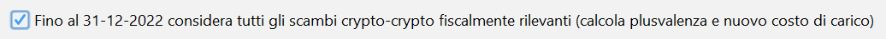

Questo permette di adeguare il comportamento del software alle regole appena descritte e di portarsi
dietro i costi di carico corretti negli anni successivi. **Dalla versione 1.0.31 l'opzione è attiva per
impostazione predefinita.**

L'opzione resta comunque disattivabile perché in
[questo documento](https://blog.moneyviz.it/criptovalute-superamento-soglia-51-64569-e-guida/593/) c'è un
passaggio non chiaro, ovvero *"questo superamento* (della soglia dei 51K) *fa diventare fiscalmente
rilevante tutti gli altri scambi effettuati in tutti i wallet del contribuente nell'anno fiscale di
riferimento"*. Dalle ricerche svolte sembrerebbe invece che diventino rilevanti i guadagni derivanti da
questi scambi, non gli scambi stessi. Chi ritiene che gli scambi cripto-cripto non vadano considerati
rilevanti neanche ante Legge di bilancio può quindi togliere la spunta.

### La soglia dei 51.645,69 euro nel quadro RT {#soglia-51645}

Fino al 2022 le plusvalenze da cessione a pronti e da prelievo di cripto concorrevano al reddito solo se
la giacenza complessiva superava 51.645,69 euro per almeno **sette giorni lavorativi continui** nel periodo
d'imposta (art. 67, comma 1-ter, TUIR, richiamato dalla circolare 30/E). Il programma può verificarlo per ogni
anno fino al 2022 nel quadro T/RT, con la casella *Fino al 31-12-2022 verifica la soglia dei 51.645,69 euro*
di **Opzioni – Opzioni di calcolo** (attiva di default).

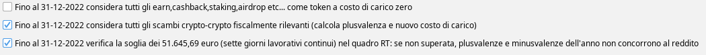

Come viene calcolata la giacenza:

- **Tutti i wallet insieme.** Si sommano tutti i movimenti di tutti i gruppi wallet. Un trasferimento fra
  wallet propri non cambia la somma, purché i due lati cadano nello stesso giorno.
- **Saldo a fine giornata**, non il massimo raggiunto durante il giorno.
- **Solo i giorni lavorativi**: lunedì-venerdì senza le festività nazionali italiane. Sabato, domenica e
  festivi non contano e non interrompono la serie: sette giorni lavorativi di fila con un fine settimana in
  mezzo sono continui.
- **Cosa conta**: cripto, stablecoin, NFT e dollari. Non contano l'euro, le altre valute e i token
  marcati SCAM. Un saldo negativo (movimento mancante) vale zero.
- **Conto derivati**: il margine e il saldo sul sotto-wallet *Derivati* di un exchange contano nella soglia, perché la
  circolare 30/E parla di giacenza di tutti i wallet. È la lettura prudenziale e la casella *Fino al 31-12-2022 nella verifica della soglia conta
  anche la giacenza sul conto derivati*, in *Opzioni di Calcolo*, è spuntata di default. Se la togli quel conto resta fuori dalla soglia.
  La scelta è tua: la circolare non dice nulla sul conto di un derivato.
- **Valore al 1° gennaio**: ogni token è valorizzato per tutto l'anno al prezzo delle 00:00 del 1° gennaio, mai
  al prezzo del giorno, anche se quel giorno non lo avevi in portafoglio. I dollari sono convertiti col cambio
  della Banca d'Italia di quel giorno (o dell'ultimo giorno utile prima).
- **Token senza prezzo del 1° gennaio**: la circolare 30/E ammette il cambio rilevato sul sito dove si è
  acquistata la cripto-valuta, ma non dice nulla per un token che quel giorno non esisteva o non era quotato.
  Il programma, per scelta propria, usa in quel caso il **prezzo di acquisto**, cioè il valore in euro del primo
  movimento di ingresso diviso la quantità. Il token resta identificabile: compare nell'elenco di
  *Prezzi del 1° gennaio* con la dicitura «Prezzo di acquisto» e la data del movimento, e la nota lo dichiara.
  Un prezzo del 1° gennaio assegnato a mano, o trovato su una fonte, ha sempre la precedenza.
- La soglia è superata solo se il valore è **strettamente maggiore** di 51.645,69 euro.

L'effetto sul quadro RT, anno per anno:

- **Soglia non superata**: la tabella mostra comunque i valori calcolati, con la cella delle
  *Plusvalenze realizzate* **evidenziata in giallo** e una nota in fondo alla colonna *Errori* («Plusvalenza non
  riportata in RT», o «Minusvalenza» se il risultato è negativo). Nel quadro RT stampato
  (PDF) i *Totali dei costi*, i *Corrispettivi* e le *Plusvalenze realizzate* sono invece a zero. L'**archivio delle
  dichiarazioni** e l'**Excel con i dettagli** riportano i valori calcolati: nell'archivio la plusvalenza è evidenziata in
  giallo, con una nota breve nell'elenco e la nota completa nel dettaglio, e l'Excel ha sotto il riepilogo la nota con i riferimenti normativi (circolare
  30/E del 27 ottobre 2023, paragrafo 2.3.1, che richiama l'art. 67, comma 1, lettera c-ter), e comma 1-ter, del
  TUIR). Le plusvalenze latenti e il valore di fine anno non cambiano. Le plusvalenze di quell'anno non concorrono al
  reddito e, come precisa la circolare, «non si rendono deducibili neppure le minusvalenze eventualmente realizzate».
  Se nell'anno ci sono anche movimenti su **derivati**, la nota lo dice: quelli non classificati come derivati sono
  trattati come cripto-attività e azzerati insieme al resto, di quelli classificati si azzera solo l'effetto sulle
  cripto-attività (il risultato dei derivati non è nel quadro RT), mentre per la circolare le cessioni a termine
  rilevano sempre (paragrafo 2.3.1) e i redditi da derivati sono redditi diversi di natura finanziaria (paragrafo 2.3.2).
- **Soglia superata**: la riga non cambia e la nota dice in quali giorni è stata superata.
- **Soglia non verificabile**: se uno o più token o NFT erano in giacenza ma non hanno né un prezzo al 1° gennaio
  né un movimento di ingresso con un valore, valgono zero e l'anno **non viene azzerato**, perché con il loro
  valore la soglia potrebbe risultare superata. La nota li elenca.
- **Prezzi del 1° gennaio**: il pulsante (scheda *Dettagli x Token*, con l'anno selezionato) elenca sia i token
  senza alcun prezzo sia quelli valorizzati al prezzo di acquisto, e permette di assegnare il prezzo del
  1° gennaio a ciascuno: *Assegna prezzo* (un token alla volta) propone le quotazioni trovate o permette di
  inserirne una, *Valore zero* è per i token tecnici o senza valore e vale per tutte le righe selezionate
  (Ctrl+A le seleziona tutte). Il prezzo è salvato come prezzo
  personalizzato delle 00:00 del 1° gennaio, nel database personale (*personale.mv.db*), e vale anche per gli altri
  calcoli che lo usano: il valore iniziale di quell'anno e il valore di fine anno del precedente nei quadri
  RW e RT, le giacenze a quella data e i movimenti prezzati entro un'ora da quell'istante. Dopo averlo assegnato
  il programma ricalcola l'anno.
- **Dettaglio soglia**: il pulsante con lo stesso nome, nella stessa scheda, apre la giacenza di ogni giorno
  lavorativo dell'anno con il valore, se sta sopra soglia e da quanti giorni lo è di fila. I giorni della serie
  che ha fatto scattare la condizione sono evidenziati.

Un esempio con dati inventati. Nel 2021 un token senza alcun prezzo (ZZDEMO) rende l'anno non verificabile,
mentre un secondo (ZZNUOVO) è calcolato al prezzo di acquisto, come dice l'ultima riga della nota. Il 2022 ha la soglia superata:

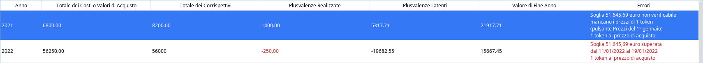

Il pulsante *Prezzi del 1° gennaio* li elenca entrambi, con il prezzo che il calcolo sta usando:

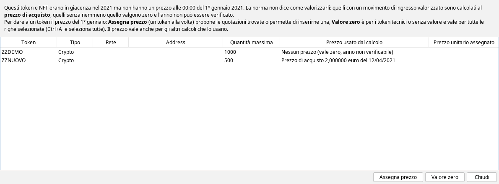

Dopo aver assegnato il valore zero a ZZDEMO l'anno è verificabile, la soglia risulta non superata e la riga
viene azzerata, mentre latente e valore di fine anno restano:

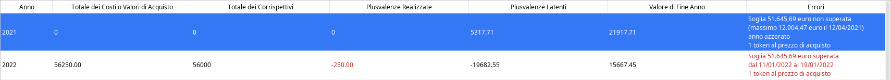

Nel 2022 due BTC restano in giacenza per oltre due mesi e la soglia è superata. *Dettaglio soglia* mostra
la giacenza di ogni giorno lavorativo e evidenzia i sette giorni che hanno fatto scattare la condizione:

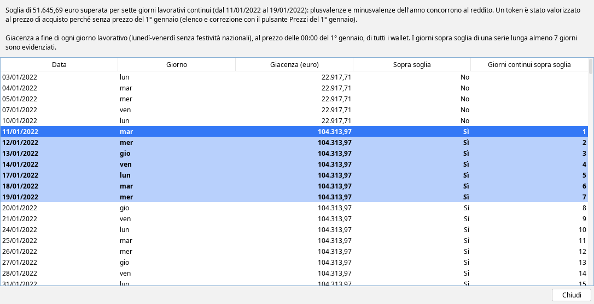

La soglia agisce solo sulla riga mostrata e stampata. Il LIFO e i costi di carico non cambiano, quindi gli
anni successivi partono dagli stessi costi di prima. Il programma non riporta le minusvalenze da un anno
all'altro. Dopo aver cambiato la casella va premuto di nuovo *Calcola* (compare l'avviso rosso). Gli scambi
cripto-cripto restano regolati dall'opzione descritta sopra, indipendente dalla soglia.

### Staking e altre rendite passive {#staking-e-altre-rendite-passive}

Sui proventi da staking l'Agenzia delle Entrate si esprime così:

> *Dette remunerazioni, se percepite da soggetti residenti senza l'intervento di una società italiana che
> ha applicato la ritenuta a titolo d'acconto, devono essere indicate in dichiarazione nella medesima
> Sezione I-A "Redditi di capitale" del Quadro RL del Modello Redditi 2023.*

In sostanza generavano reddito esattamente come succede ora, ma andavano inserite in un quadro diverso.
L'Agenzia non specifica però se anche le altre forme di rendita passiva debbano essere trattate allo
stesso modo.

Nella confusione precedente all'avvento della nuova normativa molti preferivano caricare questo tipo di
provento a costo di carico zero, valutando l'eventuale tassazione in fase di vendita. Per seguire questa
interpretazione il programma prevede la seguente opzione, sempre in **Opzioni – Opzioni di calcolo**:

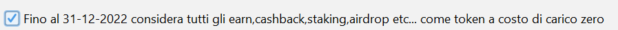

Se l'opzione non viene attivata, il programma applica anche agli anni precedenti le impostazioni valide
dal 2023, seguendo quindi le regole impostate in **Opzioni – Opzioni Rewards**.

## Funzione "RT & Analisi P&L" {#funzione-rt--analisi-pl}

La funzione, presente nella sezione **Analisi Crypto**, permette di vedere le plusvalenze realizzate e
quelle latenti nei vari anni, e fornisce un'analisi token per token della composizione delle plusvalenze
latenti.

**Plusvalenza latente e realizzata.** La plusvalenza **latente** indica un incremento di valore non
ancora realizzato attraverso una vendita o una cessione: se compro 1 BTC a inizio anno per 10.000 € e a
fine anno vale 100.000 €, ho una plusvalenza latente di 90.000 €. Non è tassabile: è solo un'indicazione
di quanto si potrebbe realizzare vendendo in quel momento. La plusvalenza diventa **realizzata** nel
momento in cui la vendita genera un evento fiscalmente rilevante.

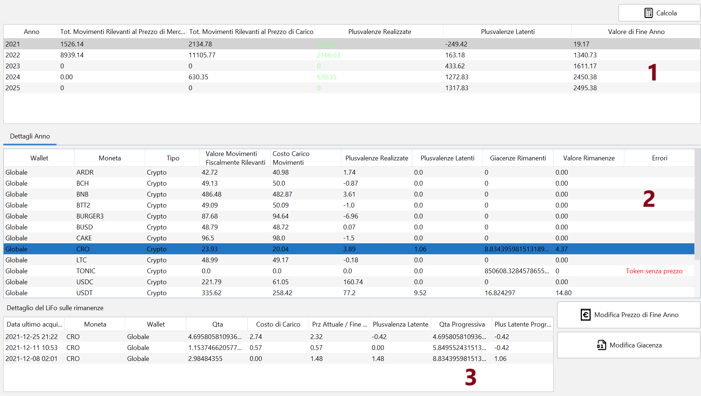

Premendo **Calcola** il programma analizza le plusvalenze dei vari anni. Sono presenti tre tabelle.

**Tabella 1** — per ogni anno vengono indicati la plusvalenza realizzata, quella latente e il totale del
valore di tutti i wallet al 31/12. Si ricorda che *plusvalenza latente totale = valore di fine anno −
totale dei costi di carico*. Per quanto riguarda il valore di fine anno, tenere presente che non tutti i
token potrebbero essere stati valorizzati: guardare la Tabella 2 per il dettaglio e assegnare un prezzo
alla moneta.

**Tabella 2** — selezionando una riga della Tabella 1 compare la composizione dei wallet token per token
per l'anno selezionato (e, se è attivo il calcolo per gruppo wallet, gruppo per gruppo). Anche qui si
vedono plusvalenze e minusvalenze, realizzate e latenti, e le rimanenze di fine anno. Nella colonna
**Errori** vengono segnalati i token a cui il programma non è riuscito ad assegnare un prezzo: per
sistemare l'anomalia selezionare la riga e premere **Modifica prezzo di fine anno**, inserendo il valore
in euro dell'intero ammontare dei token posseduti (vanno corretti i token con segnalazione di errore, non
quelli valorizzati a 0,00). Nella stessa colonna vengono segnalate anche le **giacenze negative**,
correggibili con **Modifica Giacenza**: si viene reindirizzati alla funzione *Giacenze a Data*, dove è
possibile creare un movimento correttivo.

**Tabella 3** — viene popolata selezionando un token dalla Tabella 2 e mostra la composizione dello stack
LIFO per quel token fino a fine anno (o, se è selezionato l'anno corrente, fino alla data attuale).
Supponendo questa situazione:

- 2023-01-01 compro 100 CRO per 10 €;
- 2023-02-01 compro 50 CRO per 15 €;
- 2023-03-01 compro 200 CRO per 220 €;
- a fine anno 1 CRO vale 1 €.

lo stack LIFO mostrato a fine anno sarà:

| Data ultimo acquisto | Moneta | Wallet | Qtà | Costo di carico totale | Prezzo di fine anno | Plusvalenza latente | Qtà progressiva | Plusvalenza latente progressiva |
|---|---|---|---|---|---|---|---|---|
| 2023-03-01 | CRO | Globale | 200 | 220 | 200 | −20 | 200 | −20 |
| 2023-02-01 | CRO | Globale | 50 | 15 | 50 | 35 | 250 | 15 |
| 2023-01-01 | CRO | Globale | 100 | 10 | 100 | 90 | 350 | 105 |

La tabella rappresenta la totalità dei token posseduti, in ordine, a partire dall'ultimo entrato: è
esattamente l'ordine che il programma utilizzerà per il calcolo delle plusvalenze in caso di vendita.
Dall'esempio si capisce che vendendo tutti i 350 token si genererebbe una plusvalenza di 105 €, mentre
vendendone soltanto 200 si genererebbe una minusvalenza di 20 € — un'informazione utile per un'eventuale
pianificazione fiscale.

## Note importanti {#note-importanti}

Affinché i calcoli risultino corretti è necessario:

1. correggere tutti gli errori che si presentano nella schermata principale del programma;
2. caricare tutte le movimentazioni cripto di tutti i wallet posseduti **fin dal primo possesso**: non è
   sufficiente caricare i dati del solo anno fiscale di interesse;
3. controllare le giacenze di fine anno con gli screenshot degli exchange e sistemare le anomalie;
4. leggere la documentazione e selezionare le opzioni adeguate secondo la propria interpretazione e la
   propria propensione al rischio.

Si ricorda inoltre che:

1. derivati, futures e simili seguono altre regole e sono gestiti solo in parte: il risultato di quelli classificati
   compare nel quadro T/RT, quelli non classificati restano cripto-attività, e le opzioni non sono ancora gestite (vedi
   [Derivati: come vengono calcolati](#derivati));
2. quanto scritto in questa documentazione, così come il funzionamento del programma, è frutto di
   ricerche e di un'interpretazione personale, quindi soggetto a possibili errori.

## Bibliografia {#bibliografia}

**Leggi e circolari**

- [Circolare 30/E dell'Agenzia delle Entrate](https://www.agenziaentrate.gov.it/portale/documents/20143/5589638/Circolare+criptoattivita+del+27+ottobre+2023.pdf)
- [Legge di Bilancio 2023](https://www.gazzettaufficiale.it/atto/serie_generale/caricaDettaglioAtto/originario?atto.dataPubblicazioneGazzetta=2022-12-29&atto.codiceRedazionale=22G00211&elenco30giorni=false)
- [Legge di Bilancio 2025](https://www.normattiva.it/atto/caricaDettaglioAtto?atto.dataPubblicazioneGazzetta=2024-12-31&atto.codiceRedazionale=24G00229&atto.articolo.numero=0&atto.articolo.sottoArticolo=1&atto.articolo.sottoArticolo1=0&qId=8adc1507-825e-48dc-8e45-bf015a494974)

**Interpretazioni omnicomprensive**

- [FAQ Cripto Attività FinanzaOnline](https://forum.finanzaonline.com/threads/faq-tassazione-cripto-attivita.2058741/)

**Interpretazioni specifiche sulle stablecoin (questione E-Money Token)**

- [CryptoBooks](https://cryptobooks.tax/it/blog/pagare-meno-tasse-crypto-2024)
- [Koinly](https://koinly.io/guides/guida-fiscale-italia/)
- [Blockpit.io](https://www.blockpit.io/tax-guides/guida-fiscale-sulle-criptovalute-italia)
- [Studio Tibaldo](https://www.studiotibaldo.com/stable-coin-tassazione/)
- [Studio Teruzzi](https://www.studioteruzzi.it/cripto-quando-si-tassa-la-plusvalenza-nel-quadro-rt/)
- [Agendadigitale.eu](https://www.agendadigitale.eu/mercati-digitali/criptovalute-nella-dichiarazione-dei-redditi-2024-linee-guida-per-non-sbagliare/)
- [The Crypto Gateway](https://thecryptogateway.it/tasse-su-criptovalute-2023/)
- [Filippo Angeloni](https://youtu.be/pDRzvLjlgB0?si=MR5GU2aWmftNWXUK)

[Torna all'indice della documentazione](./)
