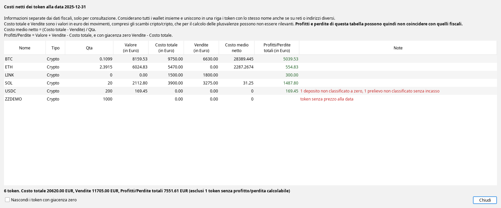

# Costo medio netto in Giacenze a data

- [A cosa serve](#a-cosa-serve)
- [Dove si trova](#dove-si-trova)
- [Il dialogo e le sue colonne](#le-colonne)
- [Come si calcola](#come-si-calcola)
- [Perché non coincide con i dati fiscali](#non-fiscale)
- [Un esempio completo in cinque passi](#esempio)
- [Confronto con il costo di carico LIFO](#confronto-lifo)
- [Quali movimenti contano e come](#movimenti)
- [Quando le colonne restano vuote e cosa dicono le note](#colonne-vuote)
- [Come confrontare i numeri con altri strumenti](#confronto-strumenti)
- [Domande frequenti](#domande)
- [Limiti e cose da sapere](#limiti)

## A cosa serve {#a-cosa-serve}

La tabella *Giacenze a data* mostra, per ogni token, la quantità posseduta, il suo valore alla data scelta e il
**costo di carico** calcolato con il metodo LIFO. Il costo di carico risponde alla domanda «quanto è costato
quello che mi resta», secondo le regole del calcolo delle plusvalenze.

Il **costo medio netto** risponde a un'altra domanda, più semplice e più vicina all'esperienza di chi guarda il
proprio portafoglio: **quanto denaro ho messo in questo token e quanto ne ho tolto, e a che prezzo dovrei vendere
quello che mi resta per essere in pareggio?**

Il dialogo dei costi netti permette di:

- vedere **quanto hai speso davvero** per acquistare un token (*Costo totale*) e **quanto hai incassato** cedendolo
  (*Vendite*), sommando tutte le piattaforme e tutti i wallet,
- conoscere il **prezzo di pareggio** (*Costo medio netto*): sopra quel prezzo il token, considerando tutto quello
  che hai già incassato, è in utile, sotto è in perdita,
- leggere il **risultato complessivo** del token (*Profitti/Perdite totali*), che somma la parte già incassata e il
  valore di quello che possiedi ancora, **anche quando non ne possiedi più** e la giacenza è zero,
- fare un **confronto** con il metodo LIFO, o con strumenti esterni che mostrano gli stessi numeri, per esempio la
  scheda *My Portfolio* di CoinGecko.

> **Non è un calcolo fiscale.** Il dialogo è solo informativo: non cambia nessun movimento, non entra nel
> calcolo delle plusvalenze (quadro RT) né nel quadro W/RW, e per questo sta in una finestra a parte e non nella
> tabella. Profitti e perdite possono **non coincidere** con quelli fiscali, perché qui anche gli scambi fra cripto
> contano come vendita e acquisto: vedi [il perché](#non-fiscale). Il manuale descrive cosa calcola il programma, le
> valutazioni sulla propria dichiarazione restano dell'utente.

## Dove si trova {#dove-si-trova}

Nella scheda **Analisi Crypto – Giacenze a Data**, sotto la tabella dei token, accanto a *Mostra Giacenze a Zero* e a
*Nascondi Token Scam*, c'è il pulsante **Costi netti**. Il manuale dell'intera scheda è **[Giacenze a data](giacenze-a-data.html)**,
raggiungibile anche dal pulsante *Guida* della scheda stessa.

- Il pulsante è attivo **solo con il wallet «Tutti»**: il calcolo riguarda tutti i wallet insieme e non avrebbe senso
  per uno solo. Con un wallet o un gruppo selezionato resta spento.
- Il dialogo si calcola **al momento**, con la data scelta in alto, e mostra una finestra di avanzamento. Non dipende
  dalla tabella: non serve premere *Calcola* prima, e le caselle *Mostra Giacenze a Zero* non lo riguardano.
- Segue la casella *Nascondi Token Scam*: con la casella spuntata i token SCAM non compaiono.
- Il calcolo considera i movimenti **anteriori alla data** scelta, come il resto della scheda.

## Il dialogo e le sue colonne {#le-colonne}

In cima al dialogo un'intestazione ricorda che le informazioni sono **separate da quelle fiscali** e che i profitti
e le perdite possono non coincidere con quelli fiscali. Sotto, una riga per token. Gli esempi di questo manuale usano i
dati inventati degli screenshot di *Giacenze a data* (tre wallet di fantasia, prezzi di mercato veri al 31/12/2025).

| Colonna | Che cosa mostra |
|---|---|
| **Nome** e **Tipo** | il token e il suo tipo. Una sola riga per nome, anche se il token è su reti o con indirizzi di contratto diversi |
| **Qta** | la quantità posseduta alla data, con tutti i wallet insieme |
| **Valore (in Euro)** | la quantità per il prezzo alla data, sommando le righe di rete. Vuoto se manca un prezzo |
| **Costo totale (in Euro)** | la somma di quanto è stato speso per ottenere il token: acquisti, scambi nei quali il token è stato ricevuto, commissioni in euro collegate all'acquisto |
| **Vendite (in Euro)** | la somma di quanto è stato incassato cedendo il token: vendite, scambi nei quali il token è stato dato, prelievi classificati come cashout |
| **Costo medio netto** | (Costo totale − Vendite) diviso la quantità posseduta. È il prezzo di pareggio. Vuoto con quantità zero o negativa |
| **Profitti/Perdite totali (in Euro)** | valore della giacenza + Vendite − Costo totale. Il risultato complessivo del token, realizzato e latente insieme. Con giacenza zero è Vendite − Costo totale |
| **Note** | cosa rende incerto il numero, in rosso. Vuota se non c'è nulla da segnalare |

Le colonne si ordinano con un clic sull'intestazione. La casella **Nascondi i token con giacenza zero** toglie dall'elenco i
token venduti per intero, che per default compaiono, perché il loro risultato è tutto realizzato e interessa quanto quello
dei token che si possiedono ancora.

Sotto la tabella una riga riassume il numero di token e i totali di *Costo totale*, *Vendite* e *Profitti/Perdite totali*.
Poiché ogni token ha una riga sola, la somma non conta nulla due volte. I token senza profitto/perdita calcolabile (per
esempio senza prezzo) non entrano nel totale dei profitti, e la riga lo dice.

## Come si calcola {#come-si-calcola}

Per ogni token il programma tiene **due conti separati**.

**1. La quantità.** È la somma con segno di tutte le entrate e le uscite del token, di tutti i movimenti anteriori
alla data, di tutti i wallet, **trasferimenti compresi**. È la stessa quantità che la tabella mostra con la selezione
«Tutti». Quello che entra aumenta la quantità, quello che esce la riduce, qualunque sia il motivo (vendita,
commissione, trasferimento con commissione di rete trattenuta, prelievo non classificato).

**2. Il denaro.** Due totali, in euro: quanto è stato **speso** per avere il token e quanto è stato **incassato**
cedendolo. Cosa viene considerato speso o incassato lo decide il tipo di movimento (vedi [la tabella](#movimenti)),
usando il **valore in euro** che il movimento ha già nella tabella dei movimenti, cioè il prezzo del momento.

Da questi due conti nascono le colonne:

- **Costo medio netto** = (speso − incassato) / quantità posseduta
- **Profitti/Perdite totali** = quantità × prezzo alla data + incassato − speso

Con **giacenza zero** la quantità non c'è più e quindi non c'è nemmeno un prezzo che serva: i profitti/perdite sono
semplicemente incassato − speso, e il costo medio netto resta vuoto perché non c'è una quantità su cui dividere.
Esempio: acquisti 100 XYZ pagati 100 € e li vendi tutti per 150 €. Quantità 0, speso 100, incassato 150: profitti/perdite
**+50,00**, a prescindere da quanto valga XYZ oggi.

Due proprietà utili:

- il costo medio netto è il **prezzo di pareggio**: se il prezzo fosse esattamente quel valore, i profitti/perdite
  totali sarebbero zero,
- i profitti/perdite totali dipendono **solo da cosa è entrato e cosa è uscito**, non dall'ordine dei movimenti né da
  come si abbina il costo alle vendite.

Il token è identificato dal **simbolo e dal tipo** (per esempio *ETH Crypto*), senza guardare indirizzo di contratto e
rete: lo stesso simbolo su due reti è un token solo, e nel dialogo ha una riga sola. Il suo valore è la somma dei valori
delle righe di rete, ognuna al proprio prezzo. Così un bridge fra reti non sposta nessun costo. Se anche una sola di
quelle righe non ha un prezzo, il valore e i profitti/perdite del token restano vuoti, perché la somma sarebbe falsa.

## Perché non coincide con i dati fiscali {#non-fiscale}

Il dialogo conta **sempre** ogni scambio fra due cripto come una vendita di una e un acquisto dell'altra, al valore del
momento. Il calcolo delle plusvalenze invece segue le regole fiscali e le opzioni scelte: uno scambio fra cripto può non
essere un'operazione rilevante, e in quel caso non realizza nulla e il costo passa alla moneta ricevuta.

Esempio completo. Acquisti 100 XYZ per 100 €. Poi scambi tutti i 100 XYZ con 20 ABC, e il valore dello scambio è 300 €.

| | Dialogo dei costi netti | Calcolo delle plusvalenze, con gli scambi fra cripto non rilevanti |
|---|---|---|
| XYZ | speso 100, incassato 300, quantità 0: profitti/perdite **+200** | nessuna plusvalenza realizzata allo scambio |
| ABC | speso 300, quantità 20: costo medio netto **15,00** | il costo di carico di ABC resta quello di XYZ, 100 € |

Il +200 del dialogo è un risultato di movimenti di denaro valutati al prezzo del momento, e non coincide con la
plusvalenza che il programma calcola per i quadri. Per questo il dialogo ricorda nell'intestazione che le informazioni
sono separate da quelle fiscali.

## Un esempio completo in cinque passi {#esempio}

Il token XYZ, tutti i valori in euro, prezzo di mercato alla data scelta 6 €. Ogni riga della tabella è la situazione
**dopo** il movimento indicato.

| Passo | Movimento | Quantità | Speso (totale) | Incassato (totale) | Costo medio netto |
|---|---|---|---|---|---|
| 1 | Acquisto di 100 XYZ pagati 100 € (1 € l'uno) | 100 | 100 | 0 | (100 − 0) / 100 = **1,00** |
| 2 | Acquisto di 100 XYZ pagati 300 € (3 € l'uno) | 200 | 400 | 0 | (400 − 0) / 200 = **2,00** |
| 3 | Vendita di 100 XYZ per 400 € (4 € l'uno) | 100 | 400 | 400 | (400 − 400) / 100 = **0,00** |
| 4 | Vendita di 50 XYZ per 250 € (5 € l'uno) | 50 | 400 | 650 | (400 − 650) / 50 = **−5,00** |
| 5 | Acquisto di 100 XYZ pagati 200 € (2 € l'uno) | 150 | 600 | 650 | (600 − 650) / 150 = **−0,33** |

Come si leggono i passi:

- **Passi 1 e 2.** Finché non ci sono vendite, il costo medio netto coincide con il prezzo medio di acquisto.
- **Passo 3.** Hai incassato 400 € e ne avevi spesi 400. Le 100 unità che restano sono «gratis»: il pareggio è a 0.
- **Passo 4.** Hai incassato 250 € in più di quanto speso. Il valore negativo dice che i soldi sono già rientrati e che
  c'è un utile in tasca, anche se il token scendesse a zero.
- **Passo 5.** Hai ricomprato a 2 €, ma il conto complessivo resta sotto zero: hai speso 600 € e ne hai già incassati 650.

Alla fine, con il prezzo a 6 € e 150 XYZ in giacenza:

| Colonna | Valore |
|---|---|
| Costo totale | 600,00 |
| Vendite | 650,00 |
| Costo medio netto | −0,33 |
| Profitti/Perdite totali | 150 × 6 + 650 − 600 = **950,00** |

Prova del pareggio al passo 2: con 200 XYZ, speso 400 e incassato 0, il costo medio netto è 2,00 e a un prezzo di
2 € i profitti/perdite sarebbero 200 × 2 + 0 − 400 = 0.

## Confronto con il costo di carico LIFO {#confronto-lifo}

Il costo di carico LIFO e il costo medio netto non devono coincidere, perché misurano cose diverse. Il LIFO
abbina ogni vendita ai lotti acquistati più di recente e dice quanto è costato quello che resta. Il costo medio netto
guarda solo il denaro entrato e uscito.

Esempio con quattro movimenti semplici (acquisti e vendite per euro, prezzo alla data 6 €):

| Passo | Movimento |
|---|---|
| 1 | Acquisto di 100 XYZ pagati 100 € |
| 2 | Acquisto di 100 XYZ pagati 300 € |
| 3 | Vendita di 100 XYZ per 400 € |
| 4 | Acquisto di 100 XYZ pagati 500 € |

Alla fine si hanno 200 XYZ, che valgono 200 × 6 = 1.200 €.

| | Costo medio netto | Costo di carico LIFO |
|---|---|---|
| Come si ottiene | (speso 900 − incassato 400) / 200 | la vendita del passo 3 scarica il lotto più recente (quello da 3 €), restano il lotto da 1 € e quello da 5 € |
| Risultato | **2,50 € per unità** | 100 + 500 = 600 €, cioè **3,00 € per unità** |
| Parte già realizzata | non distingue | 400 − 300 = 100 € |
| Parte latente | non distingue | 1.200 − 600 = 600 € |
| Risultato complessivo | 1.200 + 400 − 900 = **700 €** | 100 + 600 = **700 €** |

Il **risultato complessivo è lo stesso** con qualunque metodo, perché dipende solo da quanto è entrato e uscito. Cambia
solo come lo si divide fra utile già realizzato e utile ancora latente, e il prezzo per unità del residuo: 2,50 contro 3,00.

Una media ponderata classica darebbe un terzo numero ancora (3,50 in questo esempio): il programma non la calcola. Il costo medio netto non è
una media del costo di acquisto ma un prezzo di pareggio, e per questo può scendere sotto zero o valere zero, cosa che
una media del costo non fa mai.

## Quali movimenti contano e come {#movimenti}

Il programma classifica ogni movimento e decide cosa aggiunge a «speso» e a «incassato». Il **valore** usato è sempre
il *Valore transazione in EURO* del movimento.

| Movimento | Effetto sul token | Speso | Incassato |
|---|---|---|---|
| **Acquisto con euro** (o con un'altra valuta FIAT) | entra il token | valore dell'acquisto | |
| **Vendita per euro** | esce il token | | valore della vendita |
| **Scambio fra due cripto** | esce A ed entra B | B: valore dello scambio | A: valore dello scambio |
| **Acquisto o vendita di un NFT** pagato con cripto | la cripto esce o entra | se entra: valore | se esce: valore |
| **Deposito classificato come acquisto** (acquisto tramite contanti o servizi esterni) | entra il token | valore | |
| **Reward, staking, airdrop, earn, cashback** | entra il token | **zero** | |
| **Deposito a costo zero, donazione ricevuta, rimborso oltre il credito di un fallimento** | entra il token | **zero** | |
| **Deposito non classificato** | entra il token | **zero**, con nota | |
| **Prelievo non classificato** | esce il token | | **zero**, con nota |
| **Cashout o pagamento di un servizio** (prelievo classificato come cashout) | esce il token | | valore |
| **Commissione pagata in cripto** | esce il token | | **zero** |
| **Rettifica di giacenza, rimborso di una reward** | esce il token | | **zero** |
| **Commissione in euro di un acquisto** | nessuno | si somma al token acquistato, se collegata | |
| **Trasferimento fra i propri wallet** | entra ed esce la stessa quantità | non cambia | non cambia |
| **Deposito o prelievo in euro**, scambio fra valute FIAT | nessuno sul token | | |

Alcuni casi meritano un esempio. Negli esempi parte sempre da 100 XYZ acquistati con 100 € (speso 100 €, nessun
incasso), salvo diversa indicazione.

**Scambio fra due cripto.** Scambi 50 XYZ con 20 ABC e il valore dello scambio è 100 €. Per il programma è una
**vendita di XYZ e un acquisto di ABC**, entrambi a 100 €, anche se ai fini del calcolo delle plusvalenze lo scambio
può essere neutro. XYZ: incassato 100, quantità 50, costo medio netto (100 − 100) / 50 = **0,00**. ABC: speso 100,
quantità 20, costo medio netto 100 / 20 = **5,00**.

**Reward.** Ricevi 10 XYZ di staking, che in quel momento valgono 15 €. Entrano a **costo zero**: speso resta 100,
quantità 110, costo medio netto 100 / 110 = **0,909**. Il costo netto conta solo i soldi usciti davvero dal tuo
portafoglio, quindi tutta la reward è utile. Con il prezzo a 2 € i profitti/perdite sono 110 × 2 + 0 − 100 = **120**.
Questa scelta non segue le opzioni del calcolo delle plusvalenze sulle reward.

**Deposito non classificato.** Arrivano 50 XYZ da una provenienza che il programma non conosce: un wallet tuo non
importato, un regalo, un acquisto fatto altrove. Entrano a **costo zero** e la nota lo segnala: speso 100, quantità 150,
costo medio netto 100 / 150 = **0,667**. Se erano tuoi e arrivavano da un wallet non importato, il numero è
ottimistico: classificare il movimento (per esempio come trasferimento) lo corregge.

**Prelievo non classificato.** Escono 50 XYZ verso una destinazione sconosciuta. Escono **senza incasso**, e la nota lo
segnala: speso 100, incassato 0, quantità 50, costo medio netto 100 / 50 = **2,00**. Non viene contato come una vendita
perché potrebbe essere un trasferimento verso un tuo wallet non importato, e contarlo come vendita accrediterebbe un
incasso mai avvenuto.

**Commissione in cripto.** Paghi una commissione di 1 XYZ, che vale 2 €. Esce senza incasso: speso 100, incassato 0,
quantità 99, costo medio netto 100 / 99 = **1,0101**. Con il prezzo a 2 € i profitti/perdite sono 99 × 2 + 0 − 100 = **98**:
la commissione è un costo vero e pesa sul risultato.

**Commissione in euro su un acquisto.** Compri 100 XYZ con un addebito totale di 105 €, cioè acquisto 100 € più
commissione 5 € (alcune piattaforme la registrano come movimento a parte). La commissione si **somma allo speso**:
speso 105, costo medio netto 105 / 100 = **1,05**, e con il prezzo a 2 € i profitti/perdite sono 200 − 105 = **95**.
Funziona solo se il programma ha **collegato** la commissione a quell'acquisto e se in quel gruppo c'è **un solo**
movimento che fa entrare un token. In ogni altro caso la commissione non viene attribuita a nessun token.

**Trasferimento fra i propri wallet con commissione di rete.** Sposti 40 XYZ su un altro tuo wallet e ne arrivano 39,5.
Il trasferimento **non sposta denaro**, ma i 0,5 XYZ trattenuti come commissione di rete escono dalla quantità senza
incasso: quantità 99,5, speso 100, costo medio netto 100 / 99,5 = **1,005**.

**Bridge fra reti.** Compri 100 ETH per 100 € e ne sposti 40 su un'altra rete. Il token è lo stesso, quindi nel dialogo
resta **una riga sola**, con costo totale 100, quantità 100 e costo medio netto **1,00**: nessun costo si sposta con il bridge.

**Fallimenti di piattaforme.** Il blocco del credito, la restituzione in natura e i rimborsi sono scambi fra cripto e
si trattano come tali. Esempio: 1 BTC acquistato per 50.000 € viene bloccato in una procedura quando vale 30.000 €. Il
BTC ha costo totale 50.000, vendite 30.000 e quantità 0, quindi il costo medio netto resta vuoto e i profitti/perdite
sono 30.000 − 50.000 = **−20.000**, senza bisogno di un prezzo. Il token credito ha costo totale 30.000 e quantità 1:
costo medio netto **30.000**.

Cosa non entra mai nel pool: i token **FIAT** (euro, dollari), gli **NFT**, e le monete che non hanno alcun movimento
anteriore alla data.

## Quando le colonne restano vuote e cosa dicono le note {#colonne-vuote}

Il programma preferisce **lasciare vuoto un numero** piuttosto che mostrarne uno sbagliato.

| Situazione | Costo totale e Vendite | Costo medio netto | Profitti/Perdite |
|---|---|---|---|
| Tutto regolare | mostrati | mostrato | mostrato |
| Quantità zero (venduto tutto) | mostrati | vuoto | **Vendite − Costo totale**, senza bisogno del prezzo |
| Quantità negativa (venduto più di quanto posseduto) | mostrati | vuoto | vuoto, con la nota *giacenza negativa* |
| Il token non ha un prezzo alla data (anche su una sola riga di rete) | mostrati | mostrato | vuoto |
| Un movimento che porta denaro non ha il valore in euro | mostrati (parziali) | vuoto | vuoto |
| Token FIAT o NFT | non compaiono | | |

La colonna **Note**, in rosso, dice cosa rende il numero incerto. I testi possibili sono:

- *N movimenti senza prezzo*: la riga ha almeno un movimento che porta denaro (acquisto, vendita, scambio, cashout)
  senza valore in euro. Per ritrovare il numero basta assegnare il prezzo al movimento dalla tabella dei movimenti.
  Un valore scritto `0,00` è invece un valore valido, per esempio un importo sotto il centesimo o un movimento il cui
  prezzo è davvero zero.
- *N depositi non classificati a zero*: ci sono depositi che il programma ha contato a costo zero perché non sa da dove
  arrivano. Il costo medio netto è da prendere con cautela finché non vengono classificati.
- *N prelievi non classificati senza incasso*: ci sono prelievi contati come uscite senza incasso.
- *giacenza negativa*: in archivio ci sono più uscite che entrate per quel token, di solito manca un deposito o un acquisto.
  Il [manuale di Giacenze a data](giacenze-a-data.html) spiega come trovarlo.
- *token senza prezzo alla data*: il token ha una giacenza ma il programma non trova un prezzo a quella data, quindi il
  suo valore e i profitti/perdite restano vuoti.

Le segnalazioni possono comparire insieme, separate da virgole.

## Come confrontare i numeri con altri strumenti {#confronto-strumenti}

Schede come *My Portfolio* di CoinGecko mostrano gli stessi concetti con altri nomi: *Costo totale* (quanto è stato
speso), le vendite registrate, *Costo medio netto* e *Profitti/perdite totali*. Il calcolo è lo stesso, quindi i numeri
**tornano** quando gli stessi movimenti sono registrati nello stesso modo.

Se non tornano, di solito la differenza viene da come sono trattati alcuni movimenti:

- le **reward** qui hanno costo zero, in una scheda manuale dipende da cosa l'utente ha inserito,
- gli **scambi fra cripto** qui sono sempre una vendita e un acquisto al valore del momento,
- le **commissioni** in cripto escono senza incasso,
- i movimenti che nello strumento esterno **mancano** (trasferimenti da altre piattaforme, depositi non classificati),
- il **prezzo** usato per il valore del movimento, che può essere di un'altra fonte.

Per verificare un numero conviene guardare prima *Costo totale* e *Vendite*: se coincidono, il resto del calcolo è
aritmetica.

## Domande frequenti {#domande}

**Perché il costo medio netto è negativo?** Perché hai già incassato più di quanto hai speso su quel token. Non è un
errore: significa che anche se il token valesse zero resteresti in utile (passi 4 e 5 dell'[esempio](#esempio)).

**Perché è zero?** Perché le vendite hanno restituito esattamente quanto speso: le unità che restano sono a costo zero.

**Perché la cella è vuota?** Vedi [la tabella](#colonne-vuote) e leggi la colonna *Note*.

**Perché ho una riga sola per un token che è su più reti?** Perché il calcolo è per simbolo e tipo, sommando tutte le
reti e tutti gli indirizzi di contratto.

**Perché il pulsante è spento?** Perché il dialogo vale per tutti i wallet insieme: il denaro speso e incassato non si
può attribuire a un singolo wallet, dato che i trasferimenti fra wallet non spostano denaro. Scegli *Tutti* nel
selettore dei wallet.

**Perché il profitto di un token venduto tutto non è zero?** Perché i profitti/perdite sono incassato meno speso, e un
token venduto per intero può averti reso o fatto perdere denaro. Non sono le plusvalenze fiscali: vedi [il perché](#non-fiscale).

**Perché non coincide con il costo di carico?** Perché sono due conteggi diversi: vedi
[il confronto](#confronto-lifo). Il costo di carico segue le regole del calcolo delle plusvalenze, il costo medio netto
no.

**Se classifico un movimento, i numeri cambiano?** Sì, alla prossima apertura del dialogo: si ricalcola a ogni apertura.

## Limiti e cose da sapere {#limiti}

- **Solo informativo.** Non entra in nessun quadro della dichiarazione e non modifica nessun movimento.
- **Globale.** Si apre solo con il wallet «Tutti» e non ha una versione per un singolo wallet o gruppo.
- **Per simbolo e tipo.** Due token diversi con lo stesso simbolo (per esempio due contratti con lo stesso nome) vengono
  fusi.
- **Il valore è quello del movimento.** Prezzi mancanti o sbagliati entrano nel calcolo così come sono.
- **Lo `0,00` è un valore valido.** Un movimento il cui valore è realmente `0,00` e uno che non ha trovato un prezzo
  possono sembrare uguali: lo `0,00` non viene segnalato.
- **Movimenti non classificati.** Più ce ne sono, meno il numero è affidabile: la nota lo ricorda.
- **Commissioni in euro.** Entrano nello speso solo se il programma le ha collegate a un unico acquisto.
- **Prezzo alla data.** I profitti/perdite dei token che si possiedono usano lo stesso prezzo della tabella per la data
  scelta. Con la data di oggi il prezzo è quello attuale. Se il token non ha prezzo, la colonna resta vuota. Con giacenza
  zero non serve nessun prezzo.
- **Nessuna distinzione fra periodi.** Il calcolo parte dal primo movimento dell'archivio, a prescindere dall'anno.

Per le altre funzioni della scheda (dettaglio dei movimenti, grafico, rettifica delle giacenze, confronto con blockchain ed
exchange) vedi il manuale **[Giacenze a data](giacenze-a-data.html)**.

[Torna all'elenco dei manuali](index.html)
