# Fallimenti delle piattaforme (Celsius, FTX e simili)

- [Introduzione](#introduzione)
- [Dove si trova](#dove-si-trova)
- [Prima di iniziare](#prima-di-iniziare)
- [Caso 1: Celsius, più monete, euro e un conto Custody](#caso-1-celsius)
- [Caso 2: FTX, rimborso oltre il 100%](#caso-2-ftx)
- [Caso 3: Voyager, restituzione in natura e chiusura](#caso-3-voyager)
- [Annullare un'operazione](#annullare)
- [Il valore del credito nel quadro W/RW e in Giacenze a data](#valore-del-credito)
- [Limiti e cose da sapere](#limiti)

## Introduzione {#introduzione}

Quando una piattaforma fallisce, le monete che vi erano depositate non sono più disponibili: diventano un
**credito** verso la procedura di fallimento, che restituisce poi una parte del valore a rate (tranche), spesso
in monete diverse da quelle depositate, in dollari o in euro.

Il programma gestisce questi casi dalla scheda *Fallimenti piattaforme*. Il funzionamento in breve:

- **alla data della domanda di fallimento** ogni moneta depositata viene scambiata con un **token credito**
  dal nome riconoscibile, per esempio *CELSIUS.CREDITO.BTC*. Lo scambio non genera plusvalenze: il token
  credito eredita il costo di carico della moneta.
- **ogni rimborso** è uno scambio dal token credito alle monete ricevute. Lo scambio è un realizzo, quindi
  genera una plusvalenza o una minusvalenza pari alla differenza fra il valore ricevuto e la quota di costo
  del credito che il rimborso consuma.
- **alla chiusura della procedura** il credito non rimborsato esce senza valore e senza minusvalenza.
- nel **quadro W/RW** e in *Giacenze a data* il token credito compare finché resta in giacenza, con il valore
  scelto nelle opzioni (vedi [Il valore del credito](#valore-del-credito)).

Tutte le righe create dalla procedura sono movimenti normali, visibili nella tabella dei movimenti e
modificabili come gli altri. La guida descrive cosa calcola il programma con ogni scelta: le valutazioni
fiscali del proprio caso restano dell'utente.

Gli esempi usano dati inventati: tre piattaforme (Celsius, FTX e Voyager), importi e quantità di fantasia,
prezzi di mercato veri alle date indicate.

## Dove si trova {#dove-si-trova}

La funzione si trova in **Analisi Crypto – Fallimenti piattaforme**, subito sotto *Giacenze a Data*.

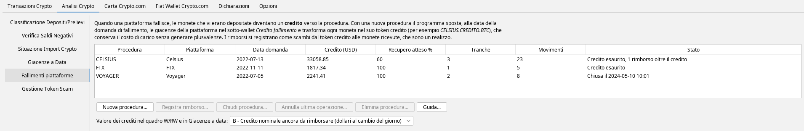

L'elenco mostra le procedure create, con il credito in dollari, il recupero atteso, le tranche registrate, i
movimenti generati e lo stato:

- *Aperta, residuo X%*: la parte di credito non ancora consumata dai rimborsi.
- *Credito esaurito*: i rimborsi hanno consumato tutto il credito (con l'eventuale indicazione dei rimborsi
  arrivati dopo, vedi [Rimborso a credito esaurito](#oltre-il-credito)).
- *Chiusa il …*: la procedura è stata chiusa con [Chiudi procedura](#chiusura).

Lo stato si ricava dai movimenti: se si annulla un'operazione, o se si chiude il programma senza salvare, lo
stato torna quello dei movimenti salvati.

I pulsanti in basso sono:

- **Nuova procedura...** — blocca le giacenze di una piattaforma alla data della domanda di fallimento.
- **Registra rimborso...** — registra una tranche pagata dalla procedura selezionata.
- **Chiudi procedura...** — fa uscire il credito non rimborsato.
- **Annulla ultima operazione...** — toglie la chiusura o l'ultimo rimborso.
- **Elimina procedura...** — toglie tutti i movimenti della procedura e i suoi dati.
- **Guida...** — apre questa guida.

Sotto i pulsanti si sceglie il [valore dei crediti](#valore-del-credito) nel quadro W/RW e in *Giacenze a data*.

## Prima di iniziare {#prima-di-iniziare}

- Importare **tutti i movimenti della piattaforma fino alla data della domanda di fallimento**: il programma
  blocca le giacenze che risultano a quella data, sotto-wallet per sotto-wallet.
- Importare anche i **depositi con cui sono arrivati i rimborsi** sulle altre piattaforme del programma
  (Coinbase, Kraken...) e **lasciarli da classificare**: la registrazione del rimborso li abbina da sola. Gli
  euro arrivati su un conto che non è nel programma, come un bonifico in banca o PayPal, si registrano senza
  deposito (vedi [Un rimborso in euro ricevuti fuori dal programma](#rimborso-in-euro)).
- La data della domanda di fallimento si trova nei documenti della procedura (per Celsius il 13 luglio 2022,
  per Voyager il 5 luglio 2022, per FTX l'11 novembre 2022).

## Caso 1: Celsius, più monete, euro e un conto Custody {#caso-1-celsius}

Su Celsius, alla data della domanda, c'erano:

| **Sotto-wallet** | **Moneta** | **Quantità** | **Costo di carico** |
|---|---|---|---|
| Earn | BTC | 0,8 | 21.600 € |
| Earn | ETH | 10 | 15.000 € |
| Earn | EUR | 7.000 | |
| Custody | BTC | 0,2 | 3.200 € |

Il conto Custody è stato restituito per intero nel marzo 2023. Gli altri saldi sono diventati un credito,
rimborsato poi in tre tranche.

### 1. Il blocco alla data della domanda {#blocco}

Con **Nuova procedura...** si sceglie la piattaforma, si scrive la data della domanda e si preme
**Leggi le giacenze**.

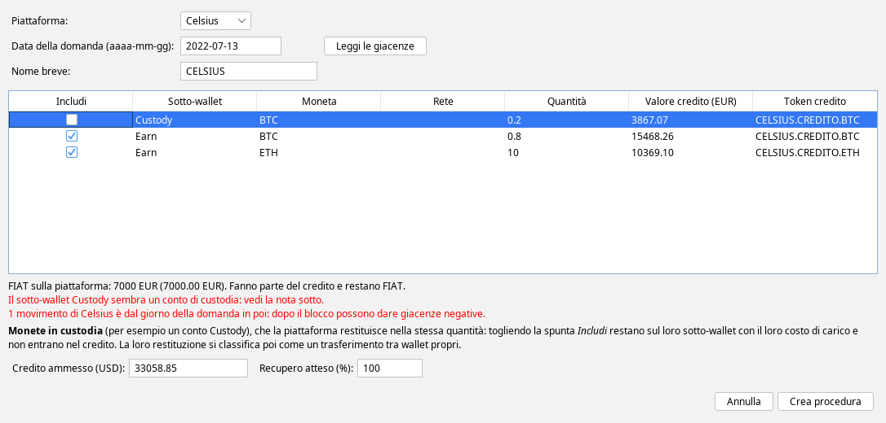

La tabella mostra le giacenze di ogni sotto-wallet alla data della domanda, con:

- **Includi**: togliendo la spunta la posizione resta fuori dal credito.
- **Valore credito (EUR)**: il valore della moneta alla data della domanda, modificabile se il credito
  ammesso dalla procedura è diverso.
- **Token credito**: il nome del token che prenderà il posto della moneta. Più sotto-wallet con la stessa
  moneta finiscono nello stesso token.

Sotto la tabella:

- i **FIAT** sulla piattaforma (qui 7.000 €) fanno parte del credito ma restano FIAT: non diventano un token.
- gli **avvisi in rosso** segnalano un sotto-wallet che sembra un conto di custodia e i movimenti della
  piattaforma successivi alla data della domanda (dopo il blocco quei movimenti possono dare giacenze
  negative, e vanno controllati).
- il **Credito ammesso (USD)** è proposto convertendo in dollari il valore in euro al cambio del giorno. Va
  corretto con il credito ammesso dalla procedura, se lo si conosce: serve al valore del credito nel quadro
  W/RW (scelta B) e alla proposta dei dollari pagati da ogni tranche.
- il **Recupero atteso (%)** è la parte del credito che si pensa di ricevere in tutto. Il valore predefinito è
  100% e si può cambiare anche dopo, a ogni rimborso (vedi [più avanti](#rimborso-in-cripto)).

**Il conto Custody.** Le monete in custodia, che la piattaforma restituisce nella stessa quantità, si
escludono togliendo la spunta *Includi*. Restano sul loro sotto-wallet con il loro costo di carico e non
entrano nel credito. Nell'esempio, togliendo il Custody il credito proposto scende da 36.952,01 a
33.058,85 dollari.

Con **Crea procedura** il programma scrive i movimenti del blocco:

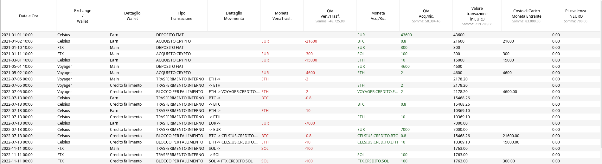

- alla mezzanotte della data della domanda le giacenze passano con un **trasferimento interno** nel
  sotto-wallet *Credito fallimento* della piattaforma, euro compresi.
- subito dopo ogni moneta viene scambiata con il suo token credito (**BLOCCO PER FALLIMENTO**): il costo di
  carico passa al token (21.600 € a *CELSIUS.CREDITO.BTC*, 15.000 € a *CELSIUS.CREDITO.ETH*) e la
  plusvalenza è zero.

Nella stessa tabella si vedono anche i blocchi di Voyager e di FTX, creati allo stesso modo.

### 2. La restituzione del conto Custody {#custody}

Il conto Custody, escluso dal blocco, è tornato con un prelievo da Celsius e un deposito su Coinbase. Si
classifica come un normale trasferimento fra wallet di proprietà, da **Analisi Crypto – Classificazione
Depositi/Prelievi** (vedi il manuale [Classificazione dei movimenti](classificazioni-movimenti.html)):

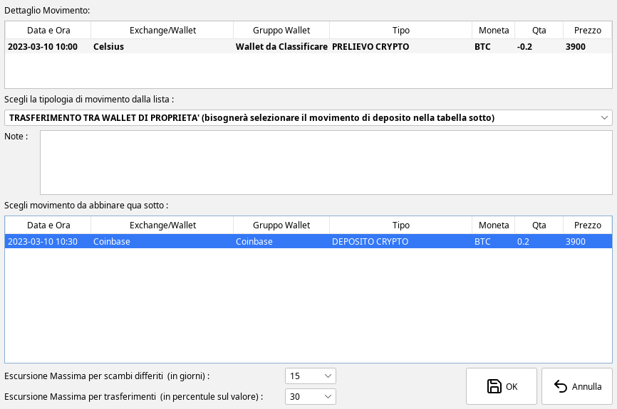

I BTC arrivano su Coinbase con il loro costo di carico di 3.200 €, senza plusvalenze.

### 3. Un rimborso in monete diverse arrivato su un altro exchange {#rimborso-in-cripto}

La prima tranche di Celsius ha pagato il 57,65% del credito: 0,25 BTC e 1,9 ETH arrivati su Coinbase il
15 gennaio 2024. Si seleziona la procedura e si preme **Registra rimborso...**:

- **Data e ora**: il momento del rimborso, almeno un minuto prima dei depositi su cui è arrivato.
- **Percentuale del credito pagata**: la percentuale indicata dalla procedura per questa tranche.
- **Dollari pagati**: proposti come percentuale per credito ammesso, si possono correggere.
- **Recupero atteso (%)**: nell'esempio 60%, la stima del recupero totale fatta a questa data.

Con **Aggiungi da deposito importato...** si sceglie ogni deposito su cui sono arrivate le monete. L'elenco
mostra i depositi non ancora classificati su altre piattaforme dalla data della domanda in poi:

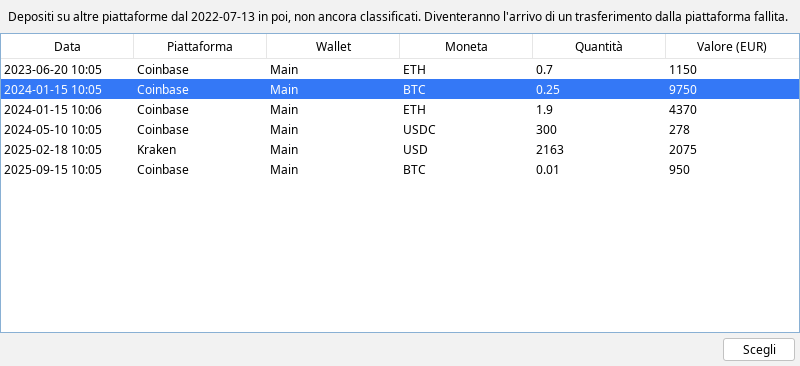

Con **Anteprima** il programma mostra le righe che scriverà, prima di scriverle:

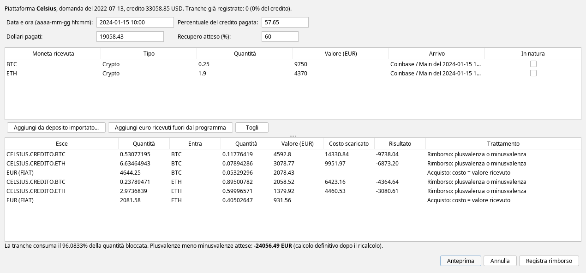

Come si legge l'anteprima:

- **quanto credito consuma la tranche**: la percentuale pagata divisa per il recupero atteso, qui
  57,65 ÷ 60 = 96,0833% del credito. Con il recupero atteso al 100% consumerebbe il 57,65%. Ogni token credito
  (e gli euro del credito) esce nella stessa proporzione.
- **come si divide il valore ricevuto**: in proporzione al peso di ogni parte del credito alla data della
  domanda (BTC, ETH ed euro).
- le righe **Rimborso** sono scambi dal token credito alla moneta ricevuta: il costo scaricato è la quota
  di costo di carico del token, il risultato è la plusvalenza o la minusvalenza (qui negativa, perché i
  BTC e gli ETH erano stati comprati a prezzi più alti).
- le righe **Acquisto** sono la quota degli euro del credito: un acquisto della moneta ricevuta con quegli
  euro, con costo di carico pari al valore ricevuto.

Con **Registra rimborso** il programma scrive le righe sul sotto-wallet *Credito fallimento* e abbina ogni
moneta ricevuta al suo deposito su Coinbase come trasferimento fra wallet di proprietà: le monete arrivano su
Coinbase con costo di carico pari al valore ricevuto.

Il recupero atteso scritto in una tranche vale da quella tranche in poi e resta salvato nella procedura. Se
la stima cambia, si corregge alla tranche successiva: le tranche già registrate non cambiano.

### 4. Un rimborso in euro ricevuti fuori dal programma {#rimborso-in-euro}

La seconda tranche di Celsius, il 2,75% del credito, è arrivata con 940 € su PayPal, un conto che non è nel
programma. Si usa **Aggiungi euro ricevuti fuori dal programma** e si scrivono quantità e valore:

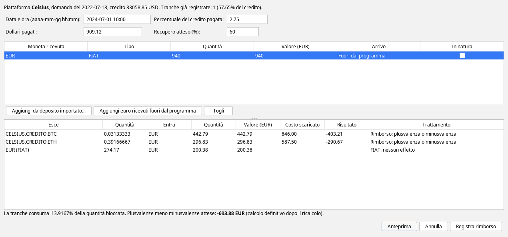

Con il recupero atteso al 60% la tranche consumerebbe 2,75 ÷ 60 = 4,58% del credito, ma ne restava solo il
3,9167%: la tranche consuma il residuo e **il credito è esaurito**. Gli euro escono dalla piattaforma con un
prelievo, perché il programma non segue il conto su cui sono arrivati.

Nell'elenco la procedura risulta *Credito esaurito*.

### 5. Un rimborso arrivato a credito esaurito {#oltre-il-credito}

Più di un anno dopo, con il credito già esaurito, arrivano altri 0,01 BTC (950 €) su Coinbase. Si registra
come gli altri rimborsi:

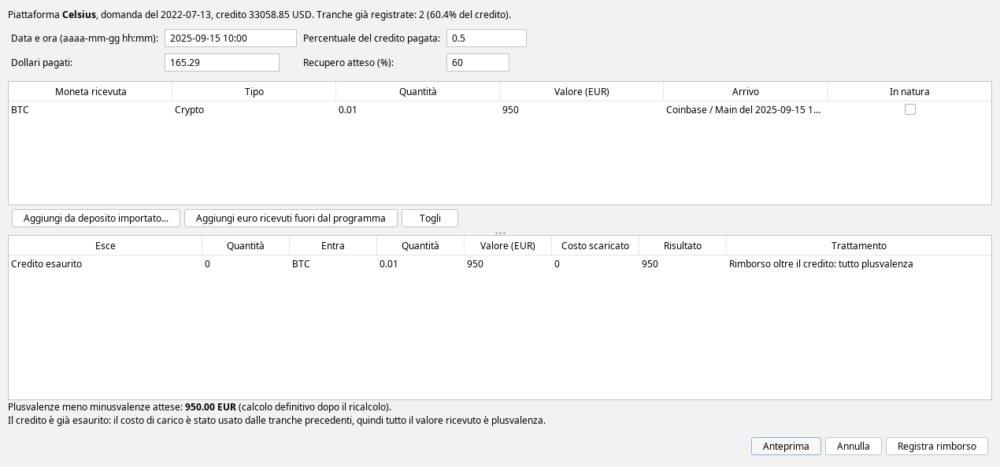

Il costo di carico del credito è già stato usato tutto dalle tranche precedenti, quindi il rimborso ha costo
zero e **tutto il valore ricevuto è plusvalenza**. Il programma lo scrive come un deposito sul sotto-wallet
*Credito fallimento* (tipo *RIMBORSO OLTRE IL CREDITO*), seguito dal trasferimento verso Coinbase: i BTC
arrivano su Coinbase con costo di carico pari al loro valore, 950 €. Lo stesso vale per un rimborso in euro.

Registrato da qui resta un rimborso della procedura e non dipende dalle opzioni delle reward.

Nell'elenco lo stato diventa *Credito esaurito, 1 rimborso oltre il credito*.

## Caso 2: FTX, rimborso oltre il 100% {#caso-2-ftx}

Su FTX c'erano 100 SOL comprati per 300 €. Alla data della domanda, l'11 novembre 2022, valevano 1.763 €,
cioè 1.817,34 dollari di credito. Nel febbraio 2025 la procedura ha pagato il 119% del credito: 2.163 dollari
(2.075 €), arrivati su Kraken.

Si registra il rimborso con la percentuale 119 e il deposito in dollari su Kraken:

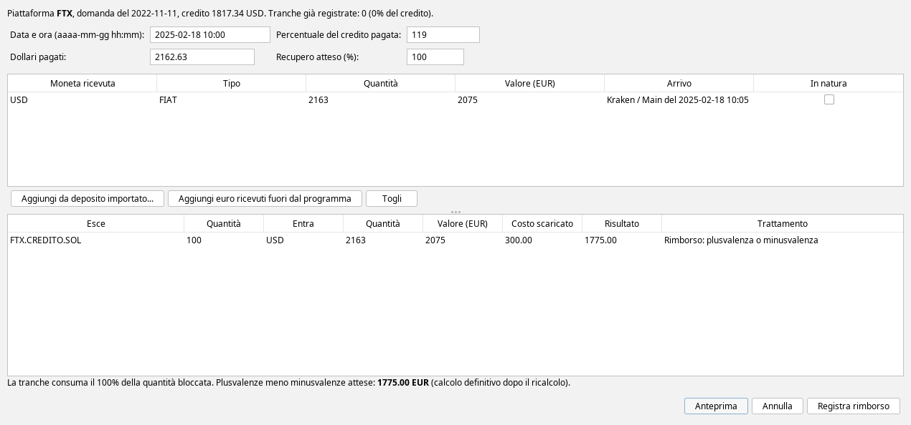

La tranche consuma tutto il credito (non può consumarne più del 100%) e la plusvalenza è la differenza fra il
valore ricevuto e il costo di carico: 2.075 - 300 = 1.775 €. Un rimborso superiore al credito non richiede
nulla di particolare.

## Caso 3: Voyager, restituzione in natura e chiusura {#caso-3-voyager}

Su Voyager c'erano 2 ETH comprati per 4.600 €.

### Restituzione in natura {#in-natura}

La prima tranche, il 35% del credito, è stata restituita nella stessa moneta: 0,7 ETH arrivati su Coinbase.
Spuntando **In natura** sulla riga della moneta ricevuta, il rimborso viene trattato come un giroconto invece
che come un realizzo:

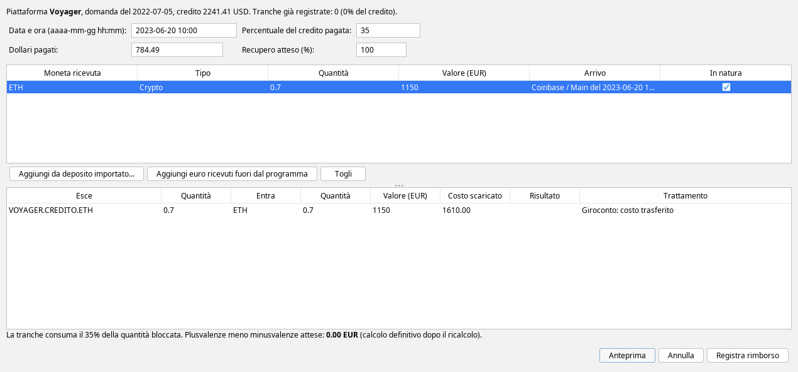

Il costo di carico del credito consumato (1.610 €, il 35% di 4.600) passa agli ETH ricevuti e la plusvalenza
è zero.

La spunta *In natura* è disponibile solo per la stessa moneta che era bloccata, e solo se il credito è di una
moneta sola (niente altre monete né euro): con più parti il rimborso si dividerebbe fra tutte. Per una
posizione restituita nella stessa quantità, come un conto Custody, la via è escluderla dal blocco (vedi
[La restituzione del conto Custody](#custody)).

### Chiusura della procedura {#chiusura}

Quando si ritiene che la procedura non pagherà altro, si seleziona e si preme **Chiudi procedura...**. Il
programma propone come data un minuto dopo l'ultimo movimento della procedura, e la si può cambiare. Nell'esempio
si chiude alla fine del 2023:

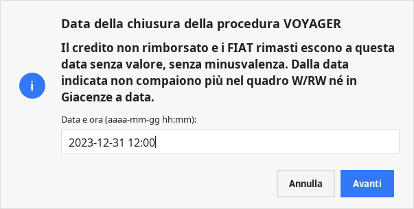

Prima di scrivere, mostra cosa esce senza valore e il costo residuo che non viene dedotto:

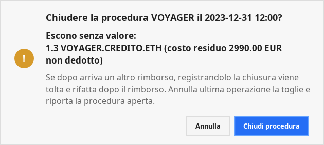

Alla chiusura il credito non rimborsato (qui 1,3 *VOYAGER.CREDITO.ETH*, con 2.990 € di costo) e gli eventuali
euro rimasti escono senza valore e **senza minusvalenza**. Dalla data della chiusura il credito non compare
più nel quadro W/RW né in *Giacenze a data*.

### Un rimborso arrivato dopo la chiusura {#dopo-la-chiusura}

Qualche mese dopo la chiusura Voyager paga un altro 5% del credito: 300 USDC su Coinbase. Si registra come
gli altri rimborsi:

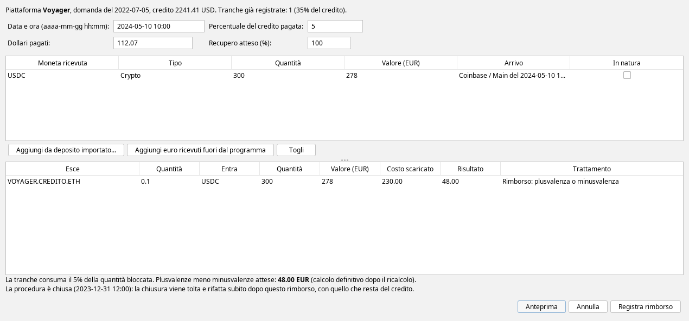

Il rimborso usa il credito che c'era prima della chiusura: consuma 0,1 token con il loro costo di 230 € e la
plusvalenza è 278 - 230 = 48 €. Prima di registrare il programma chiede conferma:

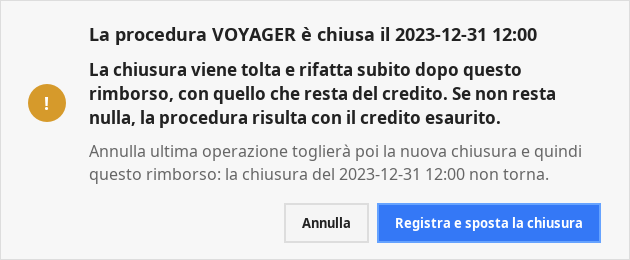

Confermando, la chiusura viene tolta e rifatta subito dopo il rimborso, con quello che resta del credito
(qui 1,2 token). Se non resta più nulla, la procedura risulta con il credito esaurito invece che chiusa.

## Annullare un'operazione {#annullare}

**Annulla ultima operazione...** toglie l'ultima operazione della procedura selezionata: la chiusura, se c'è,
altrimenti l'ultimo rimborso. Si può ripetere per tornare indietro una tranche alla volta.

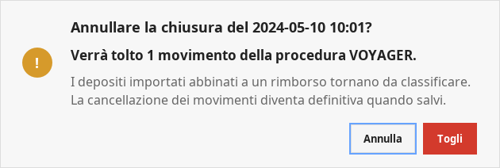

- I depositi importati che erano stati abbinati al rimborso tornano da classificare, pronti per una nuova
  registrazione.
- Dopo uno [spostamento della chiusura](#dopo-la-chiusura), annullando si toglie prima la nuova chiusura e
  poi il rimborso: la chiusura originale non torna e va rifatta con *Chiudi procedura*.
- Quando resta solo il blocco, la procedura si toglie con **Elimina procedura...**, che toglie tutti i suoi
  movimenti e i dati del piano.

Come ogni modifica ai movimenti, gli annullamenti diventano definitivi quando si salva.

## Il valore del credito nel quadro W/RW e in Giacenze a data {#valore-del-credito}

Finché il token credito è in giacenza compare nel quadro W/RW e in *Giacenze a data*. In *Giacenze a data* al
31/12/2023 dell'esempio:

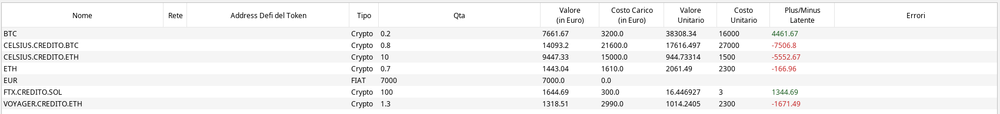

Il valore si sceglie in fondo alla scheda *Fallimenti piattaforme*:

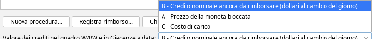

- **B – Credito nominale ancora da rimborsare** (predefinito): il credito ammesso in dollari meno le tranche
  già pagate, al cambio del giorno, diviso fra le monete in proporzione al loro valore alla data della
  domanda. Nell'esempio, a fine 2023 gli 0,8 *CELSIUS.CREDITO.BTC* valgono 14.093,20 €.
- **A – Prezzo della moneta bloccata**: il prezzo di mercato della moneta che era depositata, che può essere
  molto diverso dal credito.
- **C – Costo di carico**: il costo di carico trasferito al credito.

Nell'esempio, il quadro W/RW 2023 del gruppo con le tre piattaforme ha un valore finale di 26.503,73 € con la
scelta B e di 39.890 € con la scelta C.

La scelta non cambia plusvalenze e minusvalenze. Dopo un cambio, un quadro W/RW o una tabella di *Giacenze a
data* già calcolati mostrano l'avviso di ricalcolo. Negli anni in cui c'è un credito la scelta compare fra
le opzioni stampate in fondo al quadro e nell'[archivio delle dichiarazioni](opzioni-calcolo-rw.html#archivio-delle-dichiarazioni).

Una restituzione in natura continua il periodo di detenzione del credito: con i metodi a media ponderata
del quadro W/RW il valore iniziale delle monete restituite viene dal valore del credito a inizio anno, quindi
dipende anche dalla scelta.

## Limiti e cose da sapere {#limiti}

- **Il nome del token credito è solo un'etichetta**: il programma riconosce i token credito dalle righe del
  blocco. Due monete con lo stesso simbolo su reti diverse diventano per esempio *CELSIUS.CREDITO.USDC* e
  *CELSIUS.CREDITO.USDC-2*.
- **Le tranche vanno registrate in ordine di data**: un rimborso non può essere precedente all'ultimo già
  registrato.
- **Più valute FIAT sulla piattaforma**: la quota FIAT del credito si divide fra le valute in proporzione
  alla quantità, senza un cambio per valuta.
- **Trasla Orario** non sposta i movimenti di una procedura.
- **Movimenti della piattaforma dopo la data della domanda**: dopo il blocco la piattaforma ha giacenza zero,
  quindi un movimento successivo (per esempio un interesse accreditato dopo la domanda) dà una giacenza
  negativa da sistemare.
