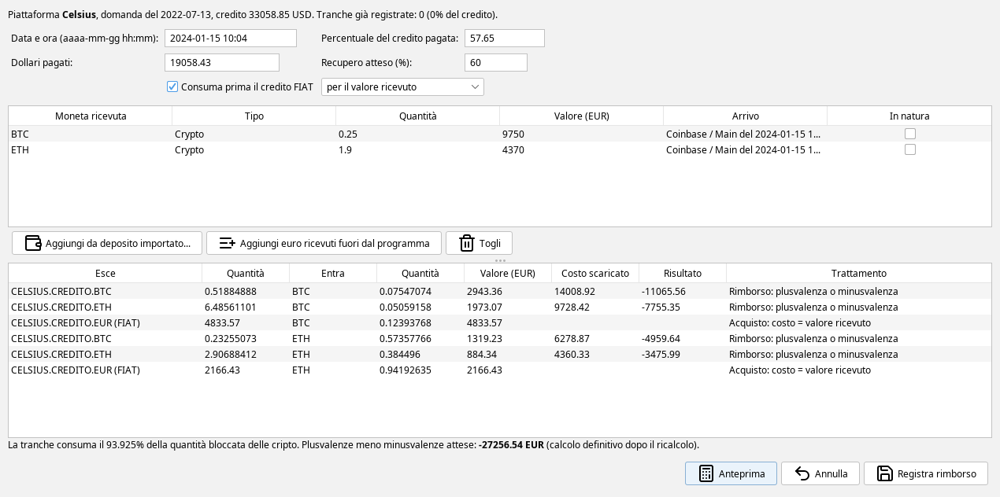

# Fallimenti delle piattaforme (Celsius, FTX e simili)

- [Introduzione](#introduzione)
- [Dove si trova](#dove-si-trova)
- [Prima di iniziare](#prima-di-iniziare)
- [Caso 1: Celsius, più monete, euro e un conto Custody](#caso-1-celsius)
- [Caso 2: FTX, rimborso oltre il 100%](#caso-2-ftx)
- [Caso 3: Voyager, restituzione in natura e chiusura](#caso-3-voyager)
- [Il credito in euro e "Consuma prima il credito FIAT"](#credito-in-euro)
- [Annullare un'operazione](#annullare)
- [Il valore del credito nel quadro W/RW e in Giacenze a data](#valore-del-credito)
- [Limiti e cose da sapere](#limiti)

## Introduzione {#introduzione}

Quando una piattaforma fallisce, le monete che vi erano depositate non sono più disponibili: diventano un
**credito** verso la procedura di fallimento, che restituisce poi una parte del valore a rate (tranche), spesso
in monete diverse da quelle depositate, in dollari o in euro.

Il programma gestisce questi casi dalla scheda *Fallimenti piattaforme*. Il funzionamento in breve:

- **alla data della domanda di fallimento** ogni moneta depositata viene scambiata con un **token credito**
  dal nome riconoscibile, per esempio *CELSIUS.CREDITO.BTC*. Lo scambio non genera plusvalenze: il token
  credito eredita il costo di carico della moneta. Gli euro (e le altre valute) diventano un **credito in
  valuta**, per esempio *CELSIUS.CREDITO.EUR*, che resta FIAT.
- **ogni rimborso** è uno scambio dal token credito alle monete ricevute. Lo scambio è un realizzo, quindi
  genera una plusvalenza o una minusvalenza pari alla differenza fra il valore ricevuto e la quota di costo
  del credito che il rimborso consuma.
- **alla chiusura della procedura** il credito non rimborsato esce senza valore e senza minusvalenza.
- nel **quadro W/RW** e in *Giacenze a data* il token credito compare finché resta in giacenza, con il valore
  scelto nelle opzioni (vedi [Il valore del credito](#valore-del-credito)).

Tutte le righe create dalla procedura sono movimenti normali, visibili nella tabella dei movimenti e
modificabili come gli altri. La guida descrive cosa calcola il programma con ogni scelta: le valutazioni
fiscali del proprio caso restano dell'utente.

Gli esempi usano dati inventati: tre piattaforme (Celsius, FTX e Voyager), importi e quantità di fantasia,
prezzi di mercato veri alle date indicate.

## Dove si trova {#dove-si-trova}

La funzione si trova in **Analisi Crypto – Fallimenti piattaforme**, subito sotto *Giacenze a Data*.

La scheda ha tre tabelle, una sotto l'altra: le procedure, i rimborsi della procedura selezionata e i
movimenti del rimborso selezionato.

L'elenco delle procedure mostra le procedure create, con il credito in dollari, il recupero atteso, le tranche registrate, i
movimenti generati e lo stato:

- *Aperta, residuo X%*: la parte di credito non ancora consumata dai rimborsi.
- *Credito esaurito*: i rimborsi hanno consumato tutto il credito (con l'eventuale indicazione dei rimborsi
  arrivati dopo, vedi [Rimborso a credito esaurito](#oltre-il-credito)).
- *Chiusa il …*: la procedura è stata chiusa con [Chiudi procedura](#chiusura).

Lo stato si ricava dai movimenti: se si annulla un'operazione, o se si chiude il programma senza salvare, lo
stato torna quello dei movimenti salvati.

Sotto l'elenco, la tabella dei **rimborsi registrati** mostra quelli della procedura selezionata, uno per riga,
e per ultima l'eventuale chiusura:

- **% pagata** e **Dollari**: come sono stati scritti registrando la tranche.
- **Monete ricevute** e **Arrivo**: le monete ricevute e il deposito a cui sono state abbinate (piattaforma e
  wallet), oppure *fuori dal programma*.
- **Valore (EUR)** e **Plus/minus (EUR)**: il valore ricevuto e il risultato fiscale del rimborso, come li ha
  lasciati l'ultimo ricalcolo.
- **Movimenti**: quanti movimenti ha scritto la procedura per quel rimborso.

Selezionando un rimborso, l'ultima tabella mostra **tutti i suoi movimenti**: quelli scritti sul sotto-wallet
*Credito fallimento* (gli scambi dal token credito, gli acquisti con il credito in euro, le uscite delle
monete ricevute) e i depositi importati a cui sono stati abbinati, con il valore e la plusvalenza o la
minusvalenza di ognuno.

I pulsanti in basso sono:

- **Nuova procedura...** — blocca le giacenze di una piattaforma alla data della domanda di fallimento.
- **Registra rimborso...** — registra una tranche pagata dalla procedura selezionata.
- **Chiudi procedura...** — fa uscire il credito non rimborsato.
- **Annulla ultima operazione...** — toglie la chiusura o l'ultimo rimborso.
- **Elimina procedura...** — toglie tutti i movimenti della procedura e i suoi dati.
- **Guida...** — apre questa guida.

Sotto i pulsanti si sceglie il [valore dei crediti](#valore-del-credito) nel quadro W/RW e in *Giacenze a data*.

## Prima di iniziare {#prima-di-iniziare}

- Importare **tutti i movimenti della piattaforma fino alla data della domanda di fallimento**: il programma
  blocca le giacenze che risultano a quella data, sotto-wallet per sotto-wallet.
- Importare anche i **depositi con cui sono arrivati i rimborsi** sulle altre piattaforme del programma
  (Coinbase, Kraken...) e **lasciarli da classificare**: la registrazione del rimborso li abbina da sola. Gli
  euro arrivati su un conto che non è nel programma, come un bonifico in banca o PayPal, si registrano senza
  deposito (vedi [Un rimborso in euro ricevuti fuori dal programma](#rimborso-in-euro)).
- La data della domanda di fallimento si trova nei documenti della procedura (per Celsius il 13 luglio 2022,
  per Voyager il 5 luglio 2022, per FTX l'11 novembre 2022).

## Caso 1: Celsius, più monete, euro e un conto Custody {#caso-1-celsius}

Su Celsius, alla data della domanda, c'erano:

| **Sotto-wallet** | **Moneta** | **Quantità** | **Costo di carico** |
|---|---|---|---|
| Earn | BTC | 0,8 | 21.600 € |
| Earn | ETH | 10 | 15.000 € |
| Earn | EUR | 7.000 | |
| Custody | BTC | 0,2 | 3.200 € |

Il conto Custody è stato restituito per intero nel marzo 2023. Gli altri saldi sono diventati un credito,
rimborsato poi in tre tranche.

### 1. Il blocco alla data della domanda {#blocco}

Con **Nuova procedura...** si sceglie la piattaforma, si scrive la data della domanda e si preme
**Leggi le giacenze**.

La tabella mostra le giacenze di ogni sotto-wallet alla data della domanda, monete ed euro, con:

- **Includi**: togliendo la spunta la posizione resta fuori dal credito.
- **Tipo**: *Crypto* per le monete, *FIAT* per gli euro e le altre valute.
- **Valore credito (EUR)**: il valore della moneta alla data della domanda, modificabile se il credito
  ammesso dalla procedura è diverso. Per gli euro è la quantità.
- **Token credito**: il nome del token che prenderà il posto della moneta. Più sotto-wallet con la stessa
  moneta finiscono nello stesso token. Gli euro diventano *CELSIUS.CREDITO.EUR*, un credito in valuta che
  resta FIAT: nei rimborsi si vede lo scambio dal credito in euro alla moneta ricevuta.

Sotto la tabella:

- gli **avvisi in rosso** segnalano un sotto-wallet che sembra un conto di custodia e i movimenti della
  piattaforma successivi alla data della domanda (dopo il blocco quei movimenti possono dare giacenze
  negative, e vanno controllati).
- il **Credito ammesso (USD)** è proposto convertendo in dollari il valore in euro al cambio del giorno. Va
  corretto con il credito ammesso dalla procedura, se lo si conosce: serve al valore del credito nel quadro
  W/RW (scelta B) e alla proposta dei dollari pagati da ogni tranche.
- il **Recupero atteso (%)** è la parte del credito che si pensa di ricevere in tutto. Il valore predefinito è
  100% e si può cambiare anche dopo, a ogni rimborso (vedi [più avanti](#rimborso-in-cripto)).

**Il conto Custody.** Le monete in custodia, che la piattaforma restituisce nella stessa quantità, si
escludono togliendo la spunta *Includi*. Restano sul loro sotto-wallet con il loro costo di carico e non
entrano nel credito. Nell'esempio, togliendo il Custody il credito proposto scende da 36.952,01 a
33.058,85 dollari.

Con **Crea procedura** il programma scrive i movimenti del blocco:

- alla mezzanotte della data della domanda le giacenze passano con un **trasferimento interno** nel
  sotto-wallet *Credito fallimento* della piattaforma, euro compresi.
- subito dopo ogni moneta viene scambiata con il suo token credito (**BLOCCO PER FALLIMENTO**): il costo di
  carico passa al token (21.600 € a *CELSIUS.CREDITO.BTC*, 15.000 € a *CELSIUS.CREDITO.ETH*) e la
  plusvalenza è zero. Gli euro passano a *CELSIUS.CREDITO.EUR* con uno scambio fra valute, senza effetti
  fiscali.

Nella stessa tabella si vedono anche i blocchi di Voyager e di FTX, creati allo stesso modo.

### 2. La restituzione del conto Custody {#custody}

Il conto Custody, escluso dal blocco, è tornato con un prelievo da Celsius e un deposito su Coinbase. Si
classifica come un normale trasferimento fra wallet di proprietà, da **Analisi Crypto – Classificazione
Depositi/Prelievi** (vedi il manuale [Classificazione dei movimenti](classificazioni-movimenti.html)):

I BTC arrivano su Coinbase con il loro costo di carico di 3.200 €, senza plusvalenze.

### 3. Un rimborso in monete diverse arrivato su un altro exchange {#rimborso-in-cripto}

La prima tranche di Celsius ha pagato il 57,65% del credito: 0,25 BTC e 1,9 ETH arrivati su Coinbase il
15 gennaio 2024. Si seleziona la procedura e si preme **Registra rimborso...**:

- **Data e ora**: il momento del rimborso, prima dei depositi su cui è arrivato. Si scrive
  come *aaaa-mm-gg hh:mm* o *gg/mm/aaaa hh:mm*; senza l'ora vale la mezzanotte. Scegliendo un deposito, il
  programma la propone da solo.
- **Percentuale del credito pagata** e **Dollari pagati**: basta scriverne uno, l'altro si ricava dal credito
  ammesso. La procedura annuncia la percentuale di ogni distribuzione, mentre la comunicazione al singolo
  creditore riporta di solito l'importo in dollari.
- **Recupero atteso (%)**: nell'esempio 60%, la stima del recupero totale fatta a questa data.
- **Consuma prima il credito FIAT**: compare quando nel credito ci sono anche euro, ed è spuntata, con accanto la
  scelta *per il valore ricevuto* o *secondo la percentuale pagata*. In questo esempio è tolta, per mostrare la
  ripartizione in proporzione: spunta e scelta sono spiegate in [Il credito in euro](#credito-in-euro).

Con **Aggiungi da deposito importato...** si sceglie ogni deposito su cui sono arrivate le monete. L'elenco
mostra i depositi non ancora classificati su altre piattaforme dalla data della domanda in poi. Un clic
sull'intestazione ordina le colonne, il clic destro filtra una colonna per valore e il campo *Cerca* tiene
solo le righe che contengono il testo scritto. Il deposito si sceglie con **Scegli** o con un doppio clic:

Con **Anteprima** il programma mostra le righe che scriverà, prima di scriverle:

Come si legge l'anteprima:

- **quanto credito consuma la tranche**: la percentuale pagata divisa per il recupero atteso, qui
  57,65 ÷ 60 = 96,0833% del credito. Con il recupero atteso al 100% consumerebbe il 57,65%. Ogni token credito,
  anche quello in euro, esce nella stessa proporzione.
- **come si divide il valore ricevuto**: in proporzione al peso di ogni parte del credito alla data della
  domanda (BTC, ETH ed euro).
- le righe **Rimborso** sono scambi dal token credito alla moneta ricevuta: il costo scaricato è la quota
  di costo di carico del token, il risultato è la plusvalenza o la minusvalenza (qui negativa, perché i
  BTC e gli ETH erano stati comprati a prezzi più alti).
- le righe **Acquisto** sono la quota del credito in euro: un acquisto della moneta ricevuta con
  *CELSIUS.CREDITO.EUR*, con costo di carico pari al valore ricevuto.

Con **Registra rimborso** il programma scrive le righe sul sotto-wallet *Credito fallimento* e abbina ogni
moneta ricevuta al suo deposito su Coinbase come trasferimento fra wallet di proprietà: le monete arrivano su
Coinbase con costo di carico pari al valore ricevuto.

Il recupero atteso scritto in una tranche vale da quella tranche in poi e resta salvato nella procedura. Se
la stima cambia, si corregge alla tranche successiva: le tranche già registrate non cambiano.

### 4. Un rimborso in euro ricevuti fuori dal programma {#rimborso-in-euro}

La seconda tranche di Celsius, il 2,75% del credito, è arrivata con 940 € su PayPal, un conto che non è nel
programma. Si usa **Aggiungi euro ricevuti fuori dal programma** e si scrivono quantità e valore:

Con il recupero atteso al 60% la tranche consumerebbe 2,75 ÷ 60 = 4,58% del credito, ma ne restava solo il
3,9167%: la tranche consuma il residuo e **il credito è esaurito**. La quota del credito in euro è uno scambio
da *CELSIUS.CREDITO.EUR* agli euro ricevuti, senza effetti. Gli euro escono dalla piattaforma con un prelievo,
perché il programma non segue il conto su cui sono arrivati.

Nell'elenco la procedura risulta *Credito esaurito*.

### 5. Un rimborso arrivato a credito esaurito {#oltre-il-credito}

Più di un anno dopo, con il credito già esaurito, arrivano altri 0,01 BTC (950 €) su Coinbase. Si registra
come gli altri rimborsi, ma il dialogo chiede solo la data e le monete ricevute: **percentuale, dollari pagati
e recupero atteso non servono**, perché non c'è più credito da consumare.

Il costo di carico del credito è già stato usato tutto dalle tranche precedenti, quindi il rimborso ha costo
zero e **tutto il valore ricevuto è plusvalenza**. Il programma lo scrive come un deposito sul sotto-wallet
*Credito fallimento* (tipo *RIMBORSO OLTRE IL CREDITO*), seguito dal trasferimento verso Coinbase: i BTC
arrivano su Coinbase con costo di carico pari al loro valore, 950 €. Lo stesso vale per un rimborso in euro.

Registrato da qui resta un rimborso della procedura e non dipende dalle opzioni delle reward. Nella tabella
dei rimborsi compare come *Oltre il credito*, con la percentuale e i dollari vuoti, e il credito in dollari
della procedura non cambia.

Nell'elenco lo stato diventa *Credito esaurito, 1 rimborso oltre il credito*.

## Caso 2: FTX, rimborso oltre il 100% {#caso-2-ftx}

Su FTX c'erano 100 SOL comprati per 300 €. Alla data della domanda, l'11 novembre 2022, valevano 1.763 €,
cioè 1.817,34 dollari di credito. Nel febbraio 2025 la procedura ha pagato il 119% del credito: 2.163 dollari
(2.075 €), arrivati su Kraken.

Si registra il rimborso con la percentuale 119 e il deposito in dollari su Kraken:

La tranche consuma tutto il credito (non può consumarne più del 100%) e la plusvalenza è la differenza fra il
valore ricevuto e il costo di carico: 2.075 - 300 = 1.775 €. Un rimborso superiore al credito non richiede
nulla di particolare.

## Caso 3: Voyager, restituzione in natura e chiusura {#caso-3-voyager}

Su Voyager c'erano 2 ETH comprati per 4.600 €.

### Restituzione in natura {#in-natura}

La prima tranche, il 35% del credito, è stata restituita nella stessa moneta: 0,7 ETH arrivati su Coinbase.
Spuntando **In natura** sulla riga della moneta ricevuta, il rimborso viene trattato come un giroconto invece
che come un realizzo:

Il costo di carico del credito consumato (1.610 €, il 35% di 4.600) passa agli ETH ricevuti e la plusvalenza
è zero.

La spunta *In natura* è disponibile solo per la stessa moneta che era bloccata, e solo se il credito è di una
moneta sola (niente altre monete né credito in euro): con più parti il rimborso si dividerebbe fra tutte. Per una
posizione restituita nella stessa quantità, come un conto Custody, la via è escluderla dal blocco (vedi
[La restituzione del conto Custody](#custody)).

### Chiusura della procedura {#chiusura}

Quando si ritiene che la procedura non pagherà altro, si seleziona e si preme **Chiudi procedura...**. Il
programma propone come data un minuto dopo l'ultimo movimento della procedura, e la si può cambiare. Nell'esempio
si chiude alla fine del 2023:

Prima di scrivere, mostra cosa esce senza valore e il costo residuo che non viene dedotto:

Alla chiusura il credito non rimborsato (qui 1,3 *VOYAGER.CREDITO.ETH*, con 2.990 € di costo) e l'eventuale
credito in euro rimasto escono senza valore e **senza minusvalenza**. Dalla data della chiusura il credito non compare
più nel quadro W/RW né in *Giacenze a data*.

### Un rimborso arrivato dopo la chiusura {#dopo-la-chiusura}

Qualche mese dopo la chiusura Voyager paga un altro 5% del credito: 300 USDC su Coinbase. Si registra come
gli altri rimborsi:

Il rimborso usa il credito che c'era prima della chiusura: consuma 0,1 token con il loro costo di 230 € e la
plusvalenza è 278 - 230 = 48 €. Prima di registrare il programma chiede conferma:

Confermando, la chiusura viene tolta e rifatta subito dopo il rimborso, con quello che resta del credito
(qui 1,2 token). Se non resta più nulla, la procedura risulta con il credito esaurito invece che chiusa.

## Il credito in euro e "Consuma prima il credito FIAT" {#credito-in-euro}

Gli euro rimasti sulla piattaforma sono un credito come le monete, ma restano FIAT: un rimborso che li riguarda
compra la moneta ricevuta, al suo valore, e la differenza fra quanto si riceve e gli euro del credito non è
una plusvalenza né una minusvalenza su cripto-attività. Con la ripartizione in proporzione ogni tranche dà agli
euro la loro quota del valore ricevuto, e quella differenza resta fuori dai calcoli.

Con la spunta **Consuma prima il credito FIAT**, attiva quando nel credito ci sono euro e monete:

- la tranche consuma **prima il credito in euro, alla pari, per tutto il valore ricevuto** finché ce n'è, a
  prescindere dalla percentuale: gli euro ricevono lo stesso valore che consumano, quindi non hanno differenze.
- la parte dell'importo pagato che supera gli euro consumati tocca alle cripto, che ricevono il resto del valore:
  **la differenza fra valore ricevuto e credito in euro viene attribuita alle cripto-attività**.
- il costo delle cripto si consuma in proporzione all'importo pagato che tocca loro, rispetto al recupero atteso
  tolta la parte in euro: così si esaurisce quando i rimborsi arrivano al recupero atteso.

Un esempio con un credito di 1.000 €: 200 € in euro e 800 € in BTC, con costo di carico 500 €.

**Recupero atteso 100%, tranche del 30% che vale 360 €.** La tranche paga 300 € di credito:

| | **Con la spunta** | **Senza la spunta** |
|---|---|---|
| Euro | 200 € di credito, ricevono 200 € | 60 € di credito, ricevono 72 € (12 € non contati) |
| BTC | 100 € di credito su 800 (12,5%, costo 62,50 €), ricevono 160 € | 30% del credito (costo 150 €), ricevono 288 € |
| Plusvalenza sui BTC | 97,50 € | 138 € |
| Resta | 87,5% del credito BTC, nessun credito in euro | 70% del credito BTC, 140 € di credito in euro |

**Recupero atteso 50%, due tranche del 25% che valgono 250 € ciascuna.** Il recupero atteso sulle cripto è
500 − 200 = 300 €:

| | **Con la spunta** | **Senza la spunta** |
|---|---|---|
| 1ª tranche, euro | 200 € di credito, ricevono 200 € | 100 € di credito, ricevono 50 € (−50 € non contati) |
| 1ª tranche, BTC | 50 € su 300 (16,67%, costo 83,33 €), ricevono 50 €: −33,33 € | 50% del credito (costo 250 €), ricevono 200 €: −50 € |
| 2ª tranche, BTC | 250 € su 300 (83,33%, costo 416,67 €), ricevono 250 €: −166,67 € | 50% del credito (costo 250 €), ricevono 200 €: −50 € |
| Totale sui BTC | −200 € | −100 € (e −100 € sugli euro, non contati) |

Il totale ricevuto è lo stesso: la spunta decide se la differenza degli euro entra nel calcolo sulle cripto o
resta fuori.

Nel [caso 1](#rimborso-in-cripto) di Celsius, con la spunta, la prima tranche dà agli euro tutti i 7.000 € del
credito, alla pari, invece dei 3.010 € della ripartizione in proporzione:

- gli euro comprano BTC per 4.833,57 € ed ETH per 2.166,43 €.
- alle cripto restano 7.120 € e consumano il 93,925% del credito: l'importo pagato (57,65% di 32.837,36 € =
  18.930,74 €) meno i 7.000 € degli euro, diviso per il recupero atteso sulle cripto (60% di 32.837,36 € meno
  7.000 € = 12.702,42 €).
- le minusvalenze attese sono 27.256,54 € invece di 24.056,49 €.

La spunta **non si applica**, e il rimborso si ripartisce in proporzione con un avviso nell'anteprima, in due
casi:

- quando il recupero atteso non supera il credito in euro: alle cripto non resterebbe nulla.
- quando la tranche chiude il credito cripto ma vale meno del credito in euro rimasto: gli euro non
  potrebbero tornare alla pari, e la loro differenza resta fuori dal calcolo.

**Una tranche che vale più di quanto paga.** Con lo stesso credito di 1.000 € e recupero atteso 100%, una tranche
del 10% (100 € di credito) vale 150 €, per esempio perché le monete ricevute si sono apprezzate:

- gli euro consumano 150 € alla pari, tutto il valore ricevuto, anche se la tranche paga solo 100 € di credito.
- l'importo pagato non supera gli euro consumati, quindi le cripto non cambiano e non c'è alcun risultato.
- restano 50 € di credito in euro e tutto il credito BTC: lo stato è *Aperta, residuo 85%*.

Quando arriva il resto, il 90% che vale 900 €, gli euro consumano gli ultimi 50 € e alle cripto toccano 850 € di
importo pagato, più degli 800 € di credito BTC: la tranche lo chiude, con 850 € ricevuti e 500 € di costo, una
plusvalenza di 350 €. In tutto: 1.050 € ricevuti, 200 € agli euro alla pari, 850 € alle cripto che costavano
500 €.

Altri due casi che seguono dalla stessa regola:

- una tranche che vale meno di quanto paga dà agli euro tutto il valore, alla pari, e le cripto consumano il resto
  dell'importo pagato senza ricevere nulla: una minusvalenza.
- una tranche che vale più del credito in euro rimasto ma paga meno di quello (per esempio il 10% che vale 300 €)
  chiude gli euro alla pari e dà il resto del valore alle cripto senza che consumino credito: è un rimborso oltre il
  credito consumato, tutto plusvalenza.

**Secondo la percentuale pagata.** Accanto alla spunta si può scegliere *secondo la percentuale pagata* invece di
*per il valore ricevuto*: gli euro consumano al massimo l'importo pagato dalla tranche, come indicato dalla
procedura. Nell'esempio del 10% che vale 150 €:

- gli euro consumano 100 € alla pari, l'importo pagato.
- il BTC non consuma credito e riceve i 50 € oltre l'importo pagato: è un rimborso oltre il credito consumato,
  tutto plusvalenza.
- restano 100 € di credito in euro e tutto il credito BTC: lo stato è *Aperta, residuo 90%*.

Con il resto, il 90% che vale 900 €, gli euro consumano gli ultimi 100 € e il BTC 800 €, tutto il suo credito: 800 €
ricevuti e 500 € di costo, una plusvalenza di 300 €. In tutto sono 350 €, come con l'altra scelta: cambia in quale
tranche, e quindi in quale anno, cade la plusvalenza. *Secondo la percentuale pagata* segue la percentuale
ufficiale di ogni distribuzione, *per il valore ricevuto* è più semplice da seguire.

Le tranche con e senza la spunta, e con le due scelte, si possono alternare: ogni tranche parte dal credito che resta,
euro e cripto.

## Annullare un'operazione {#annullare}

**Annulla ultima operazione...** toglie l'ultima operazione della procedura selezionata: la chiusura, se c'è,
altrimenti l'ultimo rimborso. Si può ripetere per tornare indietro una tranche alla volta.

- I depositi importati che erano stati abbinati al rimborso tornano da classificare, pronti per una nuova
  registrazione.
- Dopo uno [spostamento della chiusura](#dopo-la-chiusura), annullando si toglie prima la nuova chiusura e
  poi il rimborso: la chiusura originale non torna e va rifatta con *Chiudi procedura*.
- Quando resta solo il blocco, la procedura si toglie con **Elimina procedura...**, che toglie tutti i suoi
  movimenti e i dati del piano.

Come ogni modifica ai movimenti, gli annullamenti diventano definitivi quando si salva.

## Il valore del credito nel quadro W/RW e in Giacenze a data {#valore-del-credito}

Finché il token credito è in giacenza compare nel quadro W/RW e in *Giacenze a data*. In *Giacenze a data* al
31/12/2023 dell'esempio:

Il valore si sceglie in fondo alla scheda *Fallimenti piattaforme*:

- **B – Credito nominale ancora da rimborsare** (predefinito): il credito ammesso in dollari meno le tranche
  già pagate, al cambio del giorno, diviso fra le monete in proporzione al loro valore alla data della
  domanda. Nell'esempio, a fine 2023 gli 0,8 *CELSIUS.CREDITO.BTC* valgono 14.093,20 €.
- **A – Prezzo della moneta bloccata**: il prezzo di mercato della moneta che era depositata, che può essere
  molto diverso dal credito.
- **C – Costo di carico**: il costo di carico trasferito al credito.

Nell'esempio, il quadro W/RW 2023 del gruppo con le tre piattaforme ha un valore finale di 26.503,73 € con la
scelta B e di 39.890 € con la scelta C.

La scelta non cambia plusvalenze e minusvalenze. Dopo un cambio, un quadro W/RW o una tabella di *Giacenze a
data* già calcolati mostrano l'avviso di ricalcolo. Negli anni in cui c'è un credito la scelta compare fra
le opzioni stampate in fondo al quadro e nell'[archivio delle dichiarazioni](opzioni-calcolo-rw.html#archivio-delle-dichiarazioni).

Una restituzione in natura continua il periodo di detenzione del credito: con i metodi a media ponderata
del quadro W/RW il valore iniziale delle monete restituite viene dal valore del credito a inizio anno, quindi
dipende anche dalla scelta.

## Limiti e cose da sapere {#limiti}

- **Il nome del token credito è solo un'etichetta**: il programma riconosce i token credito dalle righe del
  blocco. Due monete con lo stesso simbolo su reti diverse diventano per esempio *CELSIUS.CREDITO.USDC* e
  *CELSIUS.CREDITO.USDC-2*.
- **Le tranche vanno registrate in ordine di data**: un rimborso non può essere precedente all'ultimo già
  registrato.
- **Più valute FIAT sulla piattaforma**: ogni valuta ha il suo credito in valuta (*CELSIUS.CREDITO.EUR*,
  *CELSIUS.CREDITO.USD*), con il valore in euro alla data della domanda. Un credito in valuta vale la sua
  valuta: l'euro alla pari, le altre al cambio del giorno, con ogni scelta del
  [valore del credito](#valore-del-credito). Nella parte FIAT del quadro W/RW resta la valuta che era sulla
  piattaforma.
- **Trasla Orario** non sposta i movimenti di una procedura.
- **Movimenti della piattaforma dopo la data della domanda**: dopo il blocco la piattaforma ha giacenza zero,
  quindi un movimento successivo (per esempio un interesse accreditato dopo la domanda) dà una giacenza
  negativa da sistemare.
