# Giacenze a data

- [A cosa serve](#a-cosa-serve)
- [Dove si trova](#dove-si-trova)
- [Scegliere cosa guardare](#scegliere)
- [La tabella dei token](#tabella)
- [Costo di carico e plus/minus latente](#costo-di-carico)
- [Token senza prezzo e prezzi da correggere](#prezzi)
- [Il dettaglio dei movimenti di un token](#dettaglio)
- [Il grafico di un token](#grafico)
- [Guardare un solo wallet](#wallet)
- [Correggere una giacenza](#rettifica)
- [Rinominare un token e segnalare i token SCAM](#nome-scam)
- [Confronto con blockchain ed exchange](#confronto)
- [I costi netti](#costi-netti)
- [Domande frequenti](#domande)
- [Limiti e cose da sapere](#limiti)

## A cosa serve {#a-cosa-serve}

*Giacenze a data* risponde alla domanda **«che cosa possedevo a questa data, e quanto valeva?»**. Per ogni token mostra:

- la **quantità** posseduta alla data scelta, sommando tutti i movimenti dell'archivio fino a quel giorno,
- il suo **valore** in euro al prezzo di quella data,
- il **costo di carico** di quella quantità, calcolato con il metodo LIFO dello stesso motore che calcola le plusvalenze,
- la differenza fra i due, il **plus/minus latente**,
- su richiesta, il **costo medio netto** (vedi [I costi netti](#costi-netti)).

Serve soprattutto a tre cose:

1. **controllare i saldi**: confrontare quello che il programma ritiene di avere con la situazione vera di un exchange o di
   un wallet, e trovare i movimenti mancanti o sbagliati,
2. **scoprire gli errori**: giacenze negative, token senza prezzo, movimenti non classificati,
3. **conoscere la situazione patrimoniale** a una data, per esempio a fine anno.

La scheda non modifica nulla da sola. Le modifiche, come la correzione di una quantità, si fanno sempre con una funzione
esplicita e vanno poi salvate dalla scheda *Transazioni Crypto*.

> Gli screenshot di questo manuale usano **dati inventati**: tre wallet di fantasia (*Alfa Exchange*, *Beta Exchange*,
> *Wallet Hardware*), quantità e importi di fantasia, prezzi di mercato veri alle date indicate. Il token *ZZDEMO* è
> inventato e non ha un prezzo.

## Dove si trova {#dove-si-trova}

Nella scheda **Analisi Crypto – Giacenze a Data**. Il pulsante **Guida...** in basso a destra, sopra il dettaglio, apre
questo manuale.

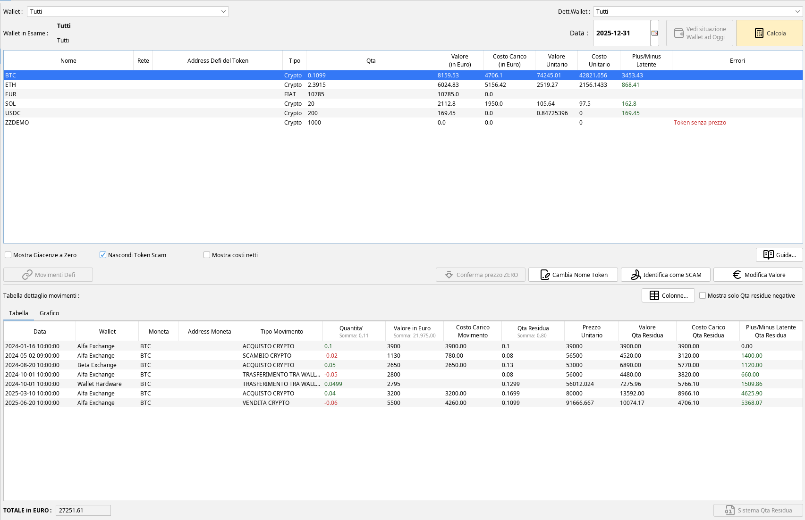

La scheda ha tre zone:

- in alto i **selettori** (wallet, sotto-wallet, data) e il pulsante *Calcola*,
- al centro la **tabella dei token**, con le caselle e i pulsanti che lavorano sul token selezionato,
- in basso il **dettaglio dei movimenti** del token selezionato, in forma di tabella o di grafico.

## Scegliere cosa guardare {#scegliere}

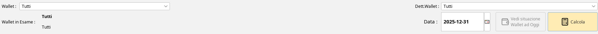

- **Wallet**: *Tutti*, un singolo wallet oppure un gruppo di wallet (le voci *Gruppo : ...*). Con *Tutti* si vede la
  situazione complessiva.
- **Dett.Wallet**: il sotto-wallet, per esempio *Principale* di un exchange. Si popola quando si sceglie un wallet.
- **Data**: il giorno di riferimento. Contano i movimenti fino alla **fine di quel giorno** e il valore è quello alla
  mezzanotte che lo chiude. Scegliendo **oggi**, o una data futura, si vede la situazione fino a questo momento, con i prezzi
  attuali.
- **Calcola**: costruisce la tabella. Cambiare un selettore non la aggiorna da solo, bisogna premere *Calcola*.
- **Wallet in Esame**: ricorda, sotto i selettori, che cosa ha usato l'ultimo calcolo.
- **Vedi situazione Wallet ad Oggi**: si abilita solo per i wallet DeFi e apre nel browser la situazione attuale di quel
  wallet sull'explorer della sua rete.

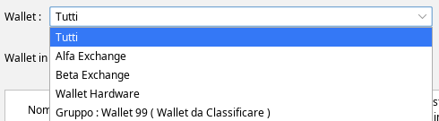

Se dopo il calcolo cambia qualcosa che incide sui valori (una classificazione, un prezzo), compare in rosso l'avviso
*«ATTENZIONE! Sono variate delle informazioni, premere CALCOLA per vedere i valori corretti!»*.

## La tabella dei token {#tabella}

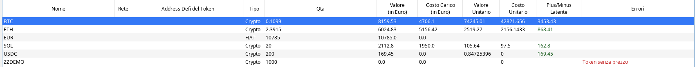

Ogni riga è un token. Le colonne sono:

| Colonna | Che cosa mostra |
|---|---|
| **Nome** | il simbolo del token. Un token marcato come SCAM ha due asterischi in coda al nome |
| **Rete** | la rete, se il token ha un indirizzo di contratto (token DeFi) |
| **Address Defi del Token** | l'indirizzo di contratto, per i token DeFi |
| **Tipo** | *Crypto*, *FIAT*, *NFT* |
| **Qta** | la quantità posseduta alla data |
| **Valore (in Euro)** | quantità × prezzo alla data |
| **Costo Carico (in Euro)** | il costo di carico LIFO di quella quantità, vedi [sotto](#costo-di-carico) |
| **Valore Unitario** | il prezzo di un'unità alla data |
| **Costo Unitario** | il costo di carico diviso la quantità |
| **Plus/Minus Latente** | valore meno costo di carico, in verde se positivo e in rosso se negativo |
| **Errori** | cosa non va nella riga, per esempio *Token senza prezzo* |
| **Qta Blockchain** (o *Qta OKX*, *Qta Binance*) | la quantità letta da blockchain o da exchange, solo quando si confronta, vedi [Confronto](#confronto) |

In fondo, a sinistra, **TOTALE in EURO** è la somma dei valori delle righe mostrate. Comprende anche le righe FIAT (in
questo esempio gli euro) e le righe con quantità negativa, che riducono il totale.

Cose da sapere sulle righe:

- una riga con **quantità negativa** è in rosso: significa che il programma ha registrato più uscite che entrate.
  Di solito è un movimento mancante (vedi [Correggere una giacenza](#rettifica)),
- le righe **FIAT** non hanno costo di carico, valore unitario né plus/minus latente,
- le colonne unitarie e il plus/minus latente restano **vuote**, non a zero, quando non c'è nulla da confrontare:
  token FIAT, quantità nulla o negativa, token senza prezzo,
- le colonne si **ordinano** con un clic sull'intestazione e si **filtrano** dal menu dell'intestazione.

Due caselle sotto la tabella cambiano le righe mostrate, e la tabella si ricalcola da sola:

- **Mostra Giacenze a Zero**: include anche i token con quantità zero, normalmente nascosti,
- **Nascondi Token Scam**: nasconde i token marcati come SCAM. È attiva di default.

## Costo di carico e plus/minus latente {#costo-di-carico}

Il costo di carico è il costo **dei lotti che compongono ancora la giacenza**, secondo il metodo LIFO: ogni vendita scarica
per primi i lotti acquistati più di recente. È calcolato dallo stesso motore delle plusvalenze e quindi segue le stesse
opzioni di calcolo, senza ricalcolarlo.

Un esempio con il BTC del dettaglio che segue: alla vendita di 0,06 BTC (5.500 €) il LIFO scarica prima il lotto da 0,04 BTC
pagato 3.200 € e poi 0,02 BTC dal lotto da 0,05 BTC pagato 2.650 €, cioè 1.060 €. Il costo scaricato è 3.200 + 1.060 = 4.260 € e
la plusvalenza è 5.500 − 4.260 = 1.240 €. Quello che resta ha costo 4.706,10 €, che è il *Costo Carico* della riga BTC.

Il plus/minus latente è il valore attuale meno questo costo: per il BTC 8.159,53 − 4.706,10 = 3.453,43.

Con un wallet selezionato, il costo di carico mostrato è quello dei lotti **più recenti** che coprono la quantità di quel
wallet. I giroconti fra i propri wallet non portano con sé nessun costo e non lo fanno sparire: la pila dei lotti resta
quella dell'insieme dei wallet.

## Token senza prezzo e prezzi da correggere {#prezzi}

Se per un token non si trova un prezzo alla data, la riga mostra in rosso **Token senza prezzo** nella colonna *Errori*,
il valore è zero e il plus/minus latente resta vuoto. Con la riga selezionata si può intervenire con due pulsanti.

**Modifica Valore** apre l'elenco dei prezzi che il programma conosce per quel token vicino alla data.

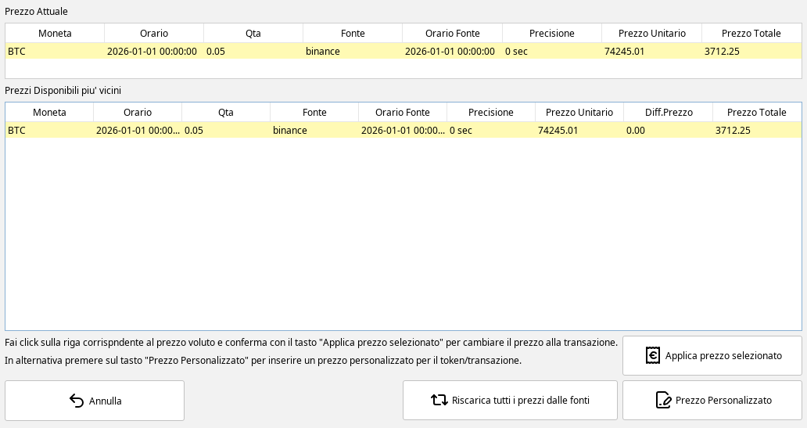

Si può:

- scegliere uno dei prezzi disponibili e premere *Applica prezzo selezionato*,
- inserire un **prezzo personalizzato** con *Prezzo Personalizzato*,
- ricaricare i prezzi con *Riscarica tutti i prezzi dalle fonti*.

Il prezzo scelto o inserito vale per quel token a quella data e sostituisce quello di prima.

**Conferma prezzo ZERO** è abilitato solo sulle righe con *Token senza prezzo*. Chiede conferma e, se la si dà, assegna il
valore zero a quel token a quella data. Va usato per i token che davvero non valgono nulla (per esempio un airdrop spam), perché
il valore zero entra nel totale.

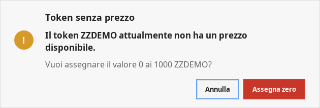

## Il dettaglio dei movimenti di un token {#dettaglio}

Selezionando una riga della tabella, in basso compare il **dettaglio**: tutti i movimenti di quel token fino alla data,
dal più vecchio al più recente, con la quantità che resta dopo ciascuno. Rispetta la selezione di wallet e sotto-wallet.

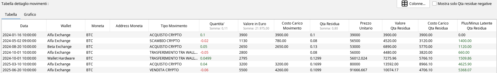

Le colonne di default sono:

| Colonna | Che cosa mostra |
|---|---|
| **Data**, **Wallet**, **Moneta**, **Address Moneta**, **Tipo Movimento** | quando, dove e che cosa |
| **Quantità** | la quantità del movimento, in verde se entra e in rosso se esce |
| **Valore in Euro** | il valore del movimento |
| **Costo Carico Movimento** | il costo dei lotti caricati o scaricati dal movimento |
| **Qta Residua** | la giacenza subito dopo il movimento |
| **Prezzo Unitario** | il prezzo di un'unità al momento del movimento |
| **Valore Qta Residua**, **Costo Carico Qta Residua**, **Plus/Minus Latente Qta Residua** | gli stessi tre numeri della tabella, ma per la quantità che resta dopo quel movimento |

Sotto le intestazioni di quantità e valore compare la **somma** della colonna. Le ultime cifre del dettaglio, cioè la quantità residua e il costo di carico dopo l'ultimo movimento, coincidono con la
riga della tabella principale.

Nell'esempio, la seconda riga è lo scambio di 0,02 BTC con ETH: il costo di quei 0,02 BTC è 780 € (0,02 × 3.900 €) e, con le
opzioni di default, passa all'ETH ricevuto senza generare plusvalenza, mentre la quantità residua scende a 0,08. Le due righe del *TRASFERIMENTO TRA WALLET* non hanno costo: il BTC
cambia wallet, ma la quantità totale scende solo di 0,0001 BTC, che è la commissione di rete trattenuta (da 0,13 a 0,1299).

Con il tasto destro su una riga si apre il **menu dei movimenti**, lo stesso della tabella *Transazioni Crypto*: dettagli e
LiFo del movimento, modifica, eliminazione, classificazione, modifica del prezzo, esportazione in Excel e altre funzioni.

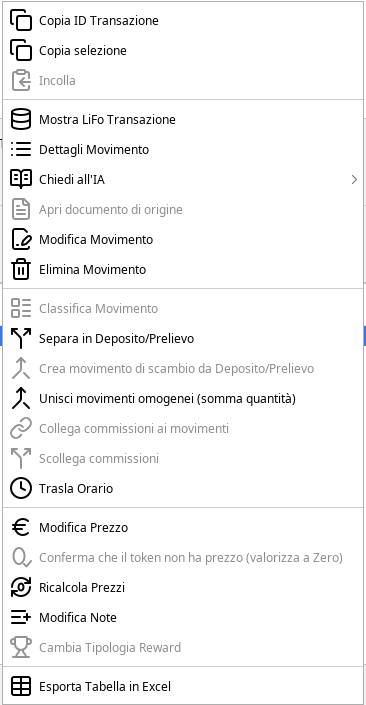

I pulsanti e le caselle sopra il dettaglio:

- **Colonne...** sceglie quali colonne mostrare e in che ordine, anche prendendole dalla tabella dei movimenti (per esempio
  *Causale originale*, *Hash Transazione*, *Note*). Le colonne si spostano e si allargano trascinando le intestazioni e la
  disposizione viene ricordata. *Ripristina predefinito* torna alle colonne iniziali.
- **Mostra solo Qta residue negative** tiene solo le righe in cui la giacenza dopo il movimento è negativa, per trovare il
  punto in cui il saldo è andato sotto zero.

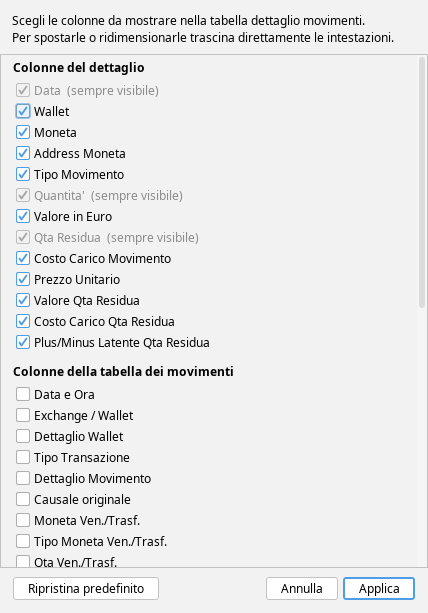

## Il grafico di un token {#grafico}

La scheda **Grafico** del dettaglio disegna la storia del token selezionato.

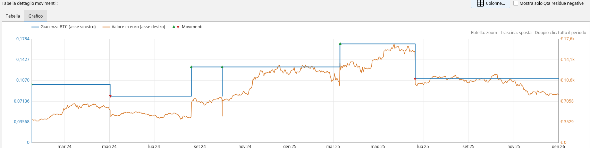

- la linea blu (asse sinistro) è la **giacenza** nel tempo,
- la linea arancione (asse destro) è il **valore in euro** di quella giacenza,
- i triangoli verdi e rossi sono i **movimenti** che l'hanno aumentata o ridotta.

Con la rotella del mouse si fa lo zoom, trascinando si sposta il grafico, con un doppio clic si torna a tutto il periodo.
Un clic su un triangolo seleziona quel movimento nella tabella.

I prezzi del grafico sono prezzi giornalieri e servono solo a disegnarlo: **non** sono usati per nessun calcolo e non
modificano i prezzi del programma.

## Guardare un solo wallet {#wallet}

Scegliendo un wallet (o un gruppo) e premendo *Calcola*, le quantità sono quelle di quel wallet.

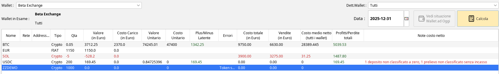

Nell'esempio *Beta Exchange* risulta con **−5 SOL**: in archivio c'è la vendita di 5 SOL, ma non il loro acquisto o il loro
arrivo. Sul totale di tutti i wallet il SOL è positivo, perché gli altri wallet ne hanno, ma su quel wallet il saldo è
sbagliato. È il caso tipico in cui si usa [la rettifica della giacenza](#rettifica) o si cerca il movimento mancante.

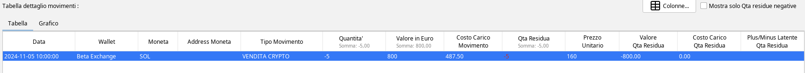

Cose da sapere con un wallet selezionato:

- **Valore** e **Plus/Minus Latente** sono quelli della quantità di quel wallet,
- le colonne dei [costi netti](#costi-netti) restano quelle di **tutti i wallet**,
- il **TOTALE in EURO** somma i valori di quel solo wallet.

## Correggere una giacenza {#rettifica}

Quando la quantità calcolata non coincide con quella vera, il pulsante **Sistema Qta Residua** crea un movimento di
rettifica che porta la giacenza al valore voluto. Funziona così:

1. scegli un **singolo wallet** dalla tendina in alto: con *Tutti* la funzione non è disponibile,
2. seleziona il token nella tabella e, nel dettaglio, il **movimento** dopo il quale vuoi correggere la quantità,
3. premi *Sistema Qta Residua* e scrivi nella finestra la **giacenza finale** che il token deve avere.

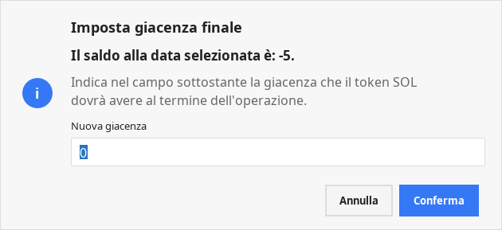

Il programma calcola la differenza e propone la classificazione del movimento da creare:

- se serve un **deposito** (la giacenza voluta è maggiore): *Nessuna Classificazione*, *Provento* (il valore diventa una
  plusvalenza, come una reward) oppure *Costo 0* (carico del lotto a costo di carico zero),
- se serve un **prelievo**: *Nessuna Classificazione*, *Cash out* (si calcola la plusvalenza), *Commissione* (trattato come
  una commissione) oppure *Rettifica giacenza* (nessuna plusvalenza, il costo esce dal LIFO),
- per i token **FIAT** si crea un semplice deposito o prelievo FIAT.

Il movimento nasce nello stesso istante di quello selezionato. Se il token ha già avuto saldi negativi in passato il programma
avverte che conviene correggere i movimenti in ordine cronologico.

Il nuovo movimento va **salvato** dalla scheda *Transazioni Crypto*, come ogni altra modifica. La funzione non è
disponibile per gli NFT né con la selezione *Tutti*.

Con un wallet DeFi su una rete leggibile, la finestra mostra anche la giacenza letta dalla blockchain e propone quella come
valore da impostare, vedi [Confronto con blockchain ed exchange](#confronto).

## Rinominare un token e segnalare i token SCAM {#nome-scam}

Con una riga selezionata sono abilitati altri due pulsanti.

**Cambia Nome Token** rinomina il token.

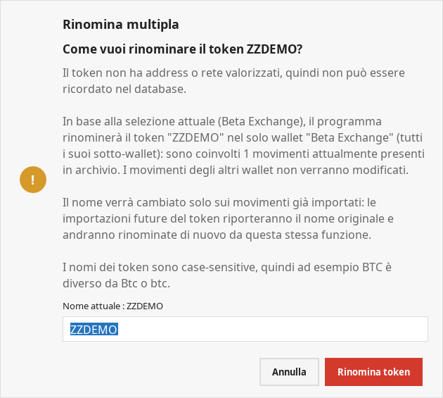

- Un token **con indirizzo di contratto e rete** viene rinominato in tutto l'archivio, per ogni wallet, e il programma
  ricorda il nuovo nome anche alle importazioni future.
- Un token **senza indirizzo** (quelli degli exchange) viene rinominato solo sui movimenti già importati, e solo nel
  wallet o nel gruppo selezionato. Le importazioni future porteranno di nuovo il nome originale.

I nomi sono sensibili alle maiuscole: *BTC* e *Btc* sono due token diversi.

**Identifica come SCAM** segna il token come truffa, tipicamente un airdrop non voluto. Il programma esegue prima dei
controlli e può avvisare:

- se il token ha **movimenti valorizzati**, perché di solito i token SCAM non hanno prezzo,
- se ha **movimenti diversi da deposito e prelievo**, come l'airdrop dell'esempio, perché i token SCAM di solito hanno solo
  quelli.

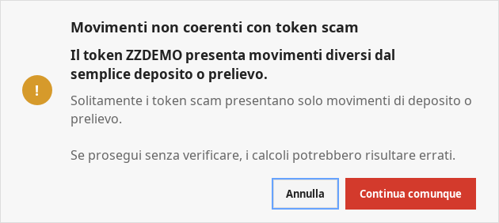

Se si prosegue, una seconda finestra chiede conferma. Per un token con indirizzo e rete il segno vale per il token ovunque
compaia, per uno senza indirizzo vale per i movimenti presenti nel wallet selezionato.

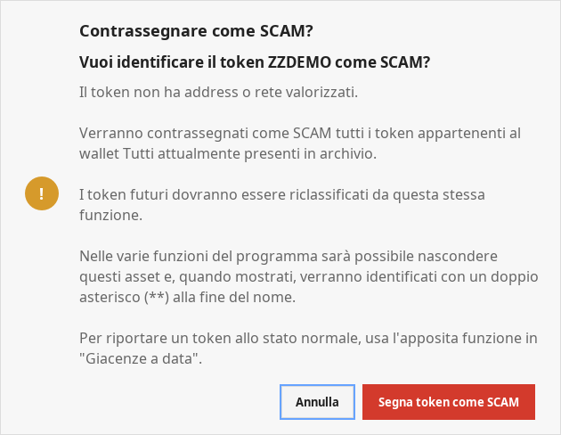

Un token SCAM compare con i due asterischi in coda al nome e viene nascosto dalla casella *Nascondi Token Scam*. Sulla stessa riga il
pulsante diventa **Rimuovi da SCAM** e annulla il segno. L'elenco dei token segnati si gestisce da *Analisi Crypto – Gestione
Token Scam*.

## Confronto con blockchain ed exchange {#confronto}

In alcuni casi la tabella mostra una colonna in più, accanto alla quantità, che confronta la giacenza dell'archivio con
quella vera.

- **Qta Blockchain**: scegliendo un **singolo wallet DeFi** di una rete leggibile, il programma legge in background dai nodi
  pubblici la quantità che il wallet aveva davvero alla data e la mette accanto a *Qta*. È **verde** se coincide con
  l'archivio, **rossa** se è diversa. Un saldo che non si riesce a leggere è *n.d.* e non viene mai mostrato come zero.
  Si confronta il solo sotto-wallet *Wallet*, cioè l'indirizzo sulla blockchain: monete messe in una farm o in garanzia
  hanno lasciato l'indirizzo e non fanno parte del confronto.
- **Qta OKX**: scegliendo il wallet di OKX con sotto-wallet *Tutti*, il confronto usa i saldi riportati dalle operazioni già
  scaricate, alla data scelta, senza collegamento alla rete.
- **Qta Binance**: lo stesso per Binance, ma **solo per la data di oggi**, perché Binance non fornisce lo storico dei saldi.

Anche il dettaglio dei movimenti ha la colonna di confronto, riga per riga, e *Sistema Qta Residua* propone come
giacenza finale quella letta dalla fonte esterna.

Il pulsante **Movimenti Defi** apre nel browser, sull'explorer della rete, i movimenti del wallet selezionato per il token
della riga. Funziona solo con un singolo wallet DeFi e per token con indirizzo di contratto, non per la moneta nativa della
rete.

## I costi netti {#costi-netti}

Spuntando **Mostra costi netti** compaiono, in fondo alla tabella, cinque colonne nascoste di default: *Costo totale*,
*Vendite*, *Costo medio netto*, *Profitti/Perdite totali* e *Note costo netto*. Raccontano un'altra storia rispetto al costo
di carico: quanto denaro hai messo e tolto da ogni token, e a che prezzo dovresti vendere quello che resta per essere in
pareggio.

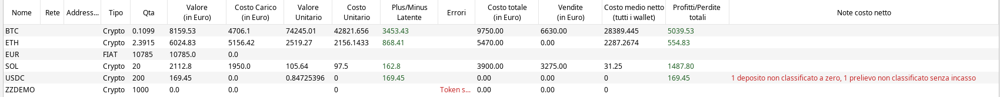

Sono solo informative e non cambiano nessun calcolo fiscale. Come si calcolano, come trattano ogni tipo di movimento e come
si leggono le note sono spiegati nel manuale dedicato: **[Costo medio netto in Giacenze a data](costo-medio-netto.html)**.

## Domande frequenti {#domande}

**Perché devo premere Calcola?** Il calcolo scarica i prezzi e può richiedere tempo, quindi parte solo quando lo chiedi. Dopo
una modifica che cambia i valori compare l'avviso rosso che ricorda di premere *Calcola*.

**Perché con la data di oggi è più lento?** Per oggi non esiste una quotazione già salvata, quindi il programma cerca i prezzi
attuali dei token che non ne hanno. La prima volta può richiedere anche più di un minuto se ci sono molti token senza prezzo.
Per una data passata i prezzi trovati, e quelli non trovabili, vengono ricordati e le volte dopo il calcolo è rapido.

**Perché un token ha quantità negativa?** Perché in archivio ci sono più uscite che entrate: di solito manca un deposito, un
acquisto o un trasferimento, oppure un'importazione è incompleta. Il dettaglio con *Mostra solo Qta residue negative* mostra
il primo movimento in cui il saldo diventa negativo.

**Perché il costo di carico di un wallet non coincide con quello che si aspetta?** Perché il LIFO ragiona sull'insieme dei
wallet: con un solo wallet selezionato il costo mostrato è quello dei lotti più recenti che coprono la sua quantità.

**Il valore di un token è zero ma il token ha un prezzo.** Controlla la colonna *Errori*: se compare *Token senza prezzo*
puoi assegnare un prezzo con *Modifica Valore*. Se compare un prezzo ma il valore è zero, la quantità del wallet scelto è zero.

**Posso usare Giacenze a data per il quadro W/RW?** La scheda mostra la situazione, ma il quadro W/RW ha un calcolo proprio,
con le sue opzioni e i suoi periodi, descritto nel manuale
**[Opzioni di calcolo del Quadro RW](opzioni-calcolo-rw.html)**.

## Limiti e cose da sapere {#limiti}

- **Il valore dipende dai prezzi**: un prezzo mancante vale zero finché non lo si assegna, e un prezzo sbagliato falsa valore
  e plus/minus latente. I token senza prezzo sono segnalati in rosso.
- **Il costo di carico non si ricalcola qui**: è quello scritto dal motore delle plusvalenze. Dopo una modifica ai
  movimenti vale quello dell'ultimo calcolo.
- **I giroconti fra wallet** non portano costo, ma se la controparte non è classificata come trasferimento il token arriva
  senza costo e il plus/minus latente risulta falsato.
- **La quantità mostrata con un wallet selezionato** può essere negativa anche se il totale non lo è: succede quando i
  movimenti di un wallet sono incompleti.
- **Il grafico** usa prezzi giornalieri solo per il disegno.
- **Il confronto con la blockchain** vale per i wallet DeFi su reti supportate e per le date in cui un nodo pubblico
  conserva lo storico. Dove non è disponibile la colonna non compare.

[Torna all'elenco dei manuali](index.html)
