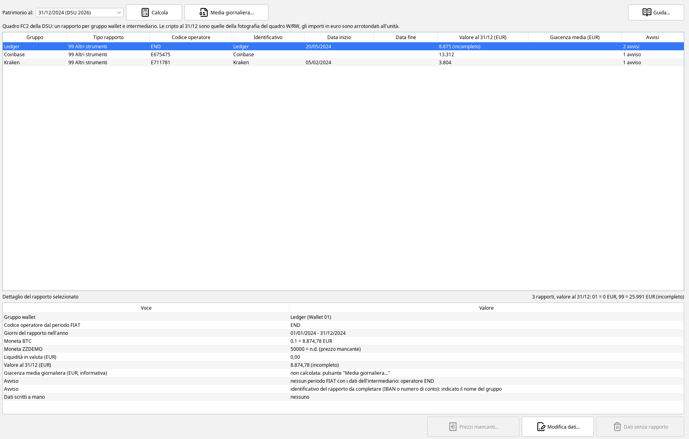
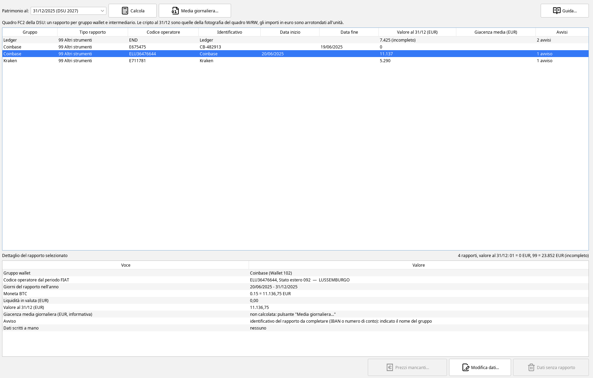
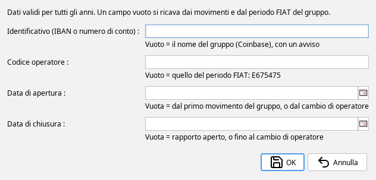
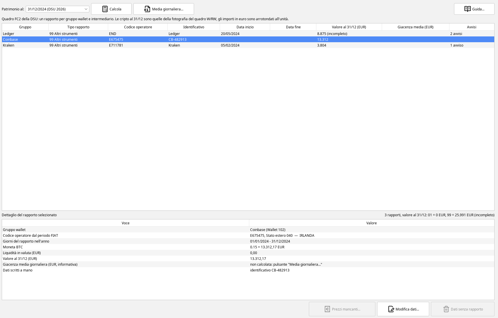
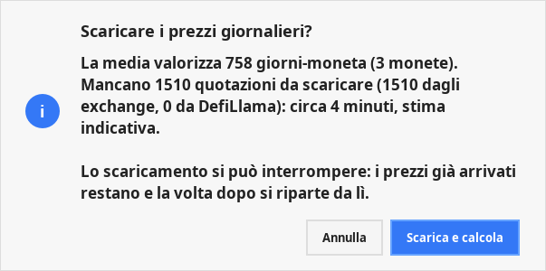
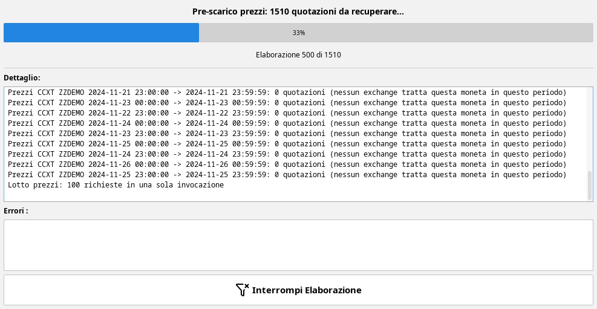
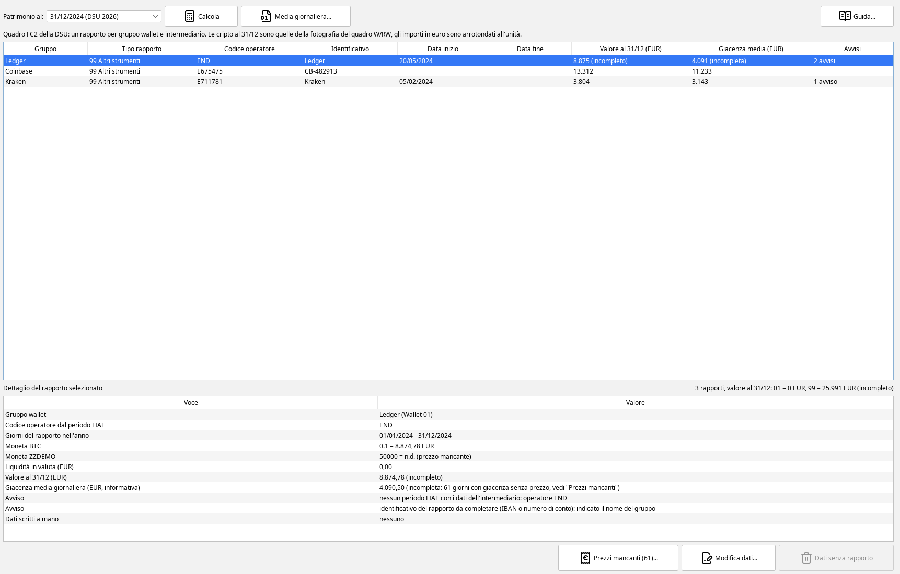
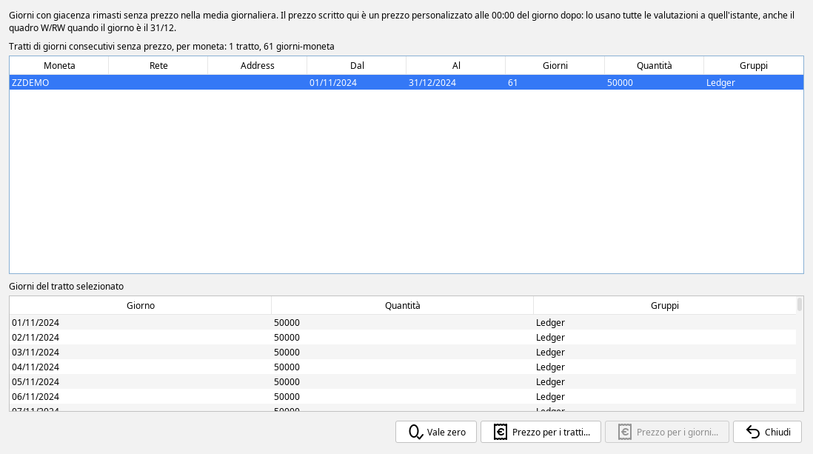
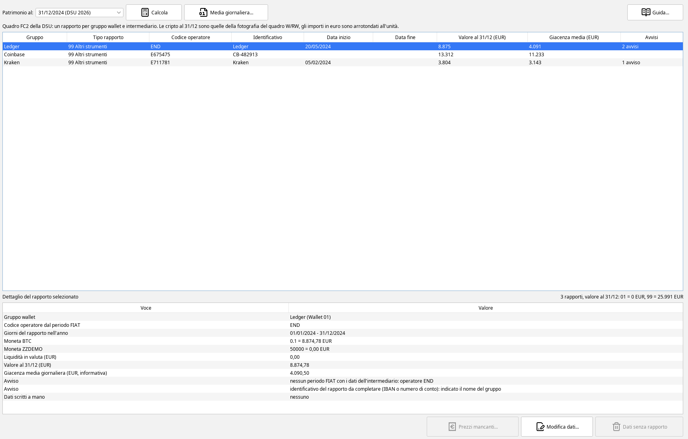

# ISEE, il patrimonio per la DSU

- [A cosa serve](#a-cosa-serve)
- [Dove si trova](#dove-si-trova)
- [Calcolare i rapporti di un anno](#calcolare)
- [La tabella dei rapporti](#tabella)
- [Come nascono i rapporti](#rapporti)
- [Il dettaglio di un rapporto](#dettaglio)
- [Scrivere i dati di un rapporto](#modifica)
- [La giacenza media giornaliera dei rapporti 99](#media)
- [I prezzi mancanti](#prezzi-mancanti)
- [Dati senza rapporto](#dati-senza-rapporto)
- [Da dove arrivano i dati](#da-dove)
- [Domande frequenti](#domande)
- [Limiti e cose da sapere](#limiti)

## A cosa serve {#a-cosa-serve}

Il tab *ISEE* prepara i dati del **Quadro FC2** della DSU, il patrimonio mobiliare, per le cripto-attività e per la
liquidità tenuta presso gli exchange. Per ogni rapporto mostra quello che il quadro chiede:

- il **tipo di rapporto**: *01* conto corrente oppure *99* altri strumenti,
- il **codice dell'operatore** e l'**identificativo** del rapporto,
- la **data di inizio** e la **data di fine**, se il rapporto è stato aperto o chiuso nell'anno,
- il **valore al 31/12**,
- la **giacenza media annua**, obbligatoria per il conto corrente e informativa per gli altri strumenti.

La DSU presentata in un anno usa il patrimonio al 31/12 di **due anni prima**: la DSU 2026 usa il patrimonio al
31/12/2024. Il tab propone quell'anno.

Il programma non compila né invia la DSU: mostra i valori da riportare. Il tab non cambia nessun movimento e nessun
calcolo dei quadri RT e W/RW, con un'eccezione voluta: i prezzi scritti dalla finestra dei
[prezzi mancanti](#prezzi-mancanti) sono prezzi personalizzati, e valgono per tutte le valutazioni.

> Gli screenshot di questo manuale usano **dati inventati**: 0,25 BTC comprati su Coinbase nel 2023, 0,1 BTC spostati su
> un Ledger il 20/05/2024, 1,2 ETH comprati su Kraken il 05/02/2024 e altri 0,9 ETH nel 2025, prezzi di mercato veri alle
> date indicate. Il token *ZZDEMO* è inventato, arriva sul Ledger con un airdrop il 01/11/2024 e non ha un prezzo.

## Dove si trova {#dove-si-trova}

Nella scheda **Dichiarazioni – ISEE**, fra *RT & Analisi P&L* e *Archivio dichiarazioni*. Il pulsante **Guida...** in alto
a destra apre questo manuale.

Il tab ha tre zone:

- in alto la scelta dell'anno e i pulsanti *Calcola* e *Media giornaliera...*,
- al centro la **tabella dei rapporti**, con i totali dell'anno sotto, a destra,
- in basso il **dettaglio** del rapporto selezionato e i pulsanti *Prezzi mancanti...*, *Modifica dati...* e
  *Dati senza rapporto*.

## Calcolare i rapporti di un anno {#calcolare}

1. Nella tendina **Patrimonio al** scegli l'anno. Ogni voce dice anche in quale DSU si usa, per esempio
   *31/12/2024 (DSU 2026)*.
2. Premi **Calcola**. Il programma scarica i prezzi di fine anno che mancano, poi calcola i rapporti. La prima volta può
   richiedere qualche minuto, le volte dopo pochi secondi.

Il calcolo non parte da solo aprendo il tab, perché può scaricare prezzi. Se lo interrompi, la tabella mostra ancora il
risultato precedente: un risultato a metà prezzi sembrerebbe solo incompleto.

Sotto la tabella, a destra, compaiono i totali dell'anno: il numero di rapporti e la somma dei valori al 31/12 dei
rapporti 01 e dei rapporti 99. Nell'esempio: *3 rapporti, valore al 31/12: 01 = 0 EUR, 99 = 25.991 EUR (incompleto)*.

## La tabella dei rapporti {#tabella}

| Colonna | Che cosa mostra |
|---|---|
| **Gruppo** | il gruppo wallet del rapporto, con il suo alias |
| **Tipo rapporto** | *01 Conto corrente* oppure *99 Altri strumenti* |
| **Codice operatore** | il codice dell'intermediario: *E* seguita dall'identificativo fiscale per un intermediario estero, il codice fiscale per uno italiano, *END* quando non c'è un intermediario o il dato manca |
| **Identificativo** | quello scritto con *Modifica dati...*: l'IBAN, il numero di conto o l'ID utente. Se non è stato scritto compare il nome del gruppo, con un avviso |
| **Data inizio** | solo se il rapporto è iniziato nell'anno, vedi [le date](#date) |
| **Data fine** | solo se il rapporto è finito nell'anno |
| **Valore al 31/12 (EUR)** | il valore a fine anno, arrotondato all'euro. *(incompleto)* se almeno una moneta non ha prezzo |
| **Giacenza media (EUR)** | sul 01 la giacenza media annua. Sul 99 la media giornaliera, solo dopo *Media giornaliera...* |
| **Avvisi** | quanti avvisi ha il rapporto: il testo è nel dettaglio |

Gli importi sono arrotondati all'euro: 299,49 diventa 299 e 299,50 diventa 300.

**Il valore al 31/12** di un rapporto 99 è la somma di due parti:

- le **cripto-attività** del gruppo, valutate come nella fotografia di fine anno del quadro W/RW: stessa quantità, stessa
  data e ora (le 00:00 del 1° gennaio), stessi prezzi. Un token segnato SCAM non conta, come nel quadro W/RW, e un
  avviso lo dice,
- la **liquidità** in valuta del gruppo, se il gruppo non ha un conto corrente (vedi sotto).

Un prezzo mancante non vale zero: il valore resta senza quella moneta e porta la scritta *(incompleto)*. Una giacenza
negativa a fine anno, che di solito vuol dire un movimento mancante, conta zero e porta un avviso.

## Come nascono i rapporti {#rapporti}

**Un rapporto per gruppo wallet.** Il rapporto è il gruppo wallet del quadro W/RW, non il singolo wallet: due wallet dello
stesso gruppo sono un rapporto solo, e un trasferimento fra loro non cambia nulla. Un gruppo senza movimenti nell'anno e
senza saldo al 31/12 non compare.

**L'operatore viene dai periodi FIAT del gruppo.** Lo Stato estero e l'identificativo fiscale scritti sui periodi FIAT
del gruppo (*Opzioni*, gruppi wallet, periodi di detenzione) danno il codice operatore. Per gli exchange preconfigurati
il programma ha già i dati: Coinbase ha *E675475* (Coinbase Europe Ltd, Irlanda) fino al 19/06/2025 e *ELU36476644*
(Coinbase Luxembourg S.A.) dal 20/06/2025. Un gruppo senza periodi FIAT, come un wallet in autocustodia, ha *END*.

**Quando l'operatore cambia, il rapporto si divide.** Due periodi FIAT con operatori diversi che si toccano danno due
rapporti: il primo finisce il giorno prima del cambio, il secondo comincia il giorno del cambio. Nel 2025 il gruppo
Coinbase dell'esempio ha due righe:

- *E675475*, data fine 19/06/2025, valore al 31/12 pari a 0: il rapporto è cessato e il valore sta sul successivo,
- *ELU36476644*, data inizio 20/06/2025, valore al 31/12 di 11.137 euro.

L'inizio del primo periodo FIAT e la fine dell'ultimo non sono aperture o chiusure: dicono solo da quando a quando
valgono quei dati. Per gli exchange preconfigurati molte date di inizio sono quelle della licenza MiCA, non quelle
dell'apertura del conto. Il periodo di Kraken, per esempio, comincia il 25/06/2025, ma il rapporto Kraken del 2024
dell'esempio ha lo stesso operatore *E711781*.

**Il conto corrente.** Se il periodo FIAT del gruppo ha *È conto corrente estero = SI*, la liquidità in valuta va in un
rapporto **01** a parte, con la sua giacenza media annua, e le cripto restano nel rapporto 99. Con *NO* la liquidità si
somma alle cripto nel rapporto 99. La giacenza media del 01 è la somma dei saldi di fine giornata dei giorni del
rapporto divisa per 365. Un esempio: 300 euro dal 01/02/2024 al 31/12/2024 sono 335 giorni, 335 × 300 = 100.500,
100.500 / 365 = 275,34 euro.

### Le date {#date}

La data di inizio è, nell'ordine:

1. la data di apertura scritta con *Modifica dati...*,
2. il giorno del cambio di operatore,
3. il primo movimento del gruppo.

La data di fine è la data di chiusura scritta con *Modifica dati...*, oppure il giorno prima di un cambio di operatore.
Le due date compaiono solo se cadono nell'anno. La data di fine **non** si ricava dai movimenti: un conto a saldo zero
di solito resta aperto. Se il saldo del gruppo è a zero dal giorno di un movimento dell'anno, un avviso lo segnala.

## Il dettaglio di un rapporto {#dettaglio}

Selezionando una riga, il dettaglio in basso mostra:

- il **gruppo wallet**, con alias e nome interno,
- il **codice operatore dal periodo FIAT**, con lo Stato estero,
- i **giorni del rapporto nell'anno**,
- per il 99 che arriva al 31/12, **ogni moneta** con la quantità e il valore, oppure *n.d. (prezzo mancante)*,
- la **liquidità in valuta** e il **valore al 31/12**,
- la **giacenza media giornaliera**, oppure *non calcolata*,
- gli **avvisi**, uno per riga,
- i **dati scritti a mano** per quel rapporto.

Nell'esempio del primo screenshot il Ledger ha 0,1 BTC per 8.874,78 euro e 50.000 *ZZDEMO* senza prezzo, quindi il
valore è incompleto. Gli avvisi dicono che il gruppo non ha un periodo FIAT (operatore *END*) e che l'identificativo
del rapporto non è stato scritto.

## Scrivere i dati di un rapporto {#modifica}

Il pulsante **Modifica dati...**, o il doppio clic su una riga, apre questa finestra:

- **Identificativo**: l'IBAN se il conto ne ha uno, altrimenti il numero di conto o l'ID utente presso l'exchange.
- **Codice operatore**: solo per correggere quello che arriva dal periodo FIAT.
- **Data di apertura** e **Data di chiusura** del rapporto: le date vere, anche di anni diversi da quello calcolato.

I campi partono **vuoti** se non hai mai scritto nulla. Sotto ogni campo una nota dice che cosa vale se resta vuoto,
per esempio *Vuoto = quello del periodo FIAT: E675475*. Premere OK senza cambiare nulla non trasforma i valori
calcolati in dati scritti a mano, quindi una correzione futura del periodo FIAT continua ad arrivare al rapporto.

I dati valgono per **tutti gli anni**: si scrivono una volta, e il calcolo dell'anno dopo li ritrova. Dopo OK il tab
ricalcola. Nell'esempio l'identificativo *CB-482913*, scritto sul rapporto Coinbase del 2024, compare in tabella e nel
dettaglio:

Nel 2025 lo stesso identificativo resta sul rapporto con l'operatore irlandese, che è lo stesso rapporto del 2024. Il
nuovo rapporto lussemburghese ha i suoi dati, da scrivere a parte se servono.

## La giacenza media giornaliera dei rapporti 99 {#media}

Per un rapporto 99 la DSU chiede il valore al 31/12. La FAQ n. 13 del Ministero del Lavoro del 13/09/2024 indica per le
cripto-attività presso un prestatore di servizi il codice 99 con il solo controvalore in euro. La giacenza media
giornaliera di un rapporto 99 è quindi un dato **informativo**: il tab la calcola solo se la chiedi, con il pulsante
**Media giornaliera...**.

**Come si calcola.** Per ogni giorno del rapporto si prende la quantità di ogni moneta a fine giornata e la si valuta
al prezzo di fine giornata. La somma dei valori di tutti i giorni si divide per **365**, anche negli anni bisestili, come
la giacenza media della DSU. La liquidità del gruppo, se sta nel 99, si aggiunge con la stessa regola.

Il **prezzo di fine giornata** del giorno D è quello delle **00:00 del giorno dopo**, ora italiana, cercato con le stesse
regole del valore al 31/12 e del quadro W/RW: prima i prezzi personalizzati, poi le quotazioni degli exchange e delle
altre fonti. Per il 31/12 è lo stesso istante della fotografia di fine anno, quindi l'ultimo giorno della media vale
esattamente quanto il valore al 31/12.

**Un esempio completo** su un anno bisestile, il 2024 (366 giorni):

- 2 ETH dal 2023. Il 30/06 si vende 1 ETH, il 01/07 se ne compra di nuovo 1.
- Prezzo di fine giornata di 2.000 euro fino al 30/06, di 3.000 euro dal 01/07.
- dal 01/01 al 29/06: 181 giorni × 2 ETH × 2.000 = 724.000
- il 30/06: 1 giorno × 1 ETH × 2.000 = 2.000, perché a fine giornata ne resta 1
- dal 01/07 al 31/12: 184 giorni × 2 ETH × 3.000 = 1.104.000
- somma: 724.000 + 2.000 + 1.104.000 = 1.830.000
- media: 1.830.000 / 365 = 5.013,70 euro

Un caso più semplice: 1 ETH tenuto per tutto il 2024 a 3.000 euro costanti dà 366 × 3.000 / 365 = 3.008,22 euro, più
del valore di un giorno, perché i giorni sono 366 e il divisore resta 365.

**I tempi.** Serve un prezzo per ogni moneta e per ogni giorno, e la prima volta molti vanno scaricati. Prima di
scaricare, il programma conta le quotazioni che mancano e, se servono più di un minuto, chiede conferma con una stima:

Su un archivio reale con una cinquantina di monete prezzate per simbolo e oltre 130 token per indirizzo di contratto,
la prima volta sono serviti circa 20 minuti per un anno. Le volte dopo i prezzi sono già in archivio e la media si ricalcola in
pochi secondi. Durante lo scaricamento una finestra mostra l'avanzamento:

Lo scaricamento si può **interrompere** in qualsiasi momento con *Interrompi Elaborazione*. I prezzi già arrivati
restano: premendo di nuovo *Media giornaliera...* la stima riparte da quello che manca. Interrotta, la media non compare
e la tabella resta com'era. Nella prima fase, quella dei token per indirizzo di contratto, la barra resta ferma: si
muove nella fase delle quotazioni degli exchange.

Alla fine la colonna *Giacenza media* si riempie per tutti i rapporti 99. Un giorno con giacenza e senza prezzo non vale
zero: la media lo esclude e porta la scritta *(incompleta)*, e il dettaglio dice quanti giorni mancano.

## I prezzi mancanti {#prezzi-mancanti}

Dopo la media, il pulsante **Prezzi mancanti (N)...** si attiva se restano giorni senza prezzo. N è il numero di
giorni-moneta da sistemare. La finestra raggruppa i giorni in **tratti** di giorni consecutivi della stessa moneta:

- in alto i tratti: moneta, rete e indirizzo di contratto se ci sono, primo e ultimo giorno, numero di giorni, quantità
  e gruppi che tengono la moneta. Nell'esempio *ZZDEMO* manca dal 01/11/2024 al 31/12/2024, 61 giorni,
- in basso i giorni del tratto selezionato, uno per riga.

Le azioni:

- **Vale zero**: scrive il prezzo 0 per ogni giorno dei tratti selezionati. Serve per i token che non hanno un valore,
  come gli airdrop di spam. Funziona anche su molti tratti insieme: su un archivio reale 42.358 giorni sono stati
  scritti in circa 5 secondi.
- **Prezzo per i tratti...**: chiede un prezzo unitario in euro e lo scrive per ogni giorno dei tratti selezionati.
- **Prezzo per i giorni...**: lo stesso, per i soli giorni selezionati nella tabella in basso.

Il prezzo si scrive con la virgola o con il punto: *0,05*, *0.05* e *1.234,56* sono tutti accettati.

Alla chiusura della finestra il tab ricalcola il valore al 31/12 e la media, senza scaricare nulla. Nell'esempio, dopo
*Vale zero* su *ZZDEMO*, il valore del Ledger al 31/12 e la sua media non sono più incompleti:

> **Un prezzo scritto qui vale ovunque.** È un prezzo personalizzato alle 00:00 del giorno dopo, per tutti i gruppi
> wallet, come quelli scritti dalle altre schede. Lo usano tutte le valutazioni a quell'istante: *Giacenze a data* su
> quel giorno, il quadro W/RW quando il giorno è il 31/12 (lo stesso istante della fine dell'anno), un movimento entro
> un'ora da quella mezzanotte se viene riprezzato. Un prezzo scritto per il 31/12/2024 cambia quindi anche il valore
> finale del quadro W/RW 2024. I prezzi personalizzati si vedono e si correggono anche dalle altre schede, per esempio
> con *Modifica Valore* in [Giacenze a data](giacenze-a-data.html#prezzi).

## Dati senza rapporto {#dati-senza-rapporto}

I dati scritti con *Modifica dati...* sono legati al periodo FIAT del gruppo da cui nasce il rapporto. Se quel periodo
viene cancellato, o se cambia il suo numero, i dati restano nell'archivio ma il calcolo non li trova più. Il pulsante
**Dati senza rapporto (N)** si attiva quando ce ne sono e mostra un elenco: per ogni voce il gruppo, il tipo, il periodo
e i dati. Scegliendo una voce la si elimina, dopo una conferma. Se i dati valgono per un rapporto ancora presente, vanno
riscritti su quel rapporto con *Modifica dati...*.

## Da dove arrivano i dati {#da-dove}

| Dato | Dove si imposta |
|---|---|
| Gruppi wallet e alias | *Opzioni*, gruppi wallet, vedi [Gruppi wallet](opzioni-calcolo-rw.html#gruppi-wallet-preconfigurati-e-bollo) |
| Stato estero, identificativo fiscale, conto corrente | i periodi FIAT del gruppo, vedi [Periodi di detenzione](opzioni-calcolo-rw.html#periodi-di-detenzione) e [Liquidità presso intermediari esteri](opzioni-calcolo-rw.html#liquidita-presso-intermediari-esteri) |
| Identificativo, operatore corretto, apertura, chiusura | il tab ISEE, con *Modifica dati...* |
| Quantità e prezzi di fine anno | i movimenti e la fotografia del quadro W/RW, vedi [Valori di inizio e fine anno](opzioni-calcolo-rw.html#valori-di-inizio-e-fine-anno) |
| Prezzi di un giorno che mancano | la finestra dei [prezzi mancanti](#prezzi-mancanti) o le altre schede dei prezzi personalizzati |

## Domande frequenti {#domande}

**Perché il codice operatore è END?** Il gruppo non ha un periodo FIAT, oppure il periodo FIAT non ha l'identificativo
fiscale. Un avviso nel dettaglio dice quale dei due. Per un wallet in autocustodia è il caso normale. Per un exchange si
completa il periodo FIAT, oppure si scrive il codice con *Modifica dati...*.

**Perché l'identificativo è il nome del gruppo?** Perché non ne è stato scritto uno. Il programma non conosce l'IBAN, il
numero di conto o l'ID utente: si scrive con *Modifica dati...*, una volta per tutti gli anni.

**Il valore al 31/12 è diverso da quello del quadro W/RW.** Il valore delle cripto è quello della fotografia di fine
anno del quadro W/RW. Nel tab ISEE c'è in più la liquidità del gruppo (nel 99, o nel 01 se c'è il conto corrente),
mentre il quadro W/RW la tratta nei suoi righi di liquidità. Il quadro W/RW inoltre divide un gruppo per periodi di
detenzione, il tab ISEE solo dove cambia l'operatore.

**Perché un rapporto ha valore 0 ma compare?** È un rapporto cessato nell'anno, per esempio prima di un cambio di
operatore: il suo valore al 31/12 sta sul rapporto successivo, e la riga serve per le date.

**Devo calcolare la media giornaliera?** La media dei rapporti 99 è informativa e il tab la calcola solo su richiesta.
Le scelte sulla propria DSU restano dell'utente.

**Ho interrotto lo scaricamento: perdo i prezzi?** No. Quelli già arrivati restano nell'archivio dei prezzi, e la volta
dopo il programma chiede solo quelli che mancano.

## Limiti e cose da sapere {#limiti}

- Il tab prepara il solo Quadro FC2 del dichiarante, per cripto-attività e liquidità presso gli exchange. Gli altri
  quadri della DSU e gli altri componenti del nucleo restano fuori.
- Il programma non conosce IBAN, numeri di conto e date di apertura dei conti: i dati che mancano compaiono come avvisi.
- Un rapporto è un gruppo wallet. Chi tiene più wallet personali nello stesso gruppo ha un solo rapporto. Per avere
  rapporti distinti servono gruppi distinti, nelle opzioni dei gruppi wallet.
- La media giornaliera dei rapporti 99 dipende dai prezzi giornalieri disponibili. I token per indirizzo di contratto
  che DefiLlama non conosce vengono richiesti di nuovo a ogni avvio del programma, finché non hanno un prezzo scritto,
  anche zero.
- Il valore al 31/12 segue le opzioni e i prezzi del quadro W/RW. Una modifica a quei prezzi cambia anche il tab ISEE,
  dopo un nuovo *Calcola*.
